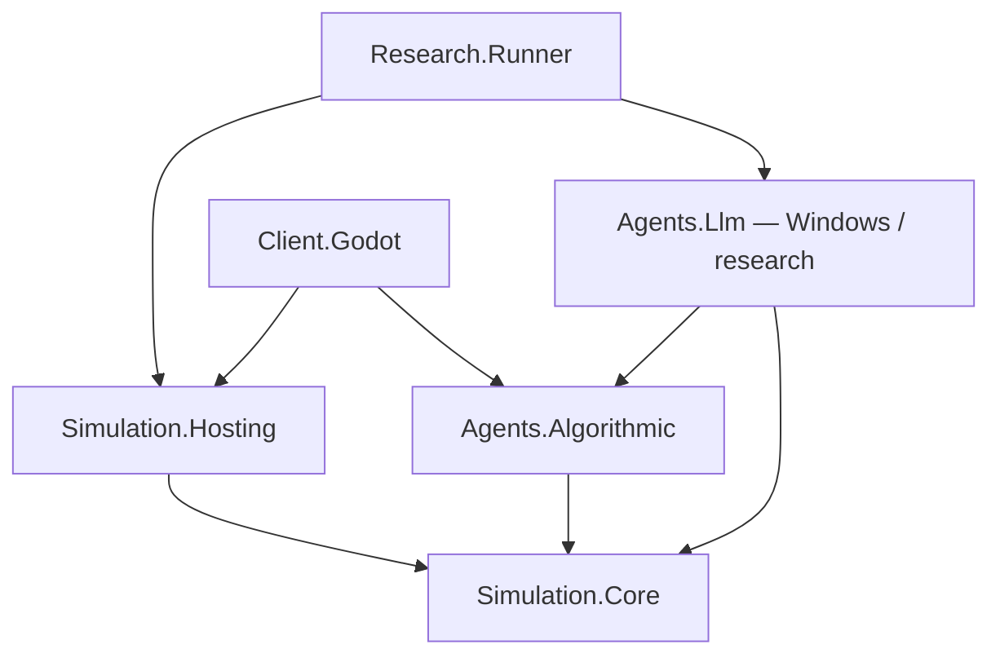

# Архитектура Delsk

Текущий срез пакета7 — последний раздел ниже; [отчёт и границы](IMPLEMENTATION_REPORT_PACKAGE7.md). Прежние описания сохраняются как датированная история.

Автор: Шелестов Максим Евгеньевич. Дата: 13.10.2026.
Статус18.10.2026: спецификация0.5. Программный объём P00–P26.6 A/B/C и облачная часть P27 реализованы; Windows EXE/Android и текущая живая демонстрация Gate D остаются открыты. Измеренные ограничения длинной истории — IMPLEMENTATION_REPORT_P27.md.

Актуальное уточнение19.10.2026: пакет1 после UI01 — [следующий план](DELSK_NEXT_STAGE_PLAN.md), [матрица команд](ACTION_ACCESS_MATRIX.md), [отчёт](IMPLEMENTATION_REPORT_PACKAGE1.md). World14/Rules household-management-1; см. §34 ниже. Старые разделы сохраняют историю своих версий.

## 1. Основания и границы

Источник правил — [game_specification.md](requirements/game_specification.md), прочитанный целиком, включая разделы 23–26. Приоритет: новое явное указание пользователя → утверждённые правила спецификации (поздние уточнения выше ранних вариантов) → этот проект технической реализации. 17.10.2026 по явному заданию пользователя обновлены только границы визуального клиента первого/второго месяцев; исходный SHA-256 сохранён как исторический в DECISIONS. Рабочее обозначение репозитория — Delsk; это не новое решение о маркетинговом названии.

Обозначения: **Требование** — согласованное правило; **Техническое решение** — выбранная здесь реализация; **Допущение** — обратимая настройка неопределённой детали. Числа и спорные края собраны в [DECISIONS.md](DECISIONS.md). Предложение из спецификации не становится исторически утверждённым требованием от того, что выбрано для прототипа.

Первый месяц сохраняет весь §15: две цепочки, землю, технику, числовой найм, рынки, автоматическую физическую доставку, столицу, выборы, секретные договоры, полноценные алгоритмы, один локальный адаптер, исследования и Android-проверку. В него также входит простой 3D-прототип P26.5 до итоговой проверки P27. Полноценный интерфейс и умеренное улучшение графики развивают этот прототип во втором месяце; сервер, реклама и магазины не блокируют ядро.

## 2. Проекты и зависимости

Один репозиторий, один авторитетный процесс на мир, один поток изменения состояния. Это модульный монолит без ECS, брокера, ORM, контейнера DI, универсального workflow и сетевого API.

| Проект/каталог | Ответственность | Прямые зависимости | Зачем отдельная граница |
| --- | --- | --- | --- |
| `src/Simulation.Core` | Типы команд/наблюдений, мир, правила, пошаговый движок, DTO снимка, проекция разрешённой информации | Только BCL | Одни правила в runner, Windows и Android; тест без движка |
| `src/Agents.Algorithmic` | Оценка целей, простой план, исполнение, доверие, scripted controller | Core | Политика заменяется без изменения правил |
| `src/Agents.Llm` | Очередь, JSON-намерения, локальный HTTP-адаптер, таймаут, гибрид с алгоритмом | Core, Algorithmic | Сетевой ввод и зависимость от модели не попадают в ядро/Android |
| `src/Simulation.Hosting` | `GameSession`, почтовый ящик команд, вызов контроллеров, JSON-снимки и JSONL, replay, жизненный цикл сессии | Core | Runner и Godot одинаково сохраняют и продолжают игру |
| `src/Research.Runner` | CLI, сценарии, серии seeds, метрики CSV/JSON, сборка зависимостей | Core, Hosting, Algorithmic; Llm при гибридном запуске | Ускоренные прогоны без Godot |
| `src/Client.Godot` | Ввод, отображение, карточки, локализация RU/EN, адаптер паузы и хранения | Core, Hosting, Algorithmic; условно Llm для Windows | Godot Nodes/Vector/Resource никогда не проникают в правила |
| `tests/Simulation.Tests` | xUnit: правила, счета, сценарии, replay, контроллеры через разрешённое наблюдение | Нужные библиотеки | Проверки без графики и реальной модели |
| `analysis/` | Python: чтение результатов и сравнение серий | Форматы CSV/JSONL/JSON | Не вторая реализация экономики |
| `content/`, `scenarios/` | Каталог товаров/рецептов/техники, параметры и начальное состояние | Версия формата | Баланс меняется без правки правил |

`Agents.Contracts` пока **namespace внутри Core**, не отдельная сборка: команды и безопасные DTO малы, дополнительный проект не даёт пользы. Отдельные `Persistence`, `Economy`, `Politics` — папки/классы, не проекты. `Server.Host` отсутствует до реальной сетевой задачи.

### Визуальный клиент P26 → P26.5 → второй месяц

P26 завершает технический ввод через `PlayerDesk`/`GameSession.Send` и разрешённое наблюдение. P26.5 добавляет к нему простое 3D-представление внутри `Client.Godot`; [объём и приёмка](IMPLEMENTATION_PLAN.md#p265) определены в плане. Карта и объекты связаны со стабильными ID/координатами Core, визуальные узлы пересоздаются из разрешённого состояния, а не становятся второй моделью мира.

Камера, выбор объекта, цвета, подписи и интерполяция между тиками принадлежат клиенту. Перемещение, добыча, производство и перевозка остаются командами/правилами Core; физика Godot не определяет их результат или длительность. Для отсутствующих публичных данных отображения допускается узкая read-only проекция с проверкой прав; нельзя читать полный исследовательский dump ради показа NPC или раскрывать их инвентари/секретные договоры. Экономические NPC имеют визуальные обозначения; агрегированные работники остаются числами.

P27 проверяет и передаёт прототип. Во втором месяце сцена и её UI развиваются по спецификации; простые Blender → glTF/GLB модели и/или готовые лицензированные ассеты заменяют визуальные обозначения без изменения правил, save/replay и headless runner. Новый движок, отдельный клиент или обязательный художественный pipeline для P26.5 не вводятся.



На рисунке показаны основные границы; полный список прямых ссылок — в таблице. Интерфейсы только там, где есть сменяемый исполнитель: `IController` (человек/script/алгоритм/гибрид), `ILocalModelAdapter` (первый Ollama, тестовый fake). Снимки, журнал, маршрутизатор, калькулятор зарплат — конкретные классы. `IController` получает immutable `Observation`, выдаёт намерения; не получает `WorldState`, файловую систему журнала или ссылку на engine. Сеанс вызывает алгоритм синхронно с ограниченным бюджетом работы, модель — асинхронно вне потока мира.

### Модули Core

| Модуль | Данные и операции | Практическая граница |
| --- | --- | --- |
| World/Time | Карта, участники, стабильные ID, tick, версии, PRNG | Не смешивать жизненный цикл мира с кадрами |
| Commands | Envelope, проверка, арбитраж конфликтов, результат | Человек и все NPC проходят один путь |
| Economy/Inventory | Счета, журнал проводок, физические остатки и резервы вместимости | Одна реализация списания исключает двойную продажу |
| Land/Production | Бронь, шаблоны, стройка, добыча, незавершённая партия, энергия | Рецепт и готовый товар не путаются |
| Trade/Contracts | Окна, аукционы, выдача, договорная поставка, escrow | Заключение договора отделено от физического исполнения |
| Logistics | Пути, перенос участником, оборудование, рейс, возвращение | Headless имеет те же расстояния и задержки |
| Labor | Численности, ставка, готовность работы, целевые доли и переходы | Нет сущностей отдельных жителей |
| Politics | Предложения, обязательства, бюллетени и первый победитель | Секретная компенсация не попадает в публичный рынок |
| Observations | Allowlist публичного/собственного/двустороннего состояния | Секретность действует и для алгоритма, и для модели |

Системы вызываются явно из `Step()`, не общаются через общий event bus. Обработчик подготавливает маленький `MutationPlan`: списания/зачисления/смены статуса; проверяет все предусловия и применяет полностью. Для однотредного мира этого достаточно вместо БД-транзакций. После commit выпускаются неизменяемые события. Ошибка планирования не меняет мир. Непредвиденная ошибка во время commit останавливает прогон как ошибку целостности; не продолжать частично изменённый мир.

## 3. Ключевые данные

Все ID — маленькие типизированные значения поверх `long` (`ParticipantId`, `InventoryId`, `ContractId` и т. д.). Счётчики сохраняются; ID не переиспользуются. В журнале идентичность — `(runId, entityId)`. После загрузки прежний мир сохраняет ID, исследовательская ветка получает новый runId + parentRunId. Каталожные `ItemId/RecipeId/EquipmentTypeId` — стабильные строковые ключи.

Деньги — `long` в сотых долях игровой денежной единицы; количества — `long` в минимальных единицах товара; численность — неотрицательные целые. Время — `long Tick`. Все финансовые умножения checked, промежуточные широкие числа; переполнение отклоняет команду. Проценты — basis points, параметры производительности — рациональные коэффициенты. Нет float в деньгах, найме, прогрессе и авторитетных координатах.

| Сущность | Минимальные поля / состояния |
| --- | --- |
| WorldState | rulesVersion, schemaVersion, content/config hash, Tick, NextIds, PRNG streams, participant/map dictionaries, события по времени, индексы dedup |
| Participant | id, счёт, личный инвентарь, cell/path/progress, имущество, коэффициенты; controllerKind хранит сеанс |
| Cell/Plot | стабильные x/z, зона, passable, owner?, reservationOwner?, reservationUntil, buildingId? |
| Inventory | id, location, custodian, capacityVolume, entries, incomingCapacityReservations |
| StockEntry | itemId, ownerId, quantity, reservationId?; один товар в одном месте может иметь разных владельцев/права получения |
| Account/MoneyHold | accountId, balance, holdId, purposeId, amount; available = balance − сумма hold; escrow отдельный счёт договора |
| Enterprise | owner, footprint, level, recipe, input/output inventory, productionEnabled, productionGroupId, deliverySystemId? |
| ProductionBatch | id, recipeVersion, consumedInputs, workDone, workRequired, outputCapacityHold, `Working/Paused/Completed` |
| Equipment | owner, type/level, location, capacity, speed, mode `Personal/Automatic`, groupId? |
| EmploymentGroup | owner, facility/equipment, role `Production/Logistics/Extraction`, N, capacity, wage, attractionWage, effectiveTick, mobilityCredit, readiness/reason |
| Population | totalLaborForce, unemployed, growthSchedule; без кошельков и списка жителей |
| Offer/TradeWindow | seller/buyer, item, quantity, basePrice, source/destination, reservedLot/budget, openTick, cutoffTick, stage |
| Bid | participant, requestedQty, maxPrice, currentPrice, moneyHold, round, `Active/Withdrawn/Allocated/Rejected` |
| TradeContract | kind `Pickup/Delivery`, parties, item, Q, unitPrice, escrow, bond, deadline, issued/delivered/released counters, status |
| Reservation | id, purpose kind/id, inventory/entry, quantity; отдельный резерв денег/вместимости не считается товаром |
| Route | owner, source, destination kind/id, item, enabled, quotaMode `UntilFull/ContractRemaining`, equipment, workGroup, reason |
| Shipment | id, route/contract?, cargo, source/destination, owner, path, departTick, arrivalTick, returnArrivalTick, payrollHold, state |
| PoliticalProposal | id, sellerSupport, candidate, electionId, resourceTerms/source, createdTick, expiry, two-party consent, `Proposed/AcceptedAwaitingResources/Rejected/Expired/Signed` |
| PoliticalCommitment | id, sellerSupport, candidate, electionId, compensationReceipt, signedTick, `Active/Executed` |
| Election | id, votingTick, current nominations/choices, final per-participant ballot, tally, result |

Не создавать `Citizen`, `Worker`, персональное трудоустройство или личные кошельки. Логистическая группа относится к системе доставки предприятия, а не размножается на входящий и исходящий рейс.

### Товар, право, резерв и обязательство

Количество физического товара равно сумме складских записей и грузов; резерв — ограничение использования той же записи, **не копия**. Вместимость рассчитывается по `Σ(quantity × unitVolume)` независимо от владельца, плюс обещанное место для прибытия/выпуска. Товар в пути занимает транспорт, а не склад источника. Прибытие атомарно заменяет груз складской записью и снимает резерв приёмной вместимости.

`freeStock = onHandOwned − exclusiveReservations`. Предложение продавца резервирует лот; при заключении сделки резерв предложения **переназначается** договору. Два маршрута не получают два независимых права на один лот. Резерв можно разбить, но сумма дочерних равна исходному количеству.

Для выдачи: товар закреплён за покупателем как `ConditionalPickupClaim`, физически у продавца; продавец не распоряжается им. До получения это условное право с возвратом при просрочке, не свободный инвентарь покупателя. Для поставки: обещание будущего выпуска не считается наличным товаром; продавец владеет грузом до приёмки.

Денежный escrow финансируется при заключении. Деньги переходят с available/hold покупателя на счёт договора; hold исчезает. Получение/приёмка переводит цену партии продавцу; просрочка возвращает неиспользованный остаток. Один moneyHold не остаётся одновременно частью available и escrow.

Счета: участники, казна (земля/бронь/техника/энергия), договорные escrow, залоги и `WagesSink` (агрегированный расход без кошельков жителей). Внешние деньги столицы — явная эмиссия на резерв заказа с проводкой источника; отменённый неиспользованный бюджет выводится отдельной проводкой. Внутренние переводы и штрафы не создают денег.

## 4. Контракт команды

Планируемый envelope (это описание API, не готовый код):

```json
{
  "commandId": "session-1:actor-2:17",
  "actorId": 2,
  "issuedAtTick": 100,
  "notBeforeTick": 101,
  "expiresAtTick": 105,
  "observationVersion": 87,
  "expectedRevisions": {"offer:9": 3},
  "type": "SubmitBuyRequest",
  "payload": {"offerId": 9, "quantity": 6, "maxUnitPriceMinor": 500}
}
```

Actor/session привязывается доверенным адаптером, не берётся из произвольного ответа модели. `CommandId` выдаёт сеанс; повтор с тем же payload возвращает записанный результат, другой payload с тем же ID — ошибка. Команда не содержит итоговый баланс, зарплатный платёж, голоса или новый снимок мира. `Result` содержит `Accepted/Rejected/Deferred`, reasonCode, appliedTick, eventIds, changedRevisions. `Deferred` допустим только как явно принятая будущая работа (например StopAfterTrip), не скрытое ожидание денег.

Порядок проверки: схема/размеры/диапазоны → актор/dedup → игровое время → доступ к ID и владение → ревизии/сроки → ресурсы/место/достижимость → batch conflict resolution → повторная проверка прямо перед atomic commit. Для чужого скрытого ID возвращать `NotAvailable`, не подтверждая существование объекта.

| Команды (семейство) | Существенные поля и проверки |
| --- | --- |
| MoveTo, Harvest, Load, Unload | cell/node, item, qty; достижимость, близость, инвентарь, режим техники; действие занимает тики |
| ReservePlot, BuyPlot, Build, Upgrade | plotIds/template/enterpriseId; положение участника для покупки, вся площадь, деньги и материалы локального склада |
| BuyEquipment, SetEquipmentMode | тип/объект; казна, присутствие у добычи, персонал; нельзя добывать одной машиной в двух режимах |
| SetRecipe, SetProductionEnabled, SetWage | свой объект/группа; recipe unlock, безопасное состояние, отдельная ставка роли |
| SetInboundEnabled, SetOutputDestination | система доставки, destination inventory/contract; право на источник, товар из договора, квота не вводится вручную |
| CreateSellOffer, SubmitBuyRequest, RaiseBid, WithdrawBid | лот, q, цена/лимит, windowId/round; ресурс и денежный hold |
| CreateBuyOffer, AcceptDeliveryQuantity, SellAvailableToCapital | бюджет/товар/срок либо offerId/q; резерв денег покупателя, залог поставщика, согласованный пункт приёмки |
| CollectPurchase | pickupContractId/q/carrier; покупатель/разрешённый маршрут в точке выдачи, доступный остаток, дедлайн |
| ProposeSupport, AcceptSupport, RejectSupport | electionId, candidate, ресурсы/источник; видимость двум сторонам, подпись после физической передачи |
| SetVoteChoice | electionId/candidate; одна текущая декларация собственного блока; активный договор определяет итог независимо от неё |
| ContinueAfterVictory | фиксирует переход в песочницу; первоначальный результат неизменен |

Новые рейсы создаёт система логистики по разрешённой настройке маршрута, начисления/голосование — движок. Это внутренние операции, не привилегированные команды NPC.

## 5. Жизненные циклы торговли и перевозки

### 5.1. Продажа из наличия и частичный вывоз

`Offer → CollectingWindow → [Auction] → PickupContract(AwaitingPickup) → PartiallyCollected → Fulfilled / ExpiredPartial / ExpiredUncollected`.

При закрытии торгов атомарно: определить полученные объёмы, перевести нужную часть hold в escrow, освободить излишний hold, переназначить лот покупателю как условное право, задать `pickupDeadline = tick + pickupTTL`. Товар физически остаётся в лавочке продавца и занимает её вместимость. Срок считается с заключения, а не создания заявки.

Пусть `Q` — продано, `C` — уже получено, `R` — остаток права на складе, `X` — освобождено при истечении. Инвариант `Q = C + R + X`. До истечения `X=0`. При получении `q≤R` товар переносится в транспорт/личный инвентарь покупателя, `C+=q`, `R-=q`, продавец получает `p×q`. **Исполнение выдачи наступает при погрузке покупателем**, а не при возвращении к нему домой. Путь домой физический, но такой груз больше не просроченная покупка.

При истечении: `v=p×R`, `fine=floor(v×fineBps/10000)`. Продавец получает fine, покупатель `v−fine`, товар `R` становится свободным товаром продавца; `X+=R`, `R=0`. Нельзя вернуть уже полученный груз или удержать ещё одну полную цену. Fine округляется вниз, сверх escrow взысканий нет. Отмена после заключения в первом прототипе не поддерживается; есть только частичный вывоз/истечение.

### 5.2. Поставка по обязательству (столица и участник)

`BuyOffer/CapitalOrder → VolumeWindow → DeliveryContract(Active) → PartiallyDelivered → Fulfilled / ExpiredPartial / ExpiredUnfulfilled`.

Покупатель резервирует бюджет предложения заранее. При принятии объёма соответствующий бюджет переходит в escrow договора; невыбранная часть остаётся у заявки до её истечения. Для столицы источник бюджета явно внешний. Наличие товара у поставщика не обязательно: договор допускает будущую продукцию. Но поставщик вносит залог `B=floor(Q×p×deliveryFineBps/10000)` из свободных денег. Нельзя подписать без залога; ручная добыча и небольшие стартовые заказы позволяют восстановиться.

При подписании участнического договора резервируется конечная приёмная вместимость **всего Q** у покупателя; иначе контракт не заключается. Это простое допущение предотвращает отказ покупателя принимать уже обещанный груз. Для столицы терминал принимает товар непосредственно во внешний sink: без безлимитного игрового склада, но с конечным объёмом заказа. Резерв вместимости принадлежит контракту; рейс получает часть этого резерва, не добавляет вторую копию.

Для активного договора:

- `Q = D + R + I + U`, где D — принято, R — закреплено на складе для рейсов, I — в пути, U — ещё не обеспеченный остаток.
- Пользователь видит «осталось доставить» `Q−D`, дополнительно «в пути I» и «подготовлено R».
- Новый резерв `q ≤ Q−D−R−I`. При загрузке `R→I`; при приёмке `I→D`. В transit одновременно ограничены все маршруты, а не каждый по отдельности.
- При приёмке деньги `p×q` из escrow идут поставщику; товар меняет владельца у участника или уходит в экспорт; соответствующее место освобождается из hold и становится занятым товаром.
- Отгрузка не равна оплате. При передаче в собственный склад нет выручки.

На дедлайне после всех прибытий этого тика `E=Q−D` окончательно фиксируется как неисполненный объём, `fine=floor(E×p×deliveryFineBps/10000)≤B`. Неиспользованный escrow `E×p` возвращается покупателю, fine из залога — покупателю (столица: внешний компенсационный счёт), `B−fine` — поставщику. Наличное R освобождается. После закрытия: `Q=D+E`; R/I/U перестают быть активной квотой, исторические значения остаются в журнале.

Штраф за невывоз платит покупатель продавцу; штраф за недопоставку платит поставщик покупателю. Эти потоки нельзя объединять одной формулой направления платежа. Нет штрафа на уже исполненную часть, нет отрицательных балансов или необеспеченного долга.

**Поздний груз:** рейс не испаряется. У закрытого договора приёмка запрещена; ещё едущий товар остаётся собственностью поставщика. Он физически доезжает до точки, затем возвращается по пути к источнику. Вместимость для возможного возврата резервируется при отправлении; при своевременной приёмке она освобождается, при просрочке держится до возврата. Это консервативно уменьшает доступное место, зато не требует переполненного аварийного склада. Завершение финансового договора не уничтожает связанный груз. Будущая переадресация не входит в прототип.

### Стартовая продажа из наличия при нулевых деньгах

Чтобы залог поставки не закрыл согласованный путь восстановления, часть общего bootstrap-бюджета столицы расходуется на покупку **уже доставленного** сырья в терминале. Это тот же расчёт наличной сделки: участник приносит сырьё, подаёт SellAvailableToCapital(item, qty), деньги обеспечены бюджетом заявки, доступный товар и деньги резервируются в общем окне; при закрытии создаётся pickup-контракт и столица тут же получает находящийся в терминале лот. Товар выводится в экспорт, деньги переводятся продавцу, залог будущей поставки не нужен. Ничего не исполняется до физической доставки. При конкуренции за ограниченный объём покупки действует пропорциональное распределение фиксированного заказа из §5.3, не преимущество первого пришедшего контроллера. Резерв сырья на время окна занимает инвентарь участника в терминале; до закрытия можно отозвать заявку и уйти, после подтверждённого приёма подмена/вывоз лота запрещены. Город не становится пятым политическим Participant.

Это допущение конкретизирует уже требуемую стартовую продажу (§7.1/10.3 спецификации), не добавляет бесплатную награду. Один внешний бюджет учитывает и такие закупки, и новые договоры будущих поставок без двойного финансирования. В P05 достаточно окна без конкурирующих заявок; пакетный порядок и контрактный settlement остаются настоящими, распределение дефицита добавляет P14/P16.

### 5.3. Торговые окна

Лот резервируется при публикации, конфликтующие заявки собираются одновременно. Входящие заявки одного окна не исполняются по очереди.

1. На каждой заявке держится `requestedQty×currentBid`, maxPrice — потолок политики, а не цена списания. Повышение увеличивает hold атомарно; при нехватке средств старое значение остаётся.
2. Если суммарный объём ≤ лота, все получают объём по исходной цене. При дефиците **все** заявки этого окна переходят в аукцион; на промежуточном этапе никому не отгружают.
3. Два раунда по 5 тиков. Допускаются повышение с реальным минимумом +1 minor unit, пропуск или выход; выход освобождает hold. Новые участники в уже начавшийся аукцион не входят (допущение).
4. На финале сортировка по убыванию ставки, равенство — сохранённая жеребьёвка отдельным PRNG. Каждому не больше его q, остаток — следующему; цена — его собственная ставка. Невыигравшие деньги освобождаются.
5. Непроданный товар освобождается/перепубликуется новым окном по явному решению владельца. Завершённые предыдущие окна не пересматриваются.

На ограниченный заказ столицы/покупателя заявки поставщиков при переподписке делят фиксированный объём **пропорционально заявленному**, целые остатки — методом наибольших дробных частей с жеребьёвкой при равенстве. Цена заказа не повышается поставщиками. Залог предварительно резервируется на весь запрошенный объём, после распределения излишек возвращается. Одна совокупная заявка участника на окно, её изменение заменяет объём, а не даёт дополнительные лотерейные билеты.

### 5.4. Логистика

Конечная сетка, общие непокупаемые проходы. Путь — обычный BFS для равной стоимости клеток с фиксированным порядком соседей. Расстояние/скорость дают длительность `ceil(distance/speed)`, минимум 1 тик для перемещения между разными точками. Сохраняется полный путь, индекс сегмента и целочисленный прогресс. Динамический трафик, столкновения машин и топливо не моделируются. Несколько участников могут стоять в одной общественной клетке.

Начально одна система доставки на предприятие, один транспортный слот и очередь входящих/исходящих заданий. Одна числовая логистическая группа обслуживает систему целиком. Простой приоритет: обязательство с ближайшим сроком, затем вход при угрозе остановки, затем освобождение выхода; равенство ротируется. Несколько рейсов одного контракта разрешены последовательно, расширение числа слотов позже не меняет учёт квоты.

`Ready → Loading → InTransit → Arrived/Accepted → ReturningEmpty → Ready`. Loading/Unloading первого стенда — атомарное действие при нахождении на точке; основной расход времени — путь. Для рейса с просрочкой `InTransit → RejectedLate → ReturningCargo → Returned`. Pickup-получение в пути домой уже завершило денежный расчёт.

Перед рейсом проверяются право на товар, остаток договора, срок прибытия `<=deadline`, путь, числовой персонал, вместимость транспорта/приёмки/возврата и денежное обеспечение логистической работы. Новый рейс с заведомо поздним ETA не стартует. В первой статической карте задержки редки, но сохранение/сбой маршрута и будущие изменения не должны ломать обработку позднего груза.

До отправления резервируется верхняя граница зарплаты логистической группы на полный рейс с возвращением: `capacity×wage×tripTicks`. С каждого фактически рабочего тика списывается `currentHeadcount×committedWage` из hold в WagesSink, неиспользованный hold освобождается по завершении. Ставка рейса фиксируется; новая ставка вступает для этой группы после рейса, это видно UI. Для аварийного возврата с грузом обеспеченный путь не длиннее зарезервированного возврата. Изменение численности не уничтожает груз: параметры начатого рейса фиксируются при отправлении, следующие рейсы проверяют новый персонал. Длинные рейсы и ограниченность такого денежного резерва — риск баланса, не повод добавлять кредит.

Флажок отправки продукта выбирает `destinationKind/id`. Для договора item/Q/deadline берутся только из него. `UntilFull` в собственную лавочку/склад не имеет суммарной квоты, но имеет конечное место. Остановка входящих поставок не выключает отправку продукта; остановка производства не выключает ни одну из них. Отключение маршрута запрещает **новые** рейсы; уже начатые заканчиваются, их работа оплачивается. Система становится неоплачиваемой после завершения выполняемой работы, а не в момент нажатия кнопки.

## 6. Производство, зарплаты и числовой рынок труда

### 6.1. Добыча, строительство, партия и работа

Ручная добыча: подход к узлу, конечная длительность, проверка места, выпуск в личный инвентарь; энергия и зарплата не нужны. Один персонаж не добывает/перевозит лично одновременно. Личная техника повышает характеристики; автоматическая добыча требует купленной машины на узле и минимальной числовой команды. Покупка машины не создаёт население.

Стройка проверяет весь шаблон принадлежащих участков, общий проход, локальные материалы и деньги атомарно. В первом стенде строительство мгновенно после доставки материалов, без отдельной строительной команды. Улучшение использует только встроенный склад, на безопасной границе без активной производственной партии; footprint сохраняется. Два коротких рецепта и небольшой второй уровень задаются контентом, объединение зданий позже.

На старте партии сырьё переносится в `consumedInputs` незавершённого производства, резервируется выходное место. Это учтённое преобразование, а не потерянный товар и не готовый выпуск. Каждый рабочий тик сначала проверяет и атомарно оплачивает зарплату/энергию, затем продвигает работу. Прогресс — целое `workDone += employed×productivityNumerator` с согласованным знаменателем. Для полного штата длительность рецепта равна каталожной; при половине штата прогресс вдвое медленнее. Избыток последнего шага не создаёт новую бесплатную партию.

StopProduction действует перед рабочим интервалом: сохраняет партию, прогресс и занятое под выход место, прекращает новую работу/зарплату/энергию. Уже потреблённые входы не списываются при Resume повторно. Это выбранный в рамках §7.4 вариант немедленной безопасной паузы. Смена рецепта/апгрейд во время такой партии отклоняется, отмена партии пока не поддерживается. Выпуск отмечается ровно один раз при достижении workRequired. Исчезновения склада при остановке нет.

Состояния причины ожидания: `UserPaused`, `NoInputs`, `NoOutputSpace`, `NoMoney`, `NoStaff`, `BelowMinimumCrew`, `NoCargo`, `NoDestinationSpace`, `NoActiveContract`. Зарплата нулевая при остановленной работе. Нормальная граница двух последовательных циклов не создаёт искусственного неоплачиваемого тика. Энергия пропорциональна выполненной работе; дробная minor-стоимость накапливается целым остатком. Плата содержания склада в стартовом балансе равна нулю, но собственная вместимость конечна.

### 6.2. Подготовка найма без тупика

Нужно различать **оплаченную работу текущего интервала** и **готовность предложить работу в следующем**. Пустая группа или группа ниже минимальной команды может нанимать, если включена, есть оборудование, необходимые входы/выходное место, маршрут/задание и деньги для первого рабочего интервала. Проверка вакансии игнорирует только недостаток персонала. Иначе группа с N=0 никогда не смогла бы получить первого работника.

При явной паузе, отсутствии сырья/места/денег readiness=false, новых людей не привлекают. Для начатой партии сырьё уже находится в WIP, повторно требовать его во входном складе нельзя; то же для зарезервированного выхода. Для логистики начатый рейс — работа до его завершения. Небольшие промежутки смены циклов при наличии следующей работы считаются непрерывной готовностью.

Доступ к одному кошельку нескольких собственных групп разрешается по сохранённому порядку приоритетов владельца; при равенстве — ротация групп. Не обещать один зарплатный резерв нескольким предприятиям. Readiness вакансий также учитывает этот общий бюджет.

### 6.3. Целевое распределение зарплата³

Каждые laborStep тиков после завершения оплаченного интервала:

1. Прирост добавляется только в unemployed и totalLaborForce.
2. Собрать готовые оплачиваемые группы с capacity>0 и положительной эффективной ставкой; `a_j=w_j³`. Общий положительный w_reference сокращается. Сравнение и насыщение считать рационально/широкими целыми, не float.
3. Распределить `L=min(totalLaborForce,ΣeligibleCapacity)` работников. Для оставшихся групп вычислить `L_remaining×a_j/Σa`. Все группы, чья доля ≥ capacity, зафиксировать на capacity, вычесть их вместимость и повторить. Это water filling с ограничением мест.
4. Полы долей + недостающие единицы по максимальной дробной части. Равные остатки разрешает сохранённая ротация/отдельный PRNG; обход dictionary или постоянный меньший ID не решает исход.
5. Неготовым группам целевая численность 0. Цель unemployed — остаток totalLaborForce. Это целевые значения, не мгновенное перемещение.

Ставка зарплаты для производства меняется со следующего рабочего интервала; её attractiveness начинает действовать после salaryChangeDelay. Частые правки заменяют отложенное значение последней ставкой, не создают несколько событий найма. Пока задержка не прошла, распределение использует предыдущую привлекательность; денежный расход уже по новой ставке. Логистика использует объявленный момент окончания текущего оплаченного рейса как начало изменения ставки/задержки.

### 6.4. Постепенные переходы

Для каждой группы разница от цели ограничена квотой: `credit += capacity×mobilityRate`, разрешённый перевод `floor(credit)`, расходованная целая часть вычитается; неиспользованный credit ограничен `max(1, capacity×mobilityRate)`, чтобы простой не копил мгновенный массовый найм, но малая группа могла накопить одну целую единицу. Доля задаётся рационально, например 1/10 вместимости за шаг. Малые группы накапливают дробную квоту до 1, поэтому уход конечен. Простой использует такую же либо меньшую положительную скорость.

Все доноры и получатели вычисляются по **одному снимку**. Сначала определить разрешённый отток из групп выше цели и из unemployed (для безработицы нет отдельной групповой квоты; приём ограничен квотами нанимателей); затем распределить доступный пул между дефицитными готовыми группами в пределах их квот/мест; неразмещённый остаток в unemployed. Никакой промежуточный результат не становится входом другому предприятию в том же шаге. Применить все delta одним commit, сохранить `N_total = unemployed + ΣN_group`.

Безработица не имеет индивидуальной «зарплаты» или политического веса. Без готовых мест люди уходят туда постепенно. При возобновлении найм тоже постепенный. Отдельного списка находящихся в пути работников нет. Квалификаций, стажа и предвыборной фиксации не вводим.

## 7. Политический обмен и выборы

Ресурсы за голос — отдельный тип обязательства, не видимая всем торговая заявка. Предложение и согласие ещё не связывают голос. Стороны согласуют ресурсы, источник, кандидата и конкретный electionId. В первом прототипе компенсация — материальные товары; денежная компенсация не добавляется без отдельного решения.

Покупатель поддержки физически доставляет материалы в свою секцию общей торговой точки. У продавца поддержки должна быть секция с достаточной вместимостью в **той же точке**. Согласованная компенсация резервируется исключительно под предложение. Система может держать принятое предложение `AcceptedAwaitingResources`, но оно не гарантирует голос и не блокирует собственный блок продавца. Это явно показано обеим сторонам.

Когда стороны согласны и ресурсы полностью присутствуют, `SignSupport` атомарно:

1. Проверяет electionId=следующие выборы, их голосование ещё не выполнено, кандидат существует.
2. Проверяет уникальность `(sellerSupport, electionId)` среди Active.
3. Проверяет фактическую компенсацию и принимающее место; не принимает чужой pickup-резерв или чужой груз.
4. Переносит право собственности в секцию получателя в этой же точке, создаёт receipt и Active commitment в одной операции.
5. Освобождает только связанные резервы; одинаковый ID не выполняется повторно.

Между удалёнными складами такая смена собственности не заменяет доставку. Подпись не частичная: неполная компенсация остаётся товаром покупателя поддержки. В конце выборного тика неуспевшие предложения истекают, их ресурсы освобождаются; уже начатая перевозка заканчивает путь и остаётся обычным имуществом владельца. Отмена после подписи отсутствует. Компенсация сразу доступна получателю и не отбирается, если выборы прошли без победителя.

В момент выборов для каждого участника `V_i=baseVote+ΣN_ownedGroups`, включая простаивающие группы. Договор направляет **текущий** собственный блок прямо кандидату. Купленная у третьего участника поддержка не входит в этот блок. Без договора используется последнее разрешённое SetVoteChoice; при отсутствии выбора — голос за себя (явное допущение). Человеку доступен тот же выбор. По одному окончательному бюллетеню на `(electionId, participantId)`.

Публичный итог раскрывает участника, кандидата и вес бюллетеня; **условия сделки и сам факт конкретного договора не публикуются**. Контракт становится Executed независимо от наличия победителя. При `2×votesCandidate>ΣV_i` фиксируется первый победитель. При равных 50% победы нет, следующие выборы через N тиков с новым ID; старые договоры не переносятся. Продолжение после победы — песочница без нового определения победителя.

Секретность обеспечивается проекцией Observation, а не инструкцией «не читать поле». Общий журнал, внутренние ID и публичный hash мира не передаются контроллерам. Публичные ревизии/observationVersion не должны отдельно сигнализировать о чужой секретной подписи; их обновляют по снимку разрешённой информации. Исследовательская трасса полная, клиентский лог и UI фильтруются. Публичная занятость и направление прошлого голоса могут позволять догадки — это допустимо.

## 8. Время, фазы и равенство участников

### 8.1. Часы и порядок

Старт: 1 tick = 1 игровая секунда. Скорость визуализации и реальное время не являются аргументом Core. `Step(t)` завершает интервал `(t−1,t]`, публикует снимок t. Команды, принятые на барьере начала шага t, основаны максимум на опубликованном снимке t−1; результат этого же шага контроллер узнаёт только после его завершения.

| Фаза Step(t) | Действия | Правило границы |
| --- | --- | --- |
| 0. Вход | Заморозить inbox для t, dedup, построить план порядка и конфликтов; принять готовые ответы модели в обычные команды | Пришедшее после барьера — не ранее t+1 |
| 1. Управление | Валидировать и применить покупки/стройку/настройки/зарплаты; собрать заявки окон и выбор кандидата, согласия предложений | При конфликте ресурса общая пакетная процедура, не обход NPC |
| 2. Движение | Завершить существующие перемещения/добывающие подходы, приёмку грузов с arrivalTick=t, возвраты | Приёмка в t=deadline своевременная |
| 3. Локальные действия и новые рейсы | Погрузка/выдача в достигнутой точке, подпись политического обмена при выполненных условиях, резерв и старт новых рейсов | Прибытие позволяет вывоз в этот тик; новый ненулевой путь завершится не раньше t+1 |
| 4. Работа и расчёты | Проверить текущий персонал/ресурсы; зарплата+энергия перед прогрессом; добыча/производство; зарплата выполняющейся логистики | Новая продукция отправляется со следующего тика; работа без оплаты не совершается |
| 5. Население и найм | Если пришёл трудовой шаг: прирост, readiness для следующего интервала, целевые доли, одновременные переходы | Переходы не меняют оплату/выпуск уже прошедшего интервала |
| 6. Торговля и рынок | Закрыть окна/раунды, создать договоры и расчётные резервы, обновить спрос/публичные цены | Все заявки, принятые на барьере t с cutoff=t, участвуют |
| 7. Сроки | Истечь броням, неполученным покупкам, неисполненным поставкам и предложениям | После физической приёмки/получения в этот тик |
| 8. Выборы | Подсчитать числовые блоки после найма, исполнить договоры, определить результат; закрыть оставшиеся предложения этих выборов | Подписанное в фазе 3 обязательство действует; закрытого electionId больше нет |
| 9. Фиксация | Инварианты, journal commit marker, snapshot hash, разрешённые наблюдения; при запросе сохранение | Только завершённый тик доступен для внешнего снимка |

Политическое предложение с expiryTick=t действительно в фазе 3, истекает в фазе 7. Для предложения на текущие выборы default expiry равен votingTick. Бронь с expiry=t ещё даёт владельцу право купить в фазе 1; после фазы 7 освобождается. Дедлайны **включительные**: действие в завершающую фазу допустимого тика принимается, после неё — нет. cutoff команды/раунда дополнительно проверяется по состоянию, поэтому запоздалый ответ никогда не открывает закрытые торги.

Учёт активных интервалов: рейс, начатый в фазе 3 тика t, оплачивает интервалы t+1…returnArrivalTick; в фазе 4 используются сохранённые отметки активности прошедшего интервала, включая рейс, только что завершённый в фазе 2. Это исключает лишнюю оплату в тик отправления и пропуск последнего тика. Для производства Stop в фазе 1 отменяет рабочий квант этого шага; это дискретное правило, одинаковое в обоих хостах.

### 8.2. Отсутствие преимущества первого NPC

Все политики получают один логический снимок до шага; не показывать позднее вызванному контроллеру уже выполненный ход раннего. На участника — равный лимит команд за tick (начально 8, включая человека); внутри участника порядок задаёт его сохранённый localSequence. Заявки на общий лот не исполняются до закрытия окна.

Для конфликтов земли/единственного ресурса в одном tick собрать участников, нормализовать их заявки, затем применить воспроизводимую перестановку отдельным fairness PRNG. Строительство с пересечением нескольких участков арбитрируется целиком: либо вся площадь, либо отказ без списаний. Одинаковое `(actor, action, resource)` не создаёт дополнительных шансов. Исполнение нескольких зависимых действий одного участника сохраняет его порядок; межучастниковый обход меняется каждый тик. Не гарантируется равный экономический исход при разных решениях, гарантируется отсутствие постоянного преимущества от позиции в массиве контроллеров.

Случайность разделена на streams `market`, `allocation`, `labor`, `controller:<id>`. Порядок исходных keys канонический до PRNG, каждый результат арбитража журналируется. Политика/анимация не потребляет market PRNG. Seed, алгоритм генератора и его версия фиксируются; не полагаться на `System.Random` как неизменный межверсионный контракт.

### 8.3. Headless и реальные задержки

Baseline runner просто вызывает те же Step подряд без sleep. Перевозка 30 тиков всё равно проходит 30 тиков. В первом месяце **не делать** оптимизацию пропуска пустых тиков: это лишний риск изменения начислений и сроков. Batch параллелизм допустим между независимыми мирами, не внутри Step одного мира.

LLM никогда не awaited внутри Step. Один внешний запрос одновременно, ограниченная очередь с ротацией участников; повторные причины одного NPC объединяются. Пока запрос выполняется, NPC завершает допустимый план/использует алгоритм. Нельзя удерживать рынок открытым из-за ответа модели.

Два раздельно маркированных исследовательских режима:

- `Realtime`: мир тикает по реальному pacer. В начале decision-slot фиксируются observation/decisionId и applyTick. Ответ применяется только на applyTick, если успел, иначе фиксируется fallback. Ни быстрый, ни поздний ответ не получает внеочередного действия.
- `RecordedDecisions`: для контролируемого ускоренного сравнения сначала получают decision tape (набор фактически сохранённых ответов и applyTick), затем проигрывают его без живой модели. Для отдельных дилемм можно заранее запросить решения на фиксированных разрешённых снимках и проверить их в ветках с теми же условиями. Такой результат не выдаётся за живой непрерывный hybrid rollout. Статистика задержек берётся только из живых прогонов.

Live headless также допустим как отдельный stress-режим: тики бегут быстро, модель часто не успевает; долю fallback обязательно показывать. Нельзя сравнивать его качество с realtime baseline без указания timing-policy. Локальная задержка живой модели не считается игровой задержкой транспорта.

### 8.4. Устаревшие ответы

Request содержит decisionId, actor, observationVersion, relevantEntityRevisions, election/window/contract IDs, requestedTick, applyTick, sessionEpoch, допустимые варианты. Ответ — только структурированное намерение из allowlist, с ограничением размеров/чисел/длины текста.

На applyTick: sessionEpoch и decisionId должны совпадать; решение ещё не завершено; окно/выборы/объект активны; не истёк TTL. Если общий снимок изменился, но все релевантные условия актуальны, разрешена повторная проверка намерения обычным валидатором. Точные денежные обязательства, ставки, адресат голосования и версии предложения не «исправляются» догадкой: изменились — `StaleRelevantState` и fallback. Безопасный выбор долгосрочной цели может быть принят при смене нерелевантного склада другого участника.

Timeout/invalid JSON/неизвестное действие/недоступный endpoint/переполненная очередь: единственное записанное алгоритмическое решение на этот slot; сетевых повторов в том же slot нет. Поздний результат отбрасывается как `DecisionAlreadyResolved`, не запускает второе действие. Если сам fallback более невалиден, записывается Hold/NoOp и новая оценка в следующем slot. LLM не выбирает actorId и не может выдать MutationPlan.

## 9. Сохранение, журнал и восстановление

`GameSession` хранит Core и сериализуемое состояние контроллеров отдельно. Снимок — DTO, не граф Godot Node. Поля снимка:

- весь мир на конце tick, версии схемы/правил/контента/конфига, content hash;
- карта и пути, партии/остатки прогресса, все счета/holds/escrow и резервы;
- контракты, грузы, обратные места, дедлайны, активные окна/ставки/раунды;
- занятость, отложенные ставки, дробные mobility/energy остатки, election/ballots;
- PRNG streams, NextIds, revision counters, очередь внутренних событий;
- command dedup/результаты, localSequence, принятые будущие команды;
- цели/планы/доверие/память политик, decision slot states и уже принятые ответы;
- lastCommittedEventSequence и state hash.

Внешние Task/HTTP-соединения не сериализуются. При загрузке sessionEpoch меняется: старые callbacks отклоняются. Незавершённый slot получает записанный fallback в свой applyTick; если сеанс хочет ещё одну попытку — новый decisionId по обычному лимиту. Уже разрешённое решение не исполняется второй раз.

Сохранять на безопасной границе: временный JSON → flush → контрольная сумма/чтение → атомарная замена файла, предыдущий исправный снимок остаётся backup. На Android использовать app-private путь. Файловая операция конкретного устройства проверяется экспериментом; нельзя обещать атомарность по одному имени метода.

Journal JSONL имеет `runId, sequence, tick, phase, commandId/causationId, type, payload, visibility`. Полный research journal хранит наблюдения, сообщения, намерения/валидацию, реальные мутации, задержки, model/prompt/config hashes. `TickCommitted` — конец законченного тика. Snapshot+log tail связываются sequence/hash; оборванный хвост после последнего commit не воспроизводится. Не строим общий event-sourcing framework: главный checkpoint — snapshot, replay прогоняет сохранённую ленту входов/порядок, проверяя контрольные hashes и события.

Replay не вызывает модель и не воспроизводит её по seed. Для exact replay нужны начальный snapshot, записанные внешние команды/решения/arbitration, версии и контент. Внутренние события снова вычисляются теми же правилами. Восстановление обычной игры загружает последний снимок и, если есть подтверждённый журнал, воспроизводит только committed tail. Сжатие старого журнала возможно после checkpoint; первый месяц dedup не обрезаем до конца конечного исследовательского прогона.

При паузе/выходе ticks не идут, срок договора не сравнивается с DateTime. Сворачивание Android останавливает scheduler и сохраняет последний законченный тик; возобновление сбрасывает real-time accumulator без catch-up. Периодическое autosave уменьшает потерю при принудительном закрытии. Падение процесса не гарантирует сохранение последнего ещё не записанного тика, но не должно дать половину сделки.

Неизвестная schema/rules version, checksum mismatch или невозможная сумма резервов — отказ загрузки с читаемой причиной и возможность открыть backup; не молча «чинить» деньги и товар. Миграции писать только при реальной смене версии.

## 10. Столица, наблюдения и исследовательские метрики

Городской выпуск за период `G=ΣproducedQuantity×fixedBasePrice`, включая добычу и готовые продукты как валовый выпуск; WIP и перепродажа не новый выпуск. Внутреннее потребление и изменения складских запасов учитывать отдельно, чтобы не трактовать весь выпуск как свободный экспорт.

Сглаживание целыми: `smoothed=(previous+G)/2` с переносом дробного остатка. Бюджет новых заказов за сопоставимый период `max(bootstrapBudget, floor(1.1×smoothed))`; 1.1 — ориентир, не гарантия продаж. Этот бюджет оценивается в **базовых ценах**: подобрать q по весам товарного спроса, после округления распределить остаток воспроизводимо. Фактический денежный escrow = q×текущая цена заказа, он может отличаться от базового стоимостного ориентира. В статистике показать обе величины.

Товарные веса имеют циклы и ограниченный seed-шум, на длинном горизонте центрируются; нормализуются к общему бюджету, не увеличивают его сами по себе. Остатки прошлых заказов учитываются отдельно от потока новых, сроки их ограничены. Нельзя создавать новый полный бюджет каждый тик.

Цена фиксируется при заключении договора: basePrice×общая волна×товарная волна×ограниченный шум (фиксированная точность). Публичны текущая цена, история, открытые объёмы и уже раскрытые ставки; будущая волна/seed/state PRNG скрыты. Исходные private инвентари/деньги NPC, лимиты maxBid и их память чужим контроллерам не видны. Публичны участки/тип предприятий, условия опубликованных предложений, занятость/объявленные ставки и прошлые бюллетени. Стороны видят свой договор/прогресс, исследователь — всё.

Выход runner: manifest JSON, полный events.jsonl, agent observations/decisions с visibility, metrics.csv, summary.json. Manifest фиксирует commit, schema/rules, content/config, seed, политики/коэффициенты/доверие, timing-policy, model digest/quantization/runtime/prompt. Без реального измерения RAM/VRAM поле null + reason, не ноль.

Метрики: cash/escrow, стоимость товарных запасов и WIP по фиксированной методике, выпуск/расходы/простой, экспорт и внутренний обмен, fulfilled quantity/late/fines, занятость/безработица, предложения/принятия/выгода, голоса/победитель, invalid/stale/NoOp, latency p50/p95/tokens/fallback, ms/tick и размер снимка. Прибыль не равна изменению наличных: выделять капиталовложения, запасы и денежные потоки.

Baseline — полноценные utility-цели + простая машина выполнения. Сначала обязательства/платёжеспособность, затем ожидаемая выгода с учётом пути/места/риска, потом расширение и выборы. Настраиваемые приоритеты собственной победы/поражения человека и доверие не дают прав обхода правил. Поддержка оценивается с учётом вероятности чужой победы, отказ остаётся возможным при высокой оплате.

## 11. Проверка проекта на сценариях

Ниже ручные трассировки **проектируемых** правил, не результаты запущенных тестов. Денежные числа для читаемости в целых/сотых игровых единицах; реализация хранит minor units. Будущие xUnit названы как критерии.

### S1. Добыча → производство → доставка → продажа

Фикстура начинает с уже принадлежащими участнику A предприятием и двумя числовыми работниками; приобретение земли/техники проверяется отдельно. A=1000 денег, B=200, сырья нет. Все коэффициенты ×1; путь до входа и до лавочки по 10 тиков, ручной инвентарь 20. Добыча десяти брёвен занимает 20 тиков. Рецепт: 2 бревна → 1 доска, 2 тика при 2 работниках, зарплата 1 на работника/тик, энергия 1 за партию. Единственная готовая группа уже у целевой численности.

| Шаг | Товар и время | Деньги |
| --- | --- | --- |
| Ручная добыча | За 20 тиков создано 10 брёвен в инвентаре | Без зарплаты/энергии |
| Перенос ко входу | 10 тиков, груз не доступен складу до разгрузки | Без платы за личный труд |
| 5 партий | 10 брёвен последовательно в WIP → 5 досок за 10 тиков | 20 в WagesSink, 5 в казну; A=975 |
| Перенос в лавочку | Ещё 10 тиков, на выходе 0, в пути 5 → в лавочке 5 | Нет выручки от перемещения |
| Окно продажи | B запрашивает 5 по 30; через 5 тиков договор, весь лот закреплён | B available=50, escrow=150 |
| Получение B | B физически пришёл; 5 досок на его транспорте/в инвентаре | Escrow=0, A=1125, B=50 |

Проверки: 10 добыто и 10 потреблено; 5 произведено и 5 у B; товар не исчезал в пути. `1125+50+20+5=1200`. Баланс наличных A вырос на 125 после рабочих затрат, это не утверждение о полной прибыли с амортизацией. Тесты `EconomicCycle_CompletesWithPhysicalTravel`, `Production_PauseResumeDoesNotConsumeTwice`, `Headless_UsesSameTicksAsPacedHost`.

### S2. Нехватка товара в одном окне

Лот 15, заявки A=6, B=8, C=3 по исходной цене 5. Сумма 17; до конца аукциона **нет** исполненной продажи. Финальные ставки A=5, B=6, C=7; holds 30,48,21. C получает 3, B 8, A остаток 4. Escrow по договорам: 21+48+20=89, A освобождается 10. Всего закреплено 15, свободный лот 0. Деньги продавцу поступят по мере получения, не при сортировке ставок. Перестановка вызовов A/B/C не меняет этот результат; при равных ставках проверять сохранённый fairness seed и распределение в серии, не требовать одинакового победителя при новом seed. Тест `ScarceWindow_AllRequestsEnterAuction`.

### S3. Частичное исполнение и просрочка

**Вывоз:** Q=10, p=5, escrow=50, получено 6. Продавцу уже 30; остаток escrow=20 и право на 4 лежит в лавочке. Fine=5%×20=1. На дедлайне продавцу ещё 1, покупателю 19, четыре единицы снова свободны у продавца. Итог 31+19=50; шесть вывезенных не отзываются. Получение ещё 1 в deadline-такту до фазы 7 уменьшило бы остаток до 3 и штраф до 0.75.

**Поставка:** Q=10, p=5, buyer escrow=50, supplier bond=2.50. Принято 6 до срока: поставщик получил 30. После deadline E=4; покупателю возвращено 20 + штраф 1, поставщику возвращено 1.50 залога. Всего `30+20+1+1.50=52.50`, равно исходным 50+2.50. Полная поставка вернула бы весь залог; нулевая — весь escrow покупателю и 2.50 штрафа из залога.

Дополнительная отказная фикстура: 2 из 4 неисполненных находятся в задержанном рейсе. На deadline финансовый договор уже закрыт; позднее они доезжают и возвращаются физически, не увеличивая D=6 и не вызывая новой выплаты. Такая фикстура моделирует прерывание пути, а не разрешение отправлять заведомо поздние рейсы в обычной игре. Тесты `Pickup_ExpiresOnlyUncollected`, `Delivery_RefundAndBondConserveMoney`, `Deadline_ArrivalAtTCounts_AtTPlusOneDoesNot`, `LateCargo_ReturnsWithoutSecondSettlement`.

### S4. Зарплата, вместимость и простой

Население 100, вместимости A=30/B=90, одинаковая ставка 10. Цель не 50/50: water filling насыщает A до 30, B получает 70. Если A повышает ставку до 20, веса 8:1, но A по-прежнему ограничен 30; высокая ставка не создаёт места или работников.

Отдельная иллюстрация без насыщения: две группы вместимостью 100, население 100, до изменения N=50/50. При A=20, B=10 цель примерно 89/11 после целочисленного распределения. При квоте 10 человек/шаг и задержке 20 тиков сначала 50/50; после наступления effective tick ближайшие шаги 60/40, 70/30, 80/20, 89/11. Нет мгновенного переноса 39 работников.

Простой: у A N=30, capacity=30, квота 3/шаг. StopProduction сохраняет N=30 в момент команды, платёж с этого рабочего кванта 0, attractive=0. Через два labor steps N=24, затем 21…0, если не возобновить. При работающем конкуренте люди уходят в его свободные места в пределах квоты, иначе в безработицу. Собственная логистика A с N=5 и активным рейсом продолжает работу и оплату. Голоса A между шагами равны baseVote+текущие 30/27/24…+5. Тесты `Labor_ConservesPopulationWithCaps`, `Labor_CubicWeights`, `Idle_ZeroPayGradualFiniteDeparture`, `PausedProduction_DoesNotPauseLogistics`, `Vacancy_CanHireFromZero`.

### S5. Политический договор и выборы

Четыре участника, baseVote=1. На момент голосования занято A=30, B=20, C=10, D=0; безработных 40. Блоки 31,21,11,1, общий вес 64. B заранее получил от A 4 доски в общей точке и подписал поддержку A на electionId=1. C получил от B 2 зерна и подписал поддержку B. Эти договоры независимы.

На выборах A голосует за себя, B автоматически за A, C за B, D за себя. Итог A=52, B=11, D=1. A побеждает: 104>64. B не перепродаёт голоса C: у A именно 52, не 63. Компенсация не повторяется в момент выборов. Если N_B успело уменьшиться до 16, его блок стал бы 17, не обещанные когда-то 21. Exact 32 из 64 в отдельной фикстуре не победа.

До голосования C не видит договор A↔B ни в DTO, ни в reason/error/log для своего контроллера. После — видит бюллетень B→A, но не 4 доски/условия. Тесты `Support_SignAndTransferAtomic`, `Support_CannotSellOwnBlockTwice`, `Election_NoRecursiveVotes`, `Election_StrictMajority`, `Observations_HideOtherPartiesSupport`.

### S6. Сохранение во время рейса

Отправка contract cargo=4 в tick100, прибытие130; до отправки R=4, затем R=0/I=4. Снимок после tick112 содержит груз, path/progress, remaining destination hold, source return hold, payroll hold, deadline=140, escrow, ID события и RNG. Приложение закрыто хоть на сутки — Tick остаётся112.

После загрузки первый следующий шаг113. В tick130 одна приёмка `I→D`, один платёж. Повторное прибытие с тем же shipmentId/eventId — no-op/записанный duplicate. Возврат транспорта к источнику также занимает путь. Хеши мира на контрольных тиках сравниваются с непрерывным прогоном; отдельно сохраниться на последнем раунде торгов и перед выборами. Тест `SaveLoad_InTransitMatchesContinuousRun` и варианты для WIP, кадрового остатка, secret commitment и окна.

### S7. Таймаут/недопустимое/устаревшее намерение

NPC отправил decision d7 на снимке tick200 с applyTick205 для текущего окна. Пока запрос идёт, мир обрабатывает t201…205. В барьере205 ответа нет: выбирается алгоритмическая заявка, d7=FallbackResolved. Ответ в206 не меняет уже разрешённое решение. Если ответ успел, но quantity<0, цена вне лимита, объект чужой или окно закрыто — отказ до mutation и тот же путь fallback. Если устарела лишь нерелевантная публичная ревизия, повторная предметная проверка может принять намерение.

При сохранении в203 и загрузке меняется sessionEpoch; callback старого процесса игнорируется, слот завершается по сохранённой timing-policy. Replay использует записанное разрешение d7 без сети. Тест `Llm_TimeoutDoesNotBlockTicks`, `InvalidIntent_NoWorldMutation`, `DecisionSlot_AppliesOnce`, `Replay_DoesNotCallModel`.

## 12. Инварианты и критерии целостности

| Код | Инвариант | Где проверять |
| --- | --- | --- |
| I01 | `population = unemployed + Σemployment`, все N≥0 и N≤capacity | Каждый labor commit, snapshot load, конец тика |
| I02 | available денег ≥0; escrow/hold обеспечены; внутренние проводки имеют равные дебет/кредит | Каждый settlement/work commit |
| I03 | Сумма счетов = начальная сумма + external emissions − explicit external sinks; WagesSink/казна входят в сумму | Итог тика/прогона |
| I04 | Наличное количество ≥ сумма exclusive reservations; один reservation имеет один purpose | Рынок, погрузка, рецепт, политическая подпись |
| I05 | Физический товар находится ровно в одном inventory или shipment; WIP учтён отдельно по входам/выпуску | Любое перемещение и restore |
| I06 | `occupiedVolume + incoming/output/return holds ≤ capacity` с явным преобразованием hold в товар | Любая загрузка/разгрузка/выпуск |
| I07 | Pickup `Q=C+R+X`; active Delivery `Q=D+R+I+U`; closed Delivery `Q=D+E`; каждый член неотрицателен | Контракты и дедлайны |
| I08 | Settlement/arrival/production completion/command ID применён не более раза | Dedup индексы и тест повтора |
| I09 | Резервы завершённой операции освобождены; hold для физического возврата живёт до возврата, даже после закрытия договора | Завершение, expiry и load |
| I10 | Один final ballot на participant/election; один Active support на собственный блок/election; purchased support не входит в V_i | Подпись/выборы |
| I11 | Выданные бюллетени в сумме = baseVotes+число занятых; безработные не голосуют | Election commit |
| I12 | Ни один секретный договор/чужое намерение/будущий market state не содержится в чужой Observation | Тесты проекций и публичных ошибок |
| I13 | Равный input tape+seed+версии → равный канонический hash; wall clock не меняет правила | Replay/cross-host fixture |
| I14 | После pause/load нет продвижения офлайн, груз не телепортируется; nextTick=lastCommittedTick+1 | Host/Android smoke |
| I15 | Остановленная работа не платит зарплату; N не обнуляется командой Stop; независимые роли не выключают друг друга | Labor/production/logistics |
| I16 | Команда другого actor не меняет чужое имущество без договорного основания; неподтверждённое предложение не передаёт голос/товар | Validator/политика |
| I17 | Земля не покупается через чужую бронь, стройка целиком на своей площади, коридоры остаются доступны | Land/path tests |

Для товара нет ложного закона «брёвна+доски неизменны»: по каждому ItemId отдельно `начало + добыча + выход рецептов + импорт − вход рецептов − экспорт = физический остаток`, с явным моментом перевода входов в WIP. Если показывается стоимость WIP, её нельзя ещё раз включать как наличное сырьё. Нарушение инварианта завершает исследовательский прогон как failed с последним исправным checkpoint, а не скрывается исправлением числа.

## 13. Реализованная кадровая граница P09–P10

Labor.cs содержит агрегированное состояние, точный allocator и фазу перехода; LaborValidation.cs проверяет настройки/прирост. Производство читает фактическую группу, а не начальный Staff. Salary и кадровые переходы используют фазы0/5; инвариант I01 проверяется каждый тик. Публичная проекция не раскрывает чужую готовность/бюджет/credit. Дискретизация роста, даты зарплат, бюджет и regression-фикстуры уточнены в DECISIONS §9. Snapshot load, техника, логистика и выборы остаются задачами плана; наличие их типов в архитектуре не подтверждает реализацию.

## 14. Реализованная добывающая техника P11

Equipment.cs — покупки/уровни, личная работа, automatic WIP и конечный buffer у узла; EquipmentValidation.cs — каталог/overflow. Производство и добыча вызываются общим ротируемым AdvanceWork в фазе4, найм обеих ролей — единой фазой5. Состояние личной операции ссылается на EquipmentId, machine хранит PersonalJobId; automatic цикл отдельно держит output capacity. Готовность экипажа проверяется без тупика N=0. Допущения покупки/upgrade/режимов — DECISIONS §10. Следующая граница P12 сохраняет обе пары ссылок/holds и кадровые остатки; текущий replay ещё не load.

## 15. Реализованное восстановление P12

Core Checkpoint/CheckpointValidation — explicit DTO и восстановление текущего state без команды/replay/IO. Hosting SessionCheckpoint/CheckpointStore — namespace/epoch/paused/counters/recorded cursor и actual file replace/backup. Полный event prefix хранится в snapshot и экспортируется committed JSONL; внешний tail самовольно не применяется. Snapshot не является журналом всех будущих систем: P13 и каждый последующий модуль расширяют state/validation/tests. Godot проверяет actual file restore на4 опасных тиках. Технические ограничения и версии — DECISIONS §11. Следующее — P13, не крупный UI.

## 16. Реализованные контроллеры P13

ControllerContracts.cs в Core даёт IController и отдельный immutable ControllerObservation: ImmutableArray во всех вложенных складах/footprints/каталогах. Allowlist включает публичную статическую карту/рецепты/рынок/занятость и полное собственное хозяйство; не ScenarioDefinition, seed, research state/hash/events или чужие деньги/запасы. Старая ParticipantObservation оставлена клиенту; алгоритмический контроллер получает только новую immutable форму.

Agents.Algorithmic зависит только от Core. Utility ранжирует готовые хозяйственные цели, finite PlanStep[] выдаёт по одному действию и ждёт собственный результат/окончание busy/снятие sale hold. Отказ очищает остаток плана и временно исключает его цель. Собственный SplitMix64 stream разрешает равные полезности; деньги/найм/путь/работа остаются в Core. Это начальный baseline, не полный P21.

Hosting собирает все наблюдения до любого Decide/Send; feedback ограничен командами своего actor. После выбора намерения идут через Send/Enqueue и обычные правила. Общий предел Core одинаков для human/NPC; алгоритм добровольно выдаёт максимум1 действие/тик. Даже после accepted Move/Harvest executor ждёт завершения физической работы. Attach только на tick0; смена/миграция политики в середине мира не добавлена.

Hosting не ссылается на Algorithmic: сохраняет конкретный ControllerCheckpoint(kind/version/actor/state JSON/pending IDs), traces и samples. Session schema2, World/Envelope остаются1; schema1 sessions без контроллеров читаются. Декодированные политики должны быть восстановлены явной фабрикой в composition root; Step без RestoreControllers запрещён. Runner знает AlgorithmicController.Restore, проверяет его состояние/канонический capture. Сохранённые ожидаемые ID связаны с собственным inbox/tape; планы, settings, trust, cursor, таймеры и PRNG восстанавливаются до следующего тика. Делегат фабрики не сериализуется.

Хеш мира не менялся; отдельный controller state hash охватывает состояния политик и awaiting IDs. Exact continuation сверяет также полные decisions/agents/controller exports; command-only replay повторяет мир без исполнения политик и не выдаётся за восстановление их памяти. Полная trace доступна исследователю, не передаётся контроллерам. В будущем секретные договоры добавляются только в собственную/двустороннюю проекцию.

## 17. Реализованные предложения и аукционы P14

MarketContracts хранит offer/current bids/conditional allocations, Market исполняет команды и phase6, MarketValidation проверяет состояние и ownership holds. Не отдельные проекты/интерфейсы. Лот публикуется только из own Shop.Input; публикация резервирует реальный запас. Все покупки одного окна собираются до cutoff; достаток закрывает по base price, shortage переводит всех в fixed auction rounds. Перестановка equal-price bidders канонически seeded; MaximumPrice и cash hold видит свой buyer, current price/quantity публичны.

При закрытии одной EconomyTransaction снимается исходный stock hold, создаются отдельные stock claims и ContractEscrow; unused cash и unsold units свободны. В buyer inventory ничего не создаётся, seller не получает оплату. MarketAllocationView — P14 подготовка PickupContract, status AwaitingPickup. Collection/counters/TTL/refund/fine ещё P15. Численности/производство/перевозка не менялись; trade actions remote phase1, auctions phase6.

World schema2/Rules market-1 содержит saved offers/bids/allocations и dedicated auction tie PRNG; reverse hold validation связывает каждый active lot, bid money и claim stock с целью. Session2/Envelope1 сохранены. World1 отказ UnknownWorldSchema, migration не реализована; old files/branch сохраняются. Смена DTO/config/action fields изменяет hashes даже пустого рынка; platform expectations обновлены после проверки old fixture finances/flows. Godot save filename содержит RulesVersion.

Новая immutable projection включает public offers/current bids/MarketRules, own private bids и bilateral allocations. Max price не попадает в чужой snapshot. Полная research state/market.json не является participant observation. P13 utility не получил новую торговую стратегию; интеграция в baseline P21 остаётся задачей плана.


## 18. Реализованная выдача P15

`MarketAllocationView` остаётся тем же договором с прежними ID, offer/source, StockHold и EscrowAccount. `Quantity` — исходный Q; `CollectedQuantity=C`, `ReleasedQuantity=X`, вычисляемый `RemainingQuantity=R=Q−C−X`. Состояния: AwaitingPickup → PartiallyCollected → Fulfilled либо Expired. `DeadlineTick=CreatedTick+PickupTtlTicks`; `ClosedTick` задан только у terminal state. `PaidMinor`, `FineMinor`, `RefundedMinor` — проверяемые накопленные результаты, а не отдельные деньги. Жители/работники не приобретают новых объектов.

Команда `CollectPurchase(PurchaseId, Quantity)` — локальная phase3 после phase2 перемещения. Actor должен быть buyer, свободен, находиться у source shop; quantity>0 и ≤R. В одной EconomyTransaction уменьшаются исходный stock и конкретный hold, добавляется товар в личный carrier, escrow платит seller quantity×contract price. Вместимость проверяется на эту партию, целое Q не резервируется в транспорте. Отказ сохраняет деньги, товар и договор. Source/Destination/цену клиент не назначает: ядро получает их по PurchaseId. Несколько рейсов используют обычный MoveTo/Transfer в собственный склад; мгновенной перевозки нет.

Phase7 после local receipt обрабатывает каждый ещё активный договор при Tick=DeadlineTick. Освобождается hold остатка R без перемещения/создания товара; X=R, R=0. Из escrow выплачиваются seller floor(R×price×fineBps/10000) и buyer оставшаяся сумма. Произведение штрафа вычисляется через Int128; счета остаются long minor units. Нулевые выплаты не создают проводок. Полученный C уже оплачен и физически принадлежит buyer: expiry не меняет его carrier, путь или склад. Полное получение до/на дедлайне даёт Fulfilled без штрафа. Ручной отмены заключённого договора в этом прототипе нет.

Инварианты: Q=C+R+X; escrow=R×price; stock hold ровно R при R>0 и отсутствует при R=0; Paid=C×price; Fine+Refund=X×price; Paid+Fine+Refund+escrow=Q×price. Начальная MarketEscrow и исходящие PickupPayment/PickupFine/PickupRefund проверяются по уникальному escrow account, сторонам, суммам и срокам. Original offer.AllocatedQuantity сохраняет исходный Q после expiry. Dedup использует существующий CommandEnvelope; terminal contracts не оплачиваются повторно. Checkpoint reverse hold validation учитывает только R, а не historical Q.

ControllerObservation/ParticipantObservation по-прежнему показывают договор только buyer/seller; research Inspect и market.json видят все договоры. DTO immutable, дополнительного интерфейса/проекта для выдачи нет: Pickup.cs отделяет конкретный lifecycle от auction allocation, оба принадлежат Core. RunArtifacts дополнительно экспортирует scenario.json с фактически использованными параметрами; это конфигурация исследования, не сохранение мира.

Текущие Rules=pickup-1, World schema3, Session2, Envelope1. World1/2 отклоняются явно, миграции нет; прежние saves/ветки сохраняются. Маршрут, carrier goods, pending CollectPurchase, counters, deadline, денежные/товарные holds, очереди и дедупликация восстанавливаются direct load. Godot save path содержит RulesVersion. Перегенерация platform hashes требуется из-за формы DTO/config; она не меняет старые денежные/товарные контрольные числа.


## 19. Реализованные поставочные обязательства P16

Конкретные Core модули: DeliveryContracts (immutable DTO/settings), DeliveryOffers (publication/volume windows), Delivery (manual receipt/expiry), DeliveryValidation (refs/holds/ledger). Все зависимости остаются прежними; дополнительного проекта, интерфейса или индивидуальных жителей нет. PickupContract и DeliveryContract различаются: первый закрепляет наличный товар у продавца, второй обещает будущую продукцию и резервирует деньги/приёмное место.

`CreateBuyOffer(Destination,ItemId,Quantity,UnitPriceMinor)` публикует фиксированные условия и держит budget=Q×price у покупателя. Destination — input собственного здания, не движущийся carrier. Место пока не резервируется; при закрытии окна проверяется полная вместимость всего распределённого объёма. Если её нет, весь batch не заключает договоры, supplier holds освобождаются, offer/budget остаются до следующего окна/expiry/cancel. Это явный отказ NoCapacity, а не частичное принятие по очереди участников.

`AcceptDeliveryQuantity(BuyOfferId либо OfferId столицы,Quantity,OfferWindow)` — заявление объёма будущей поставки. Цена берётся из offer. Из свободных денег поставщика держится floor(requested×price×fineBps/10000); товар не нужен. Одна заменяемая request на supplier/offer; неуспешная замена сохраняет старый hold. WithdrawSupplyRequest освобождает hold, cutoff не продлевает. Все requests окна получают одну fixed-price proportional allocation (Int128 arithmetic, largest fractional remainders, сохранённый AllocationRandom при равенстве). Одна participant request не даёт дополнительные lottery entries. OfferWindow не меняется от первого участника: все intents опубликованного барьера принимают тот же номер; при закрытии он увеличивается.

У заявки участника window начинается с первой request, cutoff=min(firstTick+TradeWindowTicks,offerExpiry); unused budget остаётся на ещё невыбранном объёме. После полного распределения Exhausted; невыбранный остаток можно отменить собственным CancelBuyOffer либо он истечёт. Эти действия не отменяют уже заключённые договоры. Новых прав односторонней отмены подписанного договора не вводили: его исполнение/expiry определены ранее согласованными правилами.

Заказы столицы используют существующий CapitalOffer и тот же Remaining/BudgetHold из bootstrap. Spot requests уже привезённого товара и future requests объединяются в одном phase6 batch, делят один fixed объём/бюджет пропорционально. Один supplier не подаёт оба типа в одно окно. Spot часть оплачивается/экспортируется как прежде, future часть funding переносит тот же бюджет в escrow. Ни второй копии заказа, ни дополнительной эмиссии при contract creation нет. Истёкший unused escrow возвращается CapitalBudget, funded supplier fine идёт CapitalCompensation; этот счёт создаётся только при первом capital contract и не является Participant. Новые волны/refresh/cancel capital demand — P18, existing bootstrap recovery работает без залога будущей поставки.

DeliveryContractView сохраняет ID, тип offer (BuyOfferId/CapitalOfferId), buyer nullable (null=столица), supplier, fixed destination/position/item/Q/price, buyer/escrow/bond accounts, original BondMinor, capacityHold, Created/DeadlineTick, delivered/unfulfilled/payment/refund/fine/bond-return/status/ClosedTick. Source/carrier не назначаются в договоре: DeliverContract переносит только свободный товар личного carrier авторизованного supplier. Переходы Active → PartiallyDelivered → Fulfilled / Expired.

Manual `DeliverContract(ContractId,Quantity)` phase3 после движения phase2 требует свободного supplier в destination и 0<q≤remaining. Transaction удаляет собственный carrier stock, у участника заменяет часть capacity hold реальным stock, либо увеличивает Exported у столицы; escrow оплачивает price×q. При full receipt весь bond возвращается в той же transaction. Partial bond остаётся полностью обеспеченным до завершения. Денежная оплата происходит при приёмке, не отправлении или помещении в свой склад.

Phase7 на inclusive deadline фиксирует E=Q−D, escrow E×price возвращается buyer, fine=floor(E×price×fineBps/10000) из SupplierBond → buyer/CapitalCompensation, остаток bond → supplier. Оставшаяся destination capacity освобождается. Неисполненный товар в личном carrier не удаляется и не считается принятой поставкой. Авторейсы/автоматический возврат позднего Cargo — отдельный P17; в P16 cargo не привязан к договору до manual receipt, R=I=0, U=remaining. В активном состоянии Q=D+U, при закрытии Q=D+E, активная квота обнуляется, E остаётся историей.

Инварианты: escrow=remaining×price; Paid=D×price; Paid+Refund+escrow=Q×price; fine+bond-return+current bond=original bond. Destination hold точно remaining×unitVolume; global physical stock/exports и money/population сохранены. Closed не держит capacity/bond/escrow. Проверяются ledger funding/debit/recipient/tick, offers allocated totals и общий capital remaining+spot accepted+contract Q=initial Q. Reverse hold validator включает buyer budgets/supply collateral/contracts capacity, NextId — новые IDs; projections contracts только buyer/supplier, full research — delivery.json/summary/final-state.

World schema4/Rules delivery-1, Session2/Envelope1. World1–3 отклоняются без миграции, прежние files/branches оставляются. Сохраняются открытые окна, requests, window numbers, PRNG, compensation ID, holds, реальные личные пути/stock, pending receipt и financial lifecycle. Godot save path содержит RulesVersion. Scenario/settings в scenario.json доступны исследователю; Python сверяет результаты, игровые правила исполняет C#.


## 20. Первая физическая автологистика P17a

LogisticsContracts/Logistics/LogisticsValidation — конкретные Core records/classes, без нового framework/project. LogisticsState принадлежит одному Enterprise, source фиксирован его Output; один transport slot. BuyLogistics требует владельца/его присутствия/денег, платит казне и создаёт пустой cargo inventory + EmploymentGroup(Role=Logistics,N=0). Никаких Worker/Citizen или личных кошельков экипажа. Settings: price20000minor/cargo volume10/move1tick per cell/minCrew2/capacity2/wage25 — прежние стартовые допущения DECISIONS.

SetLogisticsContract(LogisticsId,ContractId,Enabled) — management command: только собственная система и delivery obligation своего supplier. Quantity не вводится (не0 отклоняется); source/item/destination/остаток из authority. Новое назначение занятой системы не меняет started trip. Enabled=false запрещает новые рейсы, не отменяет уже подготовленный/отправленный. Обобщённые incoming queue/свои destinations/upgrade остаются P17b.

В work phase4 система с группой≥minimumCrew и готовыми свободными output goods готовит поездку: q=min(free source,unprovided contract quota,cargo capacity/unitVolume). ETA включает следующий load barrier и fixed path ticks, поздний ETA отклоняется. Одна transaction резервирует stock hold и максимальную зарплату capacity×committedWage×(outbound+return ticks); у договора U→R. Source physical stock остаётся до следующего phase2 load.

При load phase2: consume source stock hold, add/reserve cargo stock, reserve столько же source return capacity в той же transaction, R→I. Return capacity появляется после освобождения physical source, не требует двойного места до погрузки. Cargo имеет реальный path/index/segment/position, движется на каждую клетку через settings ticks. Destination capacity уже принадлежит договору и второй раз не резервируется. Loading/unloading атомарны; зарплата начисляется на travel ticks после load, включая конечный обратный tick.

Phase3 внутренние arrivals перед local actions используют общий ReceiveDelivery из P16: I→D, cargo consumed ровно один раз, participant capacity превращается в stock либо capital экспорт, escrow pays; source return capacity освобождается. Machine затем ReturningEmpty по обратному пути; договор может быть финансово Fulfilled, транспорт ещё занят. Manual DeliverContract ограничен U, не может принять назначенные R/I. Cargo запрещён generic Transfer и несёт отдельный stock hold; владельцу нельзя украсть/добавить товар в managed транспорт.

Каждый work phase4 активного рейса списывает actual Headcount×committedWage из предварительного money hold в WagesSink. Group готова к занятости даже при free owner cash0: деньги её работы уже обеспечены, LaborWorkplace.Cost=0 не резервирует тот же бюджет второй раз. Idle readiness учитывает full future trip budget в общем rotating employer budget. Logistics входит в общий salary³/caps/gradual movement/population/work order вместе с Production/Extraction. Новая wage вступает после planned return+1; committed wage и параметры started trip сохраняются. На конечном return tick оплачивается работа и освобождается unused salary hold. Простой не оплачивается, уход численности постепенный по обычному LaborSettings.

Активный delivery contract: Q=D+R+I+U, R/I сопоставлены единственным владельцам-trip records. Closed: активные R/I/U0, E=Q−D; физический cargo не удаляется. Примитив RejectedLate→ReturningCargo и source return hold поддержан для продолжения started cargo, но контролируемые задержки/полный late-return regression и остальные P17 кейсы относятся к P17b: текущий fixed map/ETA допускает только своевременный старт. Подготовленный ещё не загруженный trip при financial expiry снимает stock/wage holds; груз в пути остаётся у supplier. Не объявлять весь P17 готовым.

Snapshot5 сохраняет LogisticsView/EmploymentGroup/Trip immutable path/progress, route, cargo/source references, committed wage/budget/paid, stock/cargo/return/salary hold IDs. Reverse validators и NextId включают все новые records/holds; trip counters/time/path/cargo/ledger wage-events/role refs проверяются. OwnLogistics только владельцу, full Inspect/logistics.json исследователю. Производство Source/Output и новые Cargo inventories входят в общий I05 один раз.

Rules logistics-1, World5/Session2/Envelope1. World1–4 не мигрируются, прежние files/branches сохранены; новый Godot path по RulesVersion. Platform fixture shape/hash обновлять только после unchanged economic number checks. Наука/оценка готовности и предложенные темы отдельно в RESEARCH_READINESS.md, не как новые игровые правила.


## 21. Улучшение логистики P17b1

UpgradeLogistics сохраняет один system/slot/group и его ID/численность, оплачивает казне цену и расходует свободные материалы из встроенных Input→Output предприятия в одной EconomyTransaction. Покупатель idle/у предприятия, система выключена и без Trip. Уровень2 увеличивает cargo capacity и места/minCrew по nullable LogisticsSettings.Upgrade (immutable MaterialCost array); NextLogisticsCost/planning/labor minimum/restore используют характеристики конкретного уровня. Ставка сохраняется, current/pending payroll проверяются на overflow до commit; новых работников upgrade не создаёт. Производство и транспорт остаются разными ролями.

World6/Rules logistics-2 сохраняет Level в LogisticsView/SavedLogistics; reverse validation сверяет group/cargo с каталогом уровня. World1–5 без миграции, Session2/Envelope1 прежние. Core308 tests/12scenarios/9load pairs и Windows probe подтверждены в отчёте P17B1; исходный game_specification.md неизменён. Очереди/свои направления/полная late-return система ещё не реализованы; P17 целиком остаётся открыт.


## 22. Собственное исходящее назначение P17b2

LogisticsState сохраняет либо ContractId, либо OwnDestination Warehouse/Shop.Input. SetLogisticsStorage — remote management/own access, item из текущего recipe output, quantity из свободного output/cargo/destination volume. Planning общий для contract/own; immutable Trip хранит фиксированные item/quantity/own recipient и path. Один прежний slot/group, без лишнего транспорта/работников.

Prepare резервирует destination capacity вместе с source stock/full wage budget; load превращает source stock в cargo и обещает обратное место в source. Приёмка в собственный склад атомарно превращает destination hold в stock, освобождает return place, не создаёт escrow/payment/emission. ReturningEmpty/payroll/end tick прежние. Stop запрещает новые trips, а текущий завершается. Full inventory ждёт без оплаты, освобождение места восстанавливает readiness/числовой найм.

World7/Rules logistics-3, Session2/Envelope1. Сохранение/валидатор расширены own references/hold ownership/path endpoints, private destination виден только owner/researcher. World1–6 явно отклоняются без migration, прежние файлы сохраняются. Остальные P17b части и полный Gate C/P21 не закрыты.


## 23. P17: входящие поставки с независимым управлением

InboundLogistics — конкретный Core module, без нового проекта/потоков. System.InboundSource/InboundEnabled независимы от исходящего ContractId/OwnDestination/Enabled и production. Один slot/group выбирает ready contract output, input shortage, own output, optional input refill; общая произвольная queue/fairness ещё не реализована. Item/quantity всегда из authoritatively validated recipe/stock/volume.

Trip.InboundSource фиксирует goods source отдельно от home output inventory. Prepare stock/input capacity/full payroll; first leg FetchingEmpty/home→warehouse, ArrivalTick реально грузит cargo и source return capacity; ReturningInput/warehouse→home, EndTick принимает input и освобождает holds, последний payroll учитывается. Старый Trip.LoadTick для inbound — departure barrier пустой машины. Private references и reverse ownership/holds/time/state расширены в World8/Rules logistics-4, Session2/Envelope1, старые World1–7 без migration. Отчёт IMPLEMENTATION_REPORT_INBOUND.md; полный P17 ещё не закрыт.


## 24. P17: сохранение позднего груза и граница ставки

Проверка ETA≤deadline относится к допуску нового Loading. Для уже загруженного Outbound финансовый Expired не удаляет груз/путь/return capacity/payroll. ReturningCargo требует истечения до ArrivalTick и одного rejection event в момент физического прибытия; ReturningEmpty — своевременной приёмки и accepted event. Остальные структурные проверки грузов/места/геометрии/времени/обратного владения резервами сохранены.

SetWage phase1 и успешный prepare phase4 одного тика теперь откладывают pending pay/attraction за EndTick, не меняя committed wage и верхний резерв. Неуспешный prepare не переносит ставку. Payroll зависит от фактической численности, параметры пути начатого рейса прежние. World8/Rules logistics-5, Session2/Envelope1; DTO прежние, несовместимость Rules явная, без миграции. Fault injection только в тестовом assembly; production load не имеет обхода checksum/hash/validation. Подробное происхождение аварийного снимка — в отчёте LOGISTICS_RETURN; это не игровой маршрут с динамическими задержками.


## 25. P17: исходящий продукт в следующее собственное производство

SetLogisticsProduction конфигурирует прежний OwnDestination как input другого собственного Enterprise, проверяет совместимость текущих recipe output/input items при включении. Output planner перепроверяет совместимость перед новым prepare; finite capacity/UnitVolume/stock/return/payroll, физический roundtrip и общая числовая группа переиспользуются. Receipt внутренний, без settlement/emission; отдельные события LogisticsProductionSet/Received. Warehouse/Shop остаются на прежней команде, inbound sources не расширены.

Immutable Trip хранит прежний item/quantity/place при смене рецепта, а несовместимая будущая работа ждёт. Structural refs/ownership/holds/path валидируются при restore; текущая несовместимость сама по себе допустима. Форма snapshot World8/Session2/Envelope1 прежняя, Rules logistics-6, без миграции старых правил. [Проверки и границы](IMPLEMENTATION_REPORT_OWN_PRODUCTION.md). Общая queue/fairness/nearest deadline и оставшиеся contract quota cases ещё P17; устройство P06 не проверено.


## 26. Завершённая очередь P17

LogisticsQueue хранит immutable job views: canonical key, ContractId/own destination/inbound source, Enabled и LastServed; LogisticsView сохраняет Queue/DispatchCount, Trip — JobKey. QueueLogisticsJob добавляет/заменяет intent, SetLogisticsEnabled отдельно управляет направлением. Primary Set-команды сохраняют прежнюю семантику настройки. Единственный слот/числовая группа и stock/place/return/payroll accounting переиспользуются.

Планирование без мутаций выбирает выполнимый nearest-deadline contract, затем вход при enabled production/input shortage, затем own output, затем optional refill. Equal rank/deadline — oldest LastServed с seed offset для начальных равенств. Только successful prepare обновляет историю; readiness и стоимость не меняют порядок. Queue не резервирует второй stock/quota. Snapshot/validator связывает активный рейс с dispatched job, settings и полным набором holds. Проверки и gate — IMPLEMENTATION_REPORT_P17_P18.md.

## 27. Городской выпуск и периодический спрос P18

CapitalDemand — Core-only, включается CapitalDemandSettings; null оставляет прежние фиксированные regression orders. Первые bootstrap orders публикуются при tick0, последующие — phase6 на границе периода после work и закрытия старых окон. Generated order имеет immutable item/Q/price/terminal/created/expiry и отдельный Remaining/Released. Phase7 освобождает только незаключённый остаток; уже заключённый future contract живёт до собственного deadline. Cutoff ограничен inclusive offer expiry; freshly published IDs доступны со следующего барьера.

Period metrics снимают delta harvested/produced/recipe+construction consumption/export/physical inventory. G=Σ(harvested+produced)×base price; smoothing1/2 с остатком, target=max(bootstrap,floor(smoothed×11/10)). Каждый raw item гарантирует минимум1 в пределах bootstrap; остальные q распределяются нормализованными товарными весами с целочисленным остатком, base-value error меньше минимальной base price. Monetary budget=Σq×actual price отдельно. Только нехватка free CapitalBudget финансируется внешней проводкой; refunds используются повторно, expired unused budget выводится DebitExternal. Spot/future делят прежний order budget/volume.

Private demand stream отделён от auction/allocation/labor. Seed-derived common/item phases, triangle waves и bounded noise формируют только опубликованную цену, подписанные цены не меняются. Controller/participant DTO получает текущие цены всех items (даже q0) и до16 опубликованных периодов истории. Private phases/PRNG/demand internals не входят в Observation. Research CapitalDemandView включает baseline, periods, definitions/lifecycle и RNG; World10/Rules capital-demand-1 сохраняет всё для strict direct restore и hash. Schema9 предыдущего queue-only commit и более старые версии без migration. Следующее P19; аппаратный gate открыт.

## 26. Реализованные выборы P19

Elections/ElectionContracts/ElectionValidation — отдельный модуль Core, без новых проектов или объектов жителей. ElectionId — собственный монотонный номер с1; первый voting tick=PeriodTicks, следующие ровно через период при отсутствии победителя. Phase1 SetVoteChoice принимает только текущий electionId/существующего candidate; одна текущая декларация собственного блока. На voting tick она ещё действует, затем очищается. Человек/NPC используют общий envelope/validator; будущие политические договоры остаются P20.

Phase8 использует один EmploymentGroups источник после фазы5. В immutable ElectionResult фиксируются population/unemployed, группы с N, один direct ballot каждого участника, tally/total/winner. WorkerWeight — сумма текущих N владельца, BaseWeight — настройка, unemployed0. Не прибавлять Enterprise.Staff второй раз или группу логистики по каждому направлению. Int128 comparison2×candidateWeight>total не переполняется,50% оставляет победителя пустым.

Первый результат фиксирует ElectionVictory и Mode=Victory, закрывает scheduler. Победитель через ContinueAfterVictory phase1 переводит в Sandbox с датой; первый итог не меняется. Victory — опубликованный результат для хоста; управление паузой/завершением сессии сохраняет существующий GameSession.SetPaused, Core не вводит wall-clock или UI. В Sandbox экономика и действующие обязательства продолжают обычные фазы, повторных выборов нет.

Полная ElectionStateView входит в World11/checkpoint/hash/research export. Public ElectionObservation immutable: rules/candidate IDs/schedule, собственный pending choice, прошлые ballots/workforce/result; без чужих текущих выборов или причины выбора. Полный journal содержит private declaration events для replay/invariant validation и не передаётся контроллеру. Строгий restore сверяет исторические группы с initial N и committed employment/creation/growth events, totals/tally/majority и journal. Проверки I01/I10–I14/I16 и S5 без договора, плюс S6 перед выборами — IMPLEMENTATION_REPORT_P19.md. Политическая часть I10 и полный S5 с компенсацией остаются P20.

## 27. Приватные материальные договоры P20

Support/SupportContracts/SupportValidation — модуль Core. SupportSettings создаёт собственные конечные секции в общей точке, личная физическая доставка прежним Transfer. Offered compensation неизменна, AcceptedAwaitingResources резервирует присутствующие материалы по мере поступления. SignSupport — phase3 whole transaction consume exclusive holds/add actual stock+one PoliticalCommitment receipt; не partial. До подписи блок свободен, после — один seller/election. Unsigned истекает phase7 включительного voting tick; signed исполняется phase8 независимо от результата и использует текущий N. Приобретённая поддержка не перепродаётся в составе собственного блока.

WorldView не содержит support terms. Explicit researcher InspectSupport/full event payload доступны только исследованию; отдельная immutable SupportObservation фильтруется по сторонам. PublicEventsSince не выдаёт private events/commands/command IDs/raw sequence gaps. Proposal IDs namespaced по кандидату, чтобы чужие действия не меняли собственную нумерацию. Unknown/foreign IDs одинаковы NotAvailable. World12/Rules support-1 расширяет strict checkpoint/reference/reverse hold/journal validation; история receipt и один собственный block проверяются. Полный S5/I10/I12 подтверждены отдельным P20 gate до P21; детали — IMPLEMENTATION_REPORT_P20_P21.md.

## 28. Utility baseline P21

Agents.Algorithmic разделён по целям: ObligationGoals, MarketGoals, LogisticsGoals, PoliticalGoals и Planning. Модули читают immutable allowlist, создают конечный план обычных GameAction и используют общий исполнитель/валидатор Hosting. Runtime не получает ссылку на Engine/WorldState, не читает файлы или clocks, не вызывает LLM.

Обязательства/оплаченный pickup имеют приоритет над расширением. Свободные деньги/товар исключают существующие резервы, потребность вычитает собственные pending acquisitions; future supply admission ограничен одним контрактом/запросом. Политика учитывает физический ETA, объём, срок и экономическую стоимость. Автоназначения используют существующую очередь P17: contract earliest deadline, вход при нехватке сырья, output own storage; ядро сохраняет авторитетный dispatch/fairness.

Удалённое решение во время движения/работы сохраняет остаток основного плана, cursor/goal/reason в SuspendedPlan; после feedback он восстанавливается и повторно проверяется. Иначе принятая по пути политическая сделка могла бы затерять доставку. BidReviews предотвращает повторное повышение одного раунда, FailedSupport — повторные попытки подписать уже проданный конкурентом блок. Эти данные, private PRNG/cooldowns/trust вместе с планом входят в checkpoint2 utility-economy-v2.

В MarketOffers контроллеру дополнительно оставляется закрытый public offer, если у него есть неоплаченный выдачей собственный allocation: позиция выдачи нужна для реального пути. Это уже опубликованная информация, не доступ к чужим claims. Политические оценки читают только bilateral commitments, собственный блок никогда не включает купленные голоса. Цена/риск majority/приоритет собственной победы могут привести к отказу даже за высокую компенсацию.

Rules baseline-1 фиксирует новую версию политики/проекции; World12/Session2/Envelope1 прежние. Старые rules/policy state явно отклоняются без миграции. Подробные критерии, фактические сценарии и ограничения — IMPLEMENTATION_REPORT_P20_P21.md.

## 29. Реализованные model slots P22

Agents.Llm содержит ILocalModelAdapter/OllamaAdapter, bounded shared ModelRuntime и HybridController. Никакого HTTP в Core/Hosting, прямой мутации мира из callback или второго экономического валидатора. Модель выбирает неизменяемый PolicyOption из существующих Algorithmic candidates; executor и Send/validation прежние. Чистый preview не расходует PRNG. Неизвестный/отредактированный action не может быть разобран как команда.

IController имеет default lifecycle hooks: Hosting связывает session/epoch и замораживает ready replies до всех Decide; после сбора всех заявок запускает общий runtime. Admission очередь/response barrier не зависят от позиции NPC в массиве. Один concurrent inference/queue3, min30ticks, apply15/TTL15,4requests/120ticks, HTTP4s/retries0. Даже игнорирующий отмену adapter не блокирует Step и не разрешает вторую физическую инференцию до окончания первой.

Prompt — bounded allowlist own/bilateral/public, свои цели/доверие/короткая память и варианты. Ни world seed/hash, future price state, ни третьесторонняя политическая компенсация не передаются. Parser требует ровно6полей/целую identity/допустимый option. На applyTick проверяется relevant fingerprint текущих own и referenced public условий; цены/адресат/объём не исправляются догадкой. Обычный Core validator остаётся финальной защитой, включая одновременные конфликты.

Модель подключается на границе нового плана; начатые планы, принятые поставки, pickup и auction bid не откладываются. Неотправленный выбранный план очищается до ожидания, чтобы baseline заново выбрал fallback без сохранения своей remote команды как SuspendedPlan. Если обязательство появилось во время slot, алгоритм исполняет его до applyTick. Результат модели не получает внеочередного действия; no feasible fallback записывает Hold.

Hybrid checkpoint1 сохраняет logical Pending/Ready, request/options/revisions/reply, baseline checkpoint2/планы, serial/cooldown/budget/memory. Существующий Session2 epoch при restore аннулирует все неприменённые ответы; slot получает fallback в прежний applyTick без повторного HTTP. Ранее разрешённый slot и его receipt/обычные command IDs продолжаются точно. Внешняя очередь/Task/socket не сериализуется. World12/Rules baseline-1 и Envelope1 прежние; новая политика hybrid-plan-v1.

Исследовательский ModelTrace/model-decisions.jsonl сохраняет prompt/hash/raw response/identity/timing/resolution/latency/token counts; public events и чужие observations его не получают. Direct continuation сравнивает18файлов, world-only command replay14; replay не вызывает модель. Запрос к thinking-модели отправляет `think:false`, чтобы structured intent оставался в `content`, а не расходовал `num_predict` на рассуждение. Fake S7 не заменяет измеренный P23. Фактические проверки — IMPLEMENTATION_REPORT_P22.md и IMPLEMENTATION_REPORT_P23.md.


## 30. Подготовленные карты и границы следующих итераций P26.6

Источник требований — спецификация0.4 §26. PlayMaps — каталог двух JSON-сценариев; MapSelectionScreen читает определения только для превью, без GameSession/контроллеров. Playfield создаёт сессию только после Start. Новый мир требует подтверждения замены; Continue использует CheckpointStore и Configuration() восстановленного Engine. В текущем формате checkpoint уже содержит географию, отдельная дублирующая схема UI не нужна.

Камера следует за отрисованной интерполированной позицией, не ограничивает края. Дорога — обычные IsCorridor; отдельной экономики дороги нет. Presentation выдаёт для техники только публичные тип/координаты/владельца и для грузовика Loaded по состоянию реального рейса. Ни StorageId, WorkDone, счета, ни чужие договоры не добавляются. При активном рейсе база скрывает припаркованную модель. Загруженность меняет только модель машины, не статическую географию.

План B: единый агрегатор причин паузы (menu/debug/lifecycle/tablet), обычные команды и независимое отображение прогресса. Разрешённое перемещение снимает только тактическую паузу. Повтор добычи — короткие команды; отмена незавершённого цикла при уходе требует явного Core-правила, версии, hash/checkpoint/replay. План C: общие торговые места вместо назначения ShopParticipantId, один owned-or-reserved на участника в сумме; обновить DTO/validators/NPC policy и regression. До реализации B/C не считать их готовыми. Текущие World12/Rules baseline-1 и Session2/Envelope1 не менялись.


## 31. Планшеты и тактическая пауза — P26.6 B1

TabletState в Hosting хранит только вид открытого взаимодействия, ID/footprint предприятия и тактическую причину паузы. Playfield агрегирует её с поверхностью меню/Debug/выбора карт и lifecycle. TickScheduler.SetPaused вызывается при изменении итоговой паузы, а не на каждом Refresh; накопитель не обнуляется при обычном обновлении UI. Открытие гасит прежний курс и ждёт отпускания клавиш; разрешённый новый курс снимает только тактическую паузу. CanTravel — read-only запрос общего Core, учитывающий Job/HasSale и возможность хотя бы одного движения оси в пределах клетки/геометрии. Заблокированная клавиша не запускает мир.

Планшет закрывается по авторитетному положению при выходе из доступного footprint/терминала, а не по факту WASD. Menu скрывает его и останавливает мир; Continue восстанавливает прежний переключатель. Debug/новая партия/Load закрывают планшет. На время планшета карта занимает область под ним, нижний список контекста скрыт; после закрытия возвращается прежняя область камеры. Это только композиция клиента.

TabletPanel — общий inset, переключатель времени и статус. CapitalTablet работает со столичными spot-заказами из PlayerView и узким CapitalTradingOf(actor): только собственные pending requests/последние settlements, без чужих holds, запасов и счетов. EnterpriseTablet получает выбранное собственное производство, его инвентари, персонал и логистику. Progress использует WorkDone/WorkRequired, собственные CutoffTick, PreparedTick/EndTick и реальные объёмы/резервы. Интерфейс не считает выпуск или выдачу товара сам.

Действие на паузе только ставится в очередь GameSession.Send. До ответа одна новая команда блокирует повторные кнопки; дальнейшие тики запускаются переключателем/разрешённым движением/закрытием планшета и содержат обычные решения NPC. Отменить собственную продажу можно и при Busy через прежний CancelCapitalSale; после Load заявка определяется Core-проекцией, не памятью последнего щелчка.

CanTravel/CapitalTradingOf не меняют DTO авторитетного мира, hash, replay, правила или checkpoint. World12/Rules baseline-1 и Session2/Envelope1 сохранены. B2 потребует отдельного правила отмены добычи; C — схемы общих площадок и policy. Эти части не скрываются за готовым UI B1.

## 32. Непрерывная личная добыча — P26.6 B2

StartHarvesting в phase3 создаёт PersonalJob.Kind=HarvestLoop: quantity1, StartTick/CompletionTick, ItemId, CommandId исходной команды, уникальные JobId и capacity hold harvest-loop:{JobId}. Phase4 атомарно освобождает hold/выдаёт единицу, учитывает Flow и completed ID и начинает следующий цикл обычной длительности. NoCapacity завершает повтор; незавершённый товар не существует. Старые конечные Harvest/EquipmentHarvest остаются для прежних контроллеров и Debug.

StopHarvest в phase1 выигрывает у завершения того же тика. WASD может двигать занятого добычей участника; отмена происходит при фактическом выходе из ресурса того же ItemId, не при одном нажатии или упоре в стену. Соседние однотипные ресурсные клетки сохраняют цикл. Личная техника требует оставаться на клетке машины. Отмена освобождает capacity hold/PersonalJobId и Busy, не меняет stock/Flow; готовые единицы остаются. MoveTo валидирует путь до отмены и заменяет job только для ненулевого пути.

Между тиками MoveTravelQuantum может завершиться атомарной отменой. После последнего TickCommitted разрешён лишь проверенный phase9 HarvestCancelled с причиной LeftResourceArea и ссылкой на принятую собственную команду добычи; прочие незавершённые хвосты запрещены. Сохранение хранит итоговую позицию/квант, отсутствие job/hold и журнал, replay проходит ту же отмену. Загрузка устанавливает phase9 для межтикового события независимо от внутреннего значения _phase после restore. Replay применяет и heading, присланный на последней опубликованной границе.

Правило требует RulesVersion manual-harvest-1. World schema12/Session2/Envelope1 не меняются: уже существующие SavedJob поля полностью описывают повтор, новых несериализованных флагов нет. Restore проверяет kind/quantity/duration/hold/принятую стартовую команду/обратное владение capacity. Старые baseline-1 сохранения отклоняются без миграции и остаются по прежнему пути. Политика utility-economy-v2/checkpoint2 прежняя; права команд одинаковы.

HarvestOf возвращает immutable OwnHarvest только для указанного участника. Hosting добавляет её в PlayerView; UI рисует прогресс из Tick/TravelQuantum, не из времени рендера, не выдаёт товар и не читает research dump. Пауза замораживает весь мир и прогресс. Debug оставляет конечный Harvest, показывает остановку текущей добычи и продвигает ровно один тик. Следующая часть C отдельно меняет торговые места и UI рынка участников.

## 33. Единый экономический профиль, общий рынок и P27

EconomyProfile находится в Hosting: строгий JSON, version/id/world/npc, ограниченный размер, проверка дубликатов и известных полей. Apply собирает ScenarioDefinition из экономических значений и географии выбранной карты; Core не читает файл. NPC-часть применяет AlgorithmicController.WithEconomy в composition root, Hosting не ссылается на concrete policy. ActorId/HumanActorId/PreferredInput не перекрываются. ProfileId/EconomicRules входят в ConfigHash; вся разрешённая конфигурация и controller settings сохраняются. В runner --economy разрешён только для нового мира; validate-only ничего не исполняет; произвольный исследовательский баланс не обязан выполнить fixed baseline targets, но проходит инварианты.

EconomicRules объединяет прежние скрытые числа: шаг зарплаты человека, процент брони, степень привлекательности зарплаты и диапазоны цен/весов спроса. Значения по умолчанию сохраняют прежний баланс. NPC WageRaiseMinor используется в обоих путях пересмотра зарплат, его состояние сериализуется с ControllerSettings. Повышение зарплаты не превращено в отдельную плату за найм. Прочие цены/сроки/каталоги используют существующие typed Settings из профиля.

PlotDefinition/PlotView.IsShopSite — общий участок лавки. Обычные карты содержат ровно столько shared sites, сколько участников, без ShopParticipantId. Core не допускает второе owned-or-reserved место; перевод своей брони в ownership разрешён, cancel/expiry освобождает право без возврата платы. Коллизии проходят общий порядок management-команд. Quota/тип участка проверяются в config/restore/live invariants. Legacy assigned sites оставлены для старых самостоятельных фикстур и не смешиваются с shared в одной карте. NPC предпочитает уже своё/забронированное место и ближнее доступное, production goals исключают shop sites.

PublicShops — новая узкая read-only география; PlayerMarketView использует только Observe и собственные/двусторонние данные. Market tablet сохраняет общую паузу TabletState, выставляет обычные команды публикации/передачи/заявки/повышения/отзыва/получения. Цена-лимит покупателя не публична. Оплаченный товар остаётся в лавке продавца до физического получения; UI сверяет реальную вместимость и расположение. Выход за область закрывает планшет; разрешённый WASD продолжает общий мир. Внешние причины паузы независимы.

World schema13/Rules research-economy-1; Session schema2; Envelope2 с GZip/base64 и SHA-256 encoded payload. Файл ограничен64MiB, распакованный JSON512MiB; неверный контейнер/UTF-8/JSON/checksum/ссылки/инварианты/hash отвергаются. Весь журнал и controller observations остаются, Envelope1 с текущим миром читается; старый World/Rules не мигрируется. Save по-прежнему atomic с direct read validation и backup. Замеры5000 тиков показывают рост истории и нагрузку restore; сжатие не обещает ограниченную память на произвольном горизонте.

SessionProfiler в Hosting измеряет hosted Step, encode/decode, размер, working set после восстановления второй сессии, сверяет world/controller hash; Core не получает wall clock. Профиль headless не измеряет FPS. Скрипт run_economy_study фиксирует входы/SHA и парные seeds, только оркестрирует C# и читает выгрузки. Исторические результаты не заменяются новыми без запуска. P27 — автоматизированная проверка плюс честный перечень открытых аппаратных/LLM gates, см. IMPLEMENTATION_REPORT_P27.md и P27_LOCAL_ACCEPTANCE.md.


## 34. Интерфейс хозяйства и общие публичные показатели — пакет1

Источник — явное задание19.10.2026 выполнить §12.2 DELSK_NEXT_STAGE_PLAN. Поздние принятые правила этого плана выше прежних вариантов0.5. Числа новых цепочек остаются предложением; ресурсная аренда/остановленные выборы согласованы для P38/P36, но не реализованы здесь.

ActionPolicy — исчерпывающий switch ActionKind→Remote/AtLocation. AccessFor — read-only геометрия/own/bilateral target; это не обещание достатка денег/товара. Старые обработчики вызывают RequireActionLocation после своих прежних privacy/busy/closed проверок. SetWage впервые требует присутствия у базы роли; WageCandidate использует обычный persisted MoveTo→SetWage. UpgradeBuilding также имеет явную локальность. Ни человек, ни NPC не получают отдельного исполнителя/прав. [Матрица](ACTION_ACCESS_MATRIX.md) описывает каждую команду, целевой объект, UI и отказы.

PublicEconomy/CityEconomy — immutable Core allowlist с итогами участников, городской консолидацией, производственным периодом и трудовыми показателями. Observe/ObserveController/PlayerDesk используют один запрос; ModelPrompt получает тот же публичный итог в ограниченном контексте. В DTO нет чужих счетов/запасов/ID escrow/причин приватной готовности/условий поддержки/PRNG/будущих цен. Публичные итоги имущества могут отражать фактический материальный обмен, но не публикуют договор или его расшифровку.

Оценка capital-reference-v1 использует fixed base prices сохранённого профиля. В денежных активах — account balance (включая holds один раз), buyer escrow и supplier bond. Conditional pickup stock до выдачи оценивается у seller, escrow у buyer; при частичной выдаче соответствующие деньги/товар переходят одновременно. Запас любого inventory, включая cargo, учитывается один раз; capacity/return holds не являются товаром. WIP — стоимость уже вложенных recipe inputs, без готового выпуска/повторного входного stock. Нормативные здания включают цены и строительные материалы всех достигнутых уровней; техника — нормативные цены уровней; прямое приобретение уровня2 использует ту же общую шкалу. Существующие полностью обеспеченные договоры не создают дополнительного долга/обещанного дохода. Арендные расходы/будущие природные запасы не капитализируются. Legacy fixture Enterprises без строительного типа не получают выдуманной цены.

Капитал города = участники + Treasury. CapitalBudget/CapitalCompensation внешней столицы и WagesSink не являются активами жителей. Взаимные условные права не прибавляются второй раз. PublicPreferenceItem — объявленная в scenario специализация; это не чтение приватной памяти/целей NPC. Публичный выпуск — последний опубликованный production period; приёмки столицы — отдельно текущий период, spot и реальные DeliveryReceived; чужой неподписанный необязательный заказ не является долгом.

Средняя действующая ставка занятых: ΣN×current Wage/ΣN, включая простаивающие численные группы по одному разу; это ставка рабочего тика, не средний доход. Предложения вакансий: готовые технически/обеспеченные общим кошельком свободные места ×current AttractionWage; pending отдельно. Read query ротирует общий бюджет как labor, но не расходует деньги/PRNG и не меняет readiness. Int128 сохраняет точный числитель, округление только UI. Нет работников — нет данных, нет готовых мест — нет вакансий.

CityProgression хранит три конфигурируемых порога capital/population/active productions и ConfirmationTicks. Active production здесь enabled с положительной численностью, даже если ожидает вход; стадии без экономических бонусов. Любое повышение/понижение требует устойчивого кандидата; краткое пересечение сбрасывает подтверждение. CityStageState(stage,candidate,since) сохраняется в World14, входит в hash и сверяется с CityStageUpdated journal. Старый World13/Rules явно отклоняется без migration, его файлы и прежний путь остаются; Session2/Envelope2 прежние.

PlayerTablet — четыре вкладки, только own/bilateral/public. Глобальный просмотр не закрывается при движении; отдельная локальная карточка использует TabletState.Object/Enterprise и теряет контекст при уходе. PauseTime агрегируется с menu/help/lifecycle, Send на паузе не вызывает Step. HouseholdObjectCard переиспользуется из глобального/локального вида; экономика/прогресс не дублируются. MapSelectionScreen выбирает preview без сессии; Start отдельно подтверждает замену, cancel каталога сохраняет выбор/партию. География/профиль/политика сохраняются прежним config/controller механизмом. Три сложности и новые встречные переговоры отсутствуют; зависимые P32/P33 остаются открытыми.

## 35. Пакет2: остановленные выборы и Developer

Профиль presentation-economy-v3 задаёт PeriodTicks600/PauseForBallots=true. В phase8 фиксируются EmploymentGroups после phase5/expiry7, отключается свободный курс; один TickCommitted в phase9. Пока VotingSnapshot активен, Step/MoveTravelQuantum не меняют мир. Допустим только текущий SetVoteChoice как типизированный control input issued=notBefore=expires=Tick. Enqueue/dedup/identity и signed binding остаются Core-проверками; один принятый бюллетень. Control receipts/tally/support execution — разрешённые phase9 записи после commit, без повторных экономических фаз. Последний бюллетень считает immutable workforce, strict majority и первый winner; no-winner тоже выполняет договор и назначает следующий ID/период.

ElectionObservation содержит только awaiting IDs/свой frozen weight/своего required candidate; чужие pending choices/условия не выдаются. Research VotingSnapshot хранит submitted и группы; checkpoint/invariants сверяют журнал. GameSession обновляет hash текущего sample после control receipt, не добавляет sample/экономический tick. ControllerTurn.Voting допускает событие на текущей границе. Headless human self-policy — явный сохранённый SelfBallotController без экономических действий. Legacy fixtures оставляют PauseForBallots=false для прежних регрессий, не для обычной партии.

Hybrid использует отдельный logical ballot slot поверх прежнего ModelRuntime/strict parser. Все наблюдения и ready replies замораживаются до решений; очередь ротируется по electionId. Poll barrier не является economic tick. HTTP/queue deadline и ожидание живут вне Core. Invalid/forged/timeout/queue/deadline дают разрешённый алгоритмический ballot; старые epoch/поздние ответы не применяются. На restore незавершённый slot получает fallback без requery; replay использует обычную записанную команду.

DelskDeveloper — compile-time, ordinary default=false. Поздний Directory.Build.targets удаляет Developer/**/*.cs после SDK items; отдельный Simulation.Developer подключён условно. Core/Hosting DeveloperModify/ConfigureResearchPlayback отсутствуют в обычных DLL. Release/ExportRelease с флагом запрещены. Godot Developer собирается только в отдельной staging-копии с собственными obj/bin/locks/user save name; исходный client cache не заменяется. .gdignore/export filters исключают Developer-ресурсы, metadata audit проверяет методы/типы/references/resources. Технический обычный Debug отправляет только обычные действия.

ResearchModification — данные аудита, не новый ActionKind. Developer Core на committed границе/quantum0 вне voting атомарно меняет target money/total stock либо wage exponent1–5, сохраняет старое/новое/actor/tick/input ordinal. Используются прежние transactions/holds/capacity validators; managed cargo, capacity/unitVolume/произвольная конфигурация не изменяются. Stock injection входит отдельным net adjustment в материальный инвариант, не в harvest/production/G. Money проходит external ledger. Parameter override не заменяет исходный config/hash. Replay проверяет старое значение и применяет запись в той же позиции входов, включая после бюллетеней. Аудит ограничен1024 записями. World15/Rules stopped-elections-1, Session2/Envelope2; World14 не мигрируется, старые пути не перезаписываются.

Любой Developer build помечается, отдельный save path/DeveloperPackage запрещает загрузку обычной сборкой; manifest cleanComparisonEligible=false, paired series исключает его. Journal — ограниченное окно256 существующих ControllerTurn/ModelTrace, до16 feasible utility candidates и ограниченные тексты; connection secrets отсутствуют. Историческая полная session history не удаляется, ограничения P27 сохраняются. Forward выполняет до8 настоящих Step за кадр с8ms бюджетом между атомарными вызовами; stop/cancel на выборе, model wait, victory. Явная временная human self-policy маркируется. Load не возобновляет forward автоматически; вмешательства/принятые входы сохраняет. Клиент агрегирует voting с независимыми menu/tablet/help/lifecycle pauses и сбрасывает накопленное ожидание, не делает catch-up.
## 36. Пакет3: конечные ресурсы и физическая обработка

Актуальное дополнение19.10.2026; исторические разделы ниже/выше не переопределяют эти версии. World16 / Rules `physical-automation-1`, Session2 / Envelope2. Процедура — [PHYSICAL_AUTOMATION.md](PHYSICAL_AUTOMATION.md), проверенные критерии — [IMPLEMENTATION_REPORT_PACKAGE3.md](IMPLEMENTATION_REPORT_PACKAGE3.md).

Natural ResourceSite индексируется `(Cell,ItemId)` для совместимости старых co-located fixtures. Stock, rights и job claims сохраняются/хешируются; claim не создаёт товар. Phase0 истекает lease и восстанавливает stock до работы. Незавершённая работа арендатора отменяется с release holds; уже произведённый товар не отбирается. Техника возможна только на купленных клетках. Public-проекция раскрывает природу/права, не личный инвентарь/планы. ResourceConsumed/ResourceRegenerated дают независимый аудит; природный остаток не входит в G. Bought resource land включена в fixed-reference capital, lease/natural stock нет.

VolumeWork использует Int128 intermediate, целые завершённые единицы и остаток работы. Personal TransferOperation держит источник/получателя/qty/completed/remainder/command/location и реальные stock/capacity holds. Busy исключает вторую операцию, movement/Stop могут отменить остаток. CollectPurchase/DeliverContract используют прежние обязательства/escrow и платят за фактические единицы; quota учитывает prepared manual amount. Deadline phase7 освобождает незавершённое. Boundary cancellation допустима только как типизированное phase9 control event, произвольный незакоммиченный журнал по-прежнему запрещён.

FreightState расширяет существующий LogisticsTripView, содержит committed paths home→source→destination→home, возможный возврат source, loaded/received/returned/cancelled/remainder и stage/work ticks. Не вводится второй executor/crew/cargo. Phase2 движение, phase3 обработка; один и тот же tick не оплачивается/не обрабатывается дважды. Current numeric N определяет обработку, fixed committed movement speed сохраняется. До рейса резервируется консервативный crew-capacity wage budget, включая возможный возврат и3 handling стадии; фактические idle intervals бесплатны, остаток возвращается. Новая зарплата ждёт реального конца. Частично загруженное получает return capacity; просроченное физически возвращается. Очередь сохраняет P17 priority/fairness, custom input route к base input использует InboundEnabled, прочие — output Enabled. Остановка будущих заданий не уничтожает активные.

EquipmentMotion и ExtractionRoute — часть прежней машины. Её inventory position движется с машиной, cargo сохраняется. Полнота/нет прав/пути/команды/денег приводят к ограниченному ожиданию. При свободном буфере добыча независима от возвращения пустого грузовика; перенос источника запрещён, пока его товар/return capacity участвует в активной операции. Не более32 остановок и64 заданий; repeat scan ограничен числом остановок. Нет individual worker entities.

Физическая непроходимость — config blocked + building-relative walls. Anchor `(0,0)` всегда проход; ownership само по себе не стена. Shared GridMap управляет BFS/manual и проекцией для мини-карты/визуала. Стройка не может блокировать inventory/pickup/resource/доступный anchor и любой committed future path. Используется атомарный preflight+отказ, без динамического reroute. Сглаживание не срезает клеточные углы. Каталоги walls клонируются и валидируются при restore.

Обычные карты версионированы: one-v2/two-v2 явно добавляют public-восстановление при сохранении старых координат; third-v1 —25×21. EconomyProfile применяет баланс к существующим узлам, не генерирует географию. Сохранённая партия использует собственный config. Старые schema15 saves не мигрируются. Physical export обязателен для direct/replay comparison; собственные планы остаются в owner DTO/research, не в чужой Observation.

## 37. Пакет4: доступ, согласование и договорное получение

World17/Rules participant-trade-1, Session2/Envelope2; старый World16 явно отклоняется. NegotiationSettings и presentation-economy-v5 сохраняются в config; новая партия не меняет старые saves. Shop L1 равен warehouse L1 по config. Новые participant trades (включая поддержку) требуют реальной лавочки у обеих сторон. Столица/голосование сохраняют исключения; исполнение уже подписанного/оплаченного обязательства не зависит от нового gate.

TradeNegotiation — только ограниченная частная история версий: Sale, Purchase, Supply, Support; terms фиксируют стороны, товар/количество/цену или компенсацию, source/destination, срок и electionId. Максимум4 версии, TTL60,16 активных на сторону — настраиваемые ограничения; контрпредложение не продлевает исходную дату. Counter/Accept/Reject с reviewed version допускаются только другой стороне. Negotiation IDs принадлежат отдельному namespace инициатора: тайный разговор не двигает public NextId. Неподтверждённый разговор не резервирует товар/деньги.

Accept в одной экономической транзакции использует прежние механизмы: Sale → MarketAllocation+stock hold+escrow; Purchase/Supply → StageDelivery+escrow+supplier bond+capacity; Support → P20 AcceptedAwaitingResources, затем обычный физический transfer/SignSupport. Новый текст/модель не является командой договора. Origin NegotiationId связывает конкретную версию с действующим контрактом. Restore проверяет историю/accepted commands/lifecycle/terms/дедлайн/уникальность и прежние бухгалтерские инварианты до проверки hash.

Public lot отделяет shop gate от source: свои building input/output, исключая carrier/machine/cargo/WIP. В оферте уже до заявки видны item/quantity/source/pickup position, но не остальные остатки чужого здания. Открытые public stock holds исключают повторную direct sale; цена public auction и его fairness прежние. Производство списывает только свободные единицы.

Observe/PlayerView/model prompt раскрывают только own/bilateral переговоры, terms/history остаются research. Public events исключают payload и связанные command events; unknown/third-party ID возвращают одинаковый NotAvailable. Research negotiations.json включён в22 прямых и18 world-only сравниваемых exports. Алгоритм оценивает numeric price/need/capacity/ETA и P20 risk/own victory; model выбирает только существующие проверенные планы, stale relevant state и deadline дают прежний fallback. Прямого WorldState доступа нет.

NavigatePurchase — read-only запрос покупателя: конкретный claim, остаток срока, shared grid path и obstacles. Он не предоставляет универсального foreign transfer. Личная выдача использует P37 volume progress/Stop и сохраняет уже полученное при deadline; допускает несколько рейсов. Negotiated future deliveries поддерживают прежний supplier truck/queue, без второго fleet executor. Существующая роль грузовика не исполняет buyer pickup claim; условие P46 «если роль поддерживает» не расширяет её неявно.

Критерии, команды и воспроизводимые gates — [PARTICIPANT_TRADE.md](PARTICIPANT_TRADE.md), [отчёт](IMPLEMENTATION_REPORT_PACKAGE4.md). P47/контент/сложности не входят в пакет4.

## 38. Пакет5: общие рецепты и продовольственная цепочка C

- Core исполняет прежнюю фазу производства с 1–8 входами и одним выходом. `Ingredients` нормализует старый одиночный и новый списочный формат; неоднозначные данные отклоняются. Все входы/зарплата/энергия/место выхода готовятся в одной транзакции. Один общий конечный input inventory.
- Production WIP фиксирует recipeId и точный комплект материалов. Checkpoint/invariant сверяют их до принятия хеша. SetRecipe/upgrade допускаются только при stopped + no WIP. Дополнительные рецепты уровня кумулятивны; старые остаются доступны.
- Hire readiness/потребности/маржа/капитал/потоки считают все компоненты. Старый executor входящей логистики выбирает наименее обеспеченный компонент с учётом admitted cargo и защищает объём остальных недостающих входов одного комплекта. Та же защита у explicit route; ручной перенос остаётся явным решением игрока. Несколько источников — прежняя persisted queue, без второго fleet planner.
- В публичном рейтинге только прежний общий капитал; новые WIP вложения не раскрываются третьим участникам. ControllerBuildingLevel получает только публичный каталог открываемых рецептов, не WorldState. Выбор рецепта между партиями оценивает все материалы и округлённое число рабочих тиков уровня; план исполняется теми же pause/select/resume валидаторами.
- Контент C: milk/beet → cheese/sugar и grain+sugar+milk → pastry. Молочное сырьё — поставки через конечный пополняемый приёмный пункт P38, без животных/порчи. Существующие машины сохраняют тип. Новые модели/значки не создают товар.
- World18/Rules production-recipes-1, Session2/Envelope2. Прежняя схема явно отклоняется, не мигрируется/не перезаписывается. Обычные карты one-v3/two-v3/three-v2, профиль presentation-economy-v6; старые файлы географии сохраняются. Значения config и границы баланса: [PRODUCTION_CHAINS.md](PRODUCTION_CHAINS.md).


## Пакет6: модульные контроллеры и модель в Godot (20.10.2026)

World18/Rules production-recipes-1 не меняются. PolicyProfile/Settings/AlgorithmState принадлежат Agents.Algorithmic, не Core economy. Legacy2 сохраняет прежнюю сериализацию; modular3 фиксирует Difficulty, точные версии модулей и experience schema. HiringEconomics/StrategicPlanning — чистая оценка allowlisted ControllerObservation. Публичные Economics содержат только Labor/Handling/WageExponent. Нет чтения WorldState, будущих рынков/PRNG, clone-world search или привилегированных команд. Forecast ограничен configuration budget, trace/цель сохраняются, исполнение — общий прежний executor. Проверять не только bounds, но reserve/disjoint resources, replay/order independence, finite demand, whole-workforce wage, own-input opportunity cost.

LocalGameModel в Agents.Llm — сохранённый manifest конкретной клиентской композиции, не HTTP в Hosting/Core. Клиент создаёт один ModelRuntime и отдельные HybridController, восстанавливает exact metadata. TickScheduler принимает optional host predicate для остановки дальнейших quanta и сброса catch-up остатка. UI остаётся отзывчивым; между кадрами ProgressWaiting обслуживает уже admitted очередь, Freeze/Read по-прежнему определяют барьер решений. Retry ограничен одной попыткой/slot и runtime queue capacity, старый Work/callback не заменяет новый. Trace.RetryCount сохраняет попытку,0 опущен для legacy JSON. UserFallback/SessionRestored не разрешают одну компенсацию/команду дважды и не повторяют HTTP. Replay только командный.

SawmillTabletPresenter — view над HouseholdObjectCard actions/AccessFor; сами кнопки сцены не считают экономику. Статусы/рецепты/цены/резервы только real PlayerView/catalog; prototype Demo.gd не копируется. Общие TabletPanel pause/help/close и независимые production/inbound/outbound остаются. Узкий viewport использует читаемый compact presenter. OFL сохраняется в source и PCK. Сценарии: проверять actual render/commands queued on pause/no transport purchase/RU-EN/compact, плюс обычные Core инварианты труда/логистики. Реальная модель и эффективность Hard — отдельные незакрытые acceptance gates, см. отчёт.


## Пакет7: визуальная проекция и ограниченные эффекты (20.10.2026)

P30 расширяет только Hosting Presentation: actual level/relative catalog footprint/walls и own-only physical warehouse goods. Inspect внутри projection не даёт права публиковать чужой inventory; foreign Known=false/empty goods/capacity0. Future receipt hold не рисуется товаром. WarehouseVisuals ограничивает24 piles/4 layers и сохраняет смешанные типы. Stage отделяет static key от stock key: не пересоздавать карту/модели на каждом кадре/единице переноса. Визуальное ограждение заменяет серый blocked mesh внутри площадки, не меняет Core geometry/path. Существующие L1/L2 имеют разные силуэты, fictional levels не вводятся.

P57 PresentationEffects не хранится в World/Controller, читает только публичные события/текущий публичный workforce. Private support/negotiation не превращаются в текст, варианты имеют отдельный cosmetic hash; нет чтения будущего/World RNG/LLM. Presentation clock ограничивает время, очередь и burst независимо от числа Step; cover/pause/focus очищают эффекты, reset journal cursor не воспроизводит старую историю после load. Речь имеет приоритеты/cooldown/2 simultaneous с разной высотой. FeedbackAudio владеет bounded pool и собственными audio resources, корректно освобождает их, loop pause/resume без offline catch-up. Сохранённые volume/speech preferences — пользовательский ConfigFile, не экономическое состояние. Удалять NodeAdded subscription только если она была создана (smoke bypass _Ready).

ProductionTabletPresenter — общий адаптер supplied sawmill/bakery scenes к прежним actions/access. Шрифты идентичны, reuse OFL. Demo.gd не исполняется. При иных/multi-input рецептах generic card показывает полные требования; compact<980 сохраняет действия. Тесты: physical/private stock и save/replay; FX burst/priority/expiry/no-world-change; actual Godot waveform/pause, render cache, RU/EN bakery и preference restart. VisualModelsProbe существует только в изолированном test stage; ordinary metadata/PCK его не содержат. Форматы World18/Session2/Envelope2 прежние.

## Пакет8: исследовательская оболочка P58

Упрощение запуска 22.10.2026: ResearchLab.cmd/sh выполняет bounded подготовку
общего Release runner и открывает локальный браузер. Пресеты/формы создают прежние
планы; API/очередь не заменяют правила Core. OS-блокировка принадлежит host до
завершения активного bounded job и уже принятых HTTP-запросов. Повторный launcher
сверяет loopback instance health и открывает тот же host. Shutdown запрещает новые
старты и завершает текущий job. ZIP researcher-серии создаётся под теми же
token/Host/Origin guards между прогонами; архив не попадает в обычный Godot-клиент.
См. RESEARCH_LAB.md и решение53; Core/save/controller versions не изменены.

scripts/research_lab.py + локальный browser UI — отдельный composition/orchestration слой поверх прежнего Research.Runner, не зависимость Core/Hosting/обычного Godot. Scalar allowlist/копии исходных профилей/seed/состав разрешаются до queue; каждый arm проходит настоящие C# validators. В мире сохраняется прежняя resolved configuration, UI не моделирует экономику. Только loopback Host/Origin/token, полная история доступна исследователю. Пауза между bounded jobs; atomic journal/отдельный attempt/один file-lock owner, running после crash становится interrupted и требует явного retry. Сверяются полные UI/CLI/checkpoint/replay exports. Данные в queue/summary не заменяют исходные runner JSON/CSV/JSONL.

ControllerSettings.NegotiationsEnabled nullable/JsonIgnoreWhenNull: отсутствие сохраняет прежнюю сериализацию/политику. false исключает переговорные candidates/responses; та же оценка BuySupport использует существующий прямой ProposeSupport, поэтому политика/торговля не выключаются вместе с переговорным фактором. Это ограничение выбранной NPC-политики, не новые права Core. При load восстанавливается exact controller checkpoint.

P59: internal optional GameSession.StepMeasured отдаёт wall-clock измерения controller barrier/Core/sampling в SessionProfiler. При отсутствии subscriber Stopwatch не вызывается; никаких записей в World/session hash/checkpoint/PRNG. Итог включает CPU/allocations/process peak и encode/decode (не disk I/O). При исключении callback отписывается. Derived private research metrics читают прежние exports; escrow/refund не превращаются в доход, missing latency остаётся null. Пилот выявил большие расходы полной истории/sampling, но формат истории/hash не менялся и результат не выдаётся за mobile/60FPS pass.

## Планшеты v1 после PR46 (20.10.2026)

TabletDesign задаёт scoped visual tokens и native адаптивные колонки, не глобальную тему. ProductionTabletPresenter переиспользует пять сцен с guard по item IDs рецепта и делегирует существующим HouseholdObjectCard actions; RecipeCards зеркалят доступность прежних recipe actions. Узкое окно/нестандартный рецепт сохраняет полные native controls. Header Help/Close связан с конкретным TabletPanel; footer/TabletState и host pause прежние.

ExchangeTablet объединяет CapitalTablet/ParticipantMarketTablet без второго trading engine. MyOffers использует own shop, location хранится прежним TabletState; новые доступные remote forms проверяют прежний AccessFor. PlayerTablet/HelpOverlay показывают собственные/двусторонние проекции и публичные показатели. Ни демонстрационный world, ни новая read model с foreign secrets не вводятся. Материалы/тесты/границы — IMPLEMENTATION_REPORT_TABLETS_V1.md.

Дополнение21.10.2026: глобальный Alt+Enter обрабатывается Playfield._Input до GUI/context и вызывает прежний ToggleFullscreen/display.cfg. Повтор/отпускание игнорируются, headless/embedded excluded. Canvas_items aspect expand заполняет viewport без letterbox; это только display policy, не ход времени или World state. Native window gate и метаданные — IMPLEMENTATION_REPORT_TABLETS_V1.md.

## Границы Debug и экспортируемого Developer,21.10.2026

menu.debug и OpenDebug ограничены DEBUG (Debug/ExportDebug); в Release/ExportRelease точки входа нет. Обычный Debug сообщает о Developer-сборке, но не содержит intervention API. Изолированный packager закрепляет собственные DelskDeveloper/DelskDeveloperPackage в stage props, чтобы следующий Godot ExportDebug сохранил backend/панель без внешних флагов. Root props/экономика/паузы прежние. ExportDebug имеет отдельный Developer lock без GodotSharpEditor; ordinary экспорт использует release lock. Developer Release запрещён прежним MSBuild guard.

## Стандартная галочка экспорта,21.10.2026

По новому явному требованию владельца оригинальный Godot ExportDebug выбирает DelskDeveloper=true через ранний root props default (до fallbackfalse) во всём графе references. Для этой конфигурации отдельный stage/Package flag не нужен. Editor Debug остаётся обычным, ExportRelease обычный по умолчанию и без Developer API. Разделение obj/bin/locks сохраняется; явный Developer Release запрещён. Малый editor-only GDScript addon убирает два известных устаревших Developer файла из own Windows managed bundle после release с подтверждённым manifest; debug/ошибочный export/чужие файлы защищены. Runtime/симуляция/пауза/сохранения не меняются.

## Исследовательское пространство,23.10.2026

ResearchObservation в Research.Runner пишет lean Presentation/own researcher state на диск, byte-offset индекс, incremental events/decisions и atomic progress. Cooperative control читается только между шагами; никакой UI/Python-экономики и нового состояния Core/save. Final voting сначала завершается (replay подаёт final-barrier inputs), затем публикуется кадр. Полнота и конечный hash проверяются до statistics. ResearchWaitAtDecision-v1 обслуживает прежнюю admitted ModelRuntime queue вне Step. ModelServices routing выбирает adapter по actor и пишет private request/reply; один inference slot. Mixed restore регистрирует все NPC IDs.

Python Workspace отвечает за известные папки опытов, previews/cursors/profiles/архив/удаление, не модель мира. Входы и бинарники закрепляются hashes; сравнение сверяет недекларированные условия и timing, объявляет mode/model/factor contrast. Пять карт разделяют экономический профиль и PlayMaps.All; source-specific scenario restore mapping сохранён. Процедура RESEARCH_WORKSPACE.md.

## C1: физическое хранение и излишек (25.10.2026)

`EconomicRules.Storage` включает отдельный C1 profile поверх A2. Его значения
получены из typed полного баланса; Core не читает файлы. Старые профили с null
не меняют поведение, ID-поток или хеш. Новые карты выбирают C1, старые5 — v6.

GroundStorage сопоставляет owned empty Plot с прежним Inventory70. Права/общая
вместимость и ручной Transfer прежние; market и automatic endpoint validators
по-прежнему разрешают подходящие Building inventories. Старт строительства
потребляет материалы/деньги одной EconomyTransaction, фиксирует StorageConstruction;
завершение по активному Tick расширяет тот же Inventory и создаёт/улучшает Building.
Вложение учитывается как WIP до перехода в стоимость здания. Нового worker/executor
или отдельного склада-движка нет. C2/cancel/demolition не реализованы.

I06 относится к **normal stock + normal capacity holds**. OverflowLot хранится
отдельно в том же owned Inventory: id/owner/item/quantity/source/created/expires/warnings.
C1 новые delivery buy contracts фиксируют forecast, а не невозможный normal hold;
ранее принятые normal holds сохраняются. При фактической ReceiveDelivery одна tx
снимает груз/оплачивает receipt/наполняет свободный normal и создаёт остаток overflow.
Работают прежние ручная передача и автоматический Freight. Обычные производство,
выкладка и собственные маршруты остаются строгими. В C1 нет операции уменьшения
capacity: свой начатый маршрут защищён normal hold, «внезапная потеря места» через
будущий снос не моделируется до C2.

Phase0: завершение стройки/перевод свободного излишка; phase3: передачи/перевод;
phase7: перевод, предупреждения, отмена незавершённого rescue и loss только остатка.
Порядок expiry/id воспроизводим. Резерв rescue закрепляет часть лота отдельно от
normal stock, а место в рюкзаке — обычным transfer hold. Окончание/Stop/expiry
освобождает его без повторного receipt. Излишек нельзя передать в stock reservations.
I05 учитывает normal+overflow и явный Flow.Lost; спрос отделяет Lost от потребления,
выпуска и цен. Капитал учитывает реальные normal/overflow/WIP один раз.

Overflow events доступны владельцу и полному researcher journal; PublicEventsSince
их отфильтровывает. PlayerView берёт только собственные inventories/StorageOf.
World19 сохраняет ground/construction/lots/holds/loss. Reader принимает World18
только без C1 config/state/fields; реальное прежнее сохранение сохраняет exact hash.
Rules production-recipes-1, Session2/Envelope2 прежние: resolved optional config
однозначно задаёт legacy/C1 семантику. Новые default/null поля пропущены при hash/JSON.
Проверяемые примеры и ограничения: [STORAGE_C1.md](STORAGE_C1.md).

## C2: подготовка, снос и фактические вложения (25.10.2026)

DemolitionQuote — собственная read-only проекция из реальных
ConstructionMaterialConsumed, а не из текущего рецепта/нормативной цены. Она содержит
клетки/уровни, плату, возврат и блокировки; детерминированный token связывает
подтверждение с актуальным расчётом. PrepareDemolition/CancelDemolitionPreparation
не демонтируют объект. DemolishBuilding/CancelConstruction повторно проверяют
владение, местоположение, безопасность, token и деньги; UI требует отдельного
предварительного расчёта и непрерывного удержания2сек. В Core нет wall-clock.

Prepare запрещает новые партии/назначения/обещания объекта; существующий WIP может
закончиться, груз/подписанные обязательства сохраняются. Open buy-offer закрывается
с возвратом неиспользованных holds, уже подписанные контракты остаются. Pending
manual transfers, market pickup rights, normal holds и active freight блокируют
немедленный снос. Обычный ручной вывоз разрешён. При нехватке средств/персонала для
WIP игрок восстанавливает условия либо отменяет подготовку; партия не удаляется.

Нормальные запасы и возврат распределяются в стабильном порядке по освобождённым
клеткам. Пустой объём распределяется до создания отдельного C1 OverflowLot. Старые
партии излишка остаются с прежними ID/сроками. ConstructionRecovered — отдельный
поток, не Produced/Harvested: I05, demand-baseline, stock change и export учитывают
его один раз. Невозвращённая часть вложений имеет отдельное событие discard.
Возврат денег отсутствует. Workers→unemployed атомарно сохраняет population и
исторические election/EmploymentChanged references.

Retired Building/Enterprise и пустые старые inventories сохраняются в snapshot для
исторических market/delivery references и собственной машины. Из активных views,
капитала зданий и building walls объект исключён; на старом месте можно строить
снова. При повторной стройке архивные inventory identities не удаляются. Логистика
сохраняет собственный ID/ценность/уровень/кузов и прежний general transport executor;
новый явный маршрут может работать от освобождённой базы. Бесплатного предмета
«оборудование» из невозвратной денежной цены не создаётся.

C2 распространяется на прежние обычные карты. До явного C2 действия legacy hash
и ID-поток прежние. HasGroundStorage включает пустую землю после сноса; GroundRules
использует прежние C1 defaults, но config.Storage не подменяется. Поэтому старое
строительство/normal delivery holds не переходят молча в vNext. Typed demolition
knobs допускаются через optional EconomicRules.Demolition; default6000bp/3000/1500
соответствует BALANCE_VNEXT и проверяется тестом. Новых производств D нет.

World20 сохраняет preparation/receipts/actual investments/cell levels/recovered flow;
читает ограниченные18/19 без новых состояний и с прежним хешем. Rules production-
recipes-1/Session2/Envelope2 прежние. Retired snapshots необходимы для исторических
ссылок и не являются действующими складами/рабочими местами. Полный исследовательский
экспорт дополнен demolition.json; участнику доступны только его собственные данные,
публичный журнал не раскрывает состав возврата и confirmation token.

## D1: параллельные цеха (25.10.2026)

Явные EconomicRules.Workshops включают новый исполнитель труда внутри прежнего
AdvanceProduction. Первый EnterpriseState остаётся первой линией; дополнительные
используют тот же тип состояния, с уникальными ID групп и parent-ссылкой. У всех
общие конечные input/output, кошелёк владельца и прежняя EconomyTransaction.
Нет отдельной экономики, индивидуальных сотрудников или второго транспорта.

Кривая0/25/45/65/85/100 хранится целым прогрессом:100единиц/полный тик,
required=FullStaffTicks×100. Batch.Terms фиксирует рецепт/ставку/услугу старта;
изменение численности меняет дальнейшую скорость и текущий payroll, но не рецепт,
выход/резерв или цену полного эквивалента работы. Остановка немедленно сохраняет
WIP и hold без оплаты простоя. Изменение рецепта при WIP запрещено.

Старт потребляет полный набор свободного сырья и держит полный выход атомарно.
В прежнем общем вращении рабочих групп позиции соседних цехов занимают линии с
наименее недавним успешным стартом. Turn/serial сохраняются и входят в hash;
равные исходные позиции разрешаются детерминированно seed/ID, после успешного
старта постоянного преимущества ID нет. Readiness/найм используют общий бюджет
и прежний ограниченный числовой рынок труда. AssignWorkshopWorkers переносит
только наличный штат между своими линиями одного предприятия.

Готовые места — явная часть физического контента. Монтаж занимает60активных тиков,
забирает реальные материалы из input и деньги один раз; создаёт остановленную
линию с нулевым штатом. В новом профиле6первичных фабрик имеют только1место.
D1 не использует старый одноячеечный upgrade как расширение; проекты/XP/новые
контуры/V2/V3 относятся к D2. Многолинейный fixture явно имеет подготовленные3клетки.

Логистика проверяет несколько выбранных рецептов, сохраняет место для полного
комплекта сырья и вывозит разные продукты общим грузовиком. Уже принятые рейсы
не меняются. C2видит все WIP/штат и монтаж; подготовка заканчивает прежние партии
без следующих, снос освобождает все группы и возвращает фактические материалы
оснащения по прежним60%, без второго предмета нормативного оборудования.

World21 сохраняет монтаж, дополнительные линии, их Batch.Terms и очередь старта.
Limited reader20/19/18 допускает только старый мир без D1полей. Null/default
новых полей не пишутся: фактический C2World20load сохранил прежний hash/metrics.
Rules production-recipes-1, Session2/Envelope2 прежние, механика выбирается
сохранённым resolved config. Own DTO immutable, чужие цеха не передаются политикам;
полный workshops.json доступен исследователю. См. WORKSHOPS_D1.md.

## D2: развитие на прежнем executor

IndustryDevelopment хранит append-only grants Production(batch ID)/Quest(quest ID)
и задания, привязанные к реальному DeliveryContract. Награда после фактического
DeliveredQuantity сверх baseline; обновление phase7 после доставки/expiry.
Production XP фиксируется после успешного выпуска, preflight арифметики до tx.
Пороги600/3000/12000/40000 проверяются по actor+industry, не b.Level/production count.
Поддержанный контент рецептов ограничивает выбор независимо от общего XP.

EnterpriseExpansion хранит contour rights и реальные DemolitionCell levels;
Level.Footprint отражает отдельные физические ступени. Земля оплачивается BuyPlot
через проверенный BuyExpansionLand, материалы со входа (initial с ground70).
StorageConstruction.Development использует тот же executor/экономические tx.
ReservedCapacity development:job защищает новые клетки до completion/cancel и
участвует в reverse-hold validation. Старый корпус/ёмкости не меняются до конца.
Cancel возвращает C2долю реальных затрат, старая фабрика/население/XP сохраняются.

Состояния XP/quest/project/preparing/contour/holds входят в World22 canonical hash,
snapshot, validation, replay и researcher development.json. Controller/PlayerView
получает только свои immutable development projections; Industry events скрыты
из public stream. NPC имеет прежние persistent plans и обычные команды, никаких
ссылок на WorldState. Staging исключает целевой склад как источник, иначе возможна
бесконечная перекладка тех же материалов. Developer XP — только conditional API
и исследовательский аудит. Старые config без Development не меняют семантику/hash.

UX/граница D3: DEVELOPMENT_D2.md; решения60. Native probes не входят в клиент,
AssemblyAudit запрещает DevelopmentProbe. Полный контент и V2/V3 не активируются.

## D3: полный производственный профиль и внешняя поставка

VNextProductionProfile разрешает typed BALANCE в существующие RecipeDefinition,
BuildingTypes/IndustryProduct и opt-in ProductionContentRules. Core не читает
файлы. Варианты V2/V3 — явные ID с проверяемым base/version mapping и целыми
формулами; один прежний production executor, WorkshopBatchTerms и общие склады.
Глобальная технология и оплаченная версия конкретного цеха — отдельные проверки.
Модернизация списывает деньги/материалы атомарно, завершается phase0 через120
активных тиков; начатую партию для монтажа сначала завершают и останавливают.
Остальные цеха не изменяются. C2 учитывает actual materials, блокирует снос проекта.

Импорт — конечное предложение внешнего поставщика у терминала. Пакеты и cap
не являются бюджетом/выпуском города. BuyImport phase1 атомарно оплачивает
внешний debit и передаёт собственность в собственный terminal pickup. В рюкзак
товар попадает прежним timed Transfer. Обратная выкладка/торговая точка запрещены.
Refill phase0, расписание и cap2packages; asphalt bootstrap заканчивается после
первого actual материалов-корпусаIV (включая initial fixture или completed upgrade).
Purchased/unsold остатки не исчезают. История сохраняет достижение после сноса.
Imported учитывается отдельно в flow/stockchange, но не в G или произведённом XP.

World23 сохраняет imports/pickups/локальные технологии/проекты. Derived import
index восстанавливается из receipts, валидируются stock/payment/command/time,
капвложения и последовательность V2/V3. Limited22/21/20/19/18 запрещает новые
поля в старой схеме; null/default не меняют старые hashes. Controller/Player
получает собственные immutable данные и публичное текущее предложение. Полный
export researcher-only, private receipts не попадают в public events.

Developer-вмешательство теперь допустимо между committed travel quanta; оно
не вызывает Step и не сбрасывает quantum. ResearchModification хранит точный
quantum для replay; старое значение0 omitted. Голосование/реентерабельный Step
остаются защищены, экономика/holds/capacity меняются прежней транзакцией.
Кнопки и API отсутствуют в ordinary/Release. Точные gates/ограничения — отчётD3.

## E1: один физический автопарк и прежний Freight executor

Opt-in FleetRules разрешается VNextFleetProfile из checked A2/typed BALANCE;
новые designed-map партии выбирают vnext-e1-fleet-1. Прежние профили не получают
FleetRules автоматически. Пять моделей — правила Core, процедурные формы/скины
клиента на цену, груз и скорость не влияют. Дорога определяется фактическими
InitialCityDirtCells; разрешённый дорожный коридор не является покрытием.

OwnedVehicle имеет один CargoInventory, который хранит авторитетные позицию
и товары. Личный driver синхронизирует эту позицию с actor, его subcell offset
и facing сохраняются. Назначение предприятию подключает тот же inventory к
LogisticsState/Trip; прежние Freight holds/queue/payroll/return переиспользуются.
Board/Assign/Transfer/монтаж исключают несовместимые режимы. На предприятии
сохраняется один прежний logistics executor и один числовой водитель; большой
кузов не создаёт второго рейса, человека или бесплатной погрузочной мощности.

Конечные DealerVehicle, purchase money holds, inclusive5tick окно, receipts,
nextSupply и отдельный seeded PRNG входят в World24. Supply phase0 каждые500
активных тиков; max6, свободное место либо unbought age>=2500, pending protected.
Покупка phase6 выбирает одного участника после общего окна, создаёт один
inventory, освобождает проигравшие holds. Оплата идёт в существующую казну,
как у прежней покупки техники; отдельная экономика капитала автосалона не вводится.

FleetHandling использует целую VolumeWork и целые предметы. Начатая ручная
передача работает со следующего целого тика, водитель10 либо установленный
комплект35/100. Реальная независимая площадка прибавляет10/40/100 один раз за
тик. Её I/II группа нанимается из общего населения, III оплачивает service5minor
за работу; оператор комплекта повторно ручным грузчиком не считается. Монтаж
содержит реальные деньги/материалы/completion tick, учитывается в C2 вложениях.

World24 limited23–18 допускает только отсутствие новых полей; default omitted
сохраняет старые canonical hashes. Own immutable FleetObservation отделена от
полного researcher fleet.json. Независимый fleet_audit.py проверяет экземпляры,
покупки/holds/поставки, ссылки на единственный cargo, работу и плату; прежние
money/stock/population/capital/privacy audits остаются обязательными. Session2,
Envelope2 и RulesVersion прежние. E2/дороги/новый помощник и услуги не входят.
