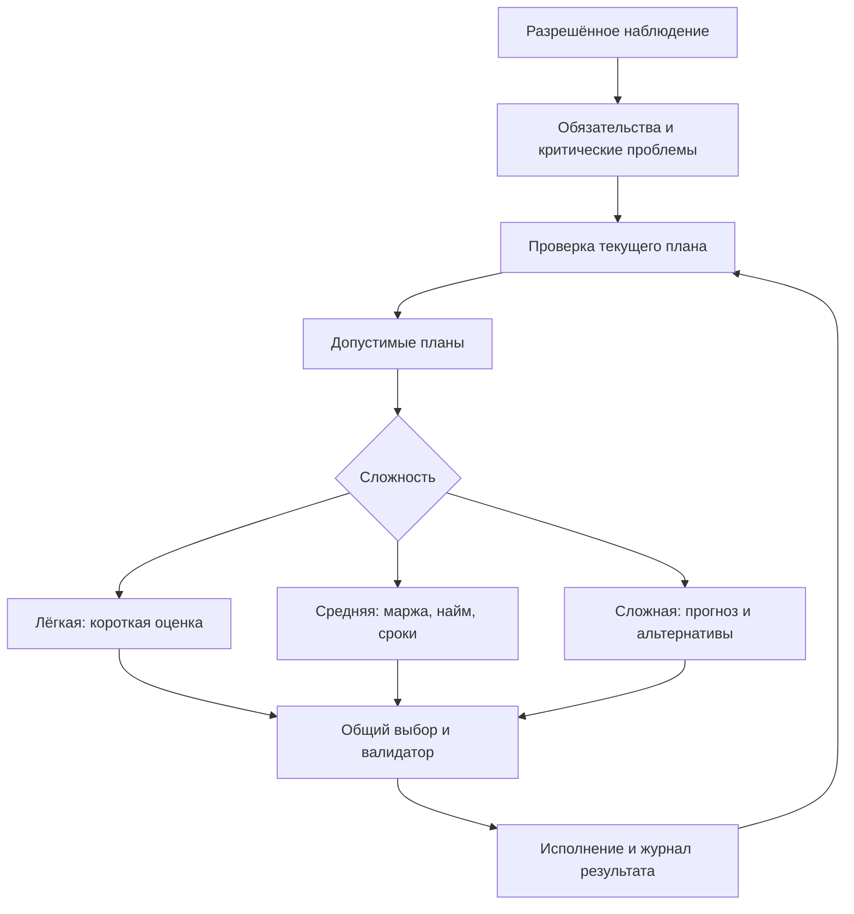

# Delsk — план следующего этапа: P28–P60

Автор проекта: Шелестов Максим Евгеньевич / MaksShelest.

Дата: 19 октября 2026 года, Europe/Samara. Версия документа: 1.1.

Статус: план, а не отчёт о реализации. Принятые правила основаны на обсуждении с владельцем проекта; варианты новых товаров ещё требуют выбора. Документ можно передать в Cursor или использовать как основу для обновления документации репозитория.

## Фактический статус пакетов в репозитории

Обновление: 19.10.2026. Исходная дорожная карта версии1.1 сохранена ниже; исторические P00–P27/UI01 не перенумерованы. Основа пакета1 — слитый PR#36, `e8d5640`; открытых PR в начале не было. Данные исходного файла не являются доказательством реализации.

Пакет1 реализован в `feat/package1-household-management` в доступном объёме, без заблокированных частей P32/P33. Факты, проверки и ограничения — [отчёт пакета1](IMPLEMENTATION_REPORT_PACKAGE1.md); покрытие команд — [матрица](ACTION_ACCESS_MATRIX.md), [свидетельства](verification/package1/checks.json). Полный gate:714/714tests,82exports,9replay,54comparison pairs; Linux Godot smoke/hash и оконные RU/EN проверки пройдены. Аппаратная приёмка Windows/Android остаётся открытой.

| Пункт | Реализованная граница | Оставшаяся зависимость/приёмка |
| --- | --- | --- |
| P28 | План сохранён, связан с основной дорожной картой; принятые правила отделены от контента-предложения | Закрыт в пакете1 |
| P29 | Общая карточка производства/хранилища/техники, улучшения/рецепты/маршруты, существующие контракты и поддержка человека | Программная/Linux-оконная приёмка пройдена; P30/P37 отдельно, другие устройства не проверены |
| P31 | Явный Remote/AtLocation для всех43 ActionKind, Core-запрос и проверки, физический маршрут NPC к зарплате | Закрыт: gate/privacy/save-load/replay |
| P32 | Одна выбранная карта, отдельный каталог/отмена, Start/Continue/замена, настройки экрана | Выбор сложности **не реализован**, зависит от P51–P53 |
| P33 | Глобальный планшет четырёх вкладок, own/bilateral/public проекции, независимая пауза, локальный контекст | Вкладка показывает существующие договоры; встречные переговоры **не реализованы**, P45 |
| P34 | Единая справочная оценка капитала/escrow/WIP/имущества, публичные суммы/город, подтверждение стадии | Закрыт: независимый audit всех82exports и save/load/replay |
| P35 | Обычный профиль: начальная ставка20minor и ручной шаг5minor; два точных взвешенных показателя рынка труда | Закрыт: тесты/окно; исторические параметры фикстур/сохранённой партии не переписываются |

P30, P36–P60 остаются планом. Не начинать их по наличию карточки или типа команды. Условия/зависимости каждого — §4–5 ниже. Новые цепочки A/B/C в §3 — предложения до выбора владельцем. P32/P33 не объявляются полностью закрытыми из-за перечисленных зависимостей.

Принятые уточнения §2 выше старых вариантов спецификации0.5: торговля со столицей без лавочки сохраняется; ресурсная аренда/покупка и остановленная стадия выборов согласованы, но реализуются P38/P36. В пакете1 нет аренды, конечных ресурсов, новых фабрик или сложностей NPC. Общих торговых мест в обычных картах теперь5 на4участника; прежний Core-лимит одного owned-or-reserved места сохранён.

## 0. Как передать этот файл в Codex

Это один файл с требованиями, подробным планом и готовым заданием. Прикрепите его к первой задаче Codex и отправьте следующий текст:

```text
Начни пакет 1 по приложенному DELSK_NEXT_STAGE_PLAN.md.
Выполни стартовое задание из раздела 12.2, добавь план в репозиторий
и доведи пакет до проверенного результата с PR.
```

В разделе 12.1 задачи сгруппированы в восемь смысловых пакетов. Раздел 12.2 содержит полный стартовый промпт, который также можно скопировать целиком. Для следующих заданий достаточно короткой команды из раздела 12.3: актуальный план и статус уже должны находиться в репозитории. Если меняется среда выполнения, передайте ей доступ к репозиторию с этим документом; наличие файла только в другом чате не заменяет этого доступа.

## 1. Границы и исходное состояние

Репозиторий: https://github.com/MaksShelest/Delsk . Проверенная основа: ветка `feat/economic-cycle-p00-p05`, коммит `e8d5640`, слияние PR №36 с UI01. На момент подготовки документа рабочее дерево чистое. Код, конфигурация и приложенные исходные документы этим заданием не изменялись.

Исторические P00–P27 не перенумеровываются. UI01 — уже выполненная последующая итерация; её результаты не следует делать заново. Здесь нумерация продолжается с P28. Все P28–P60 пока имеют статус «план». Один пункт может потребовать нескольких небольших PR; это перечень объёма, а не обещание выполнить всё за один календарный месяц.

В текущей основе уже существуют независимое C#-ядро, алгоритмические NPC, рынок, логистика, числовой найм, политика, сохранения, консольные исследования и Godot-клиент. Четыре товара стандартной экономики: wood, grain, plank, bread. В обычной 3D-партии работает алгоритмический контроллер; наличие исследовательского LLM-адаптера не означает подключение модели к обычной игре.

UI01 освободил игровое поле от постоянной нижней панели, уменьшил HUD, добавил заполняющуюся кнопку добычи, RU/EN-справку, упрощённую биржу и полноэкранный режим. Следующая интерфейсная работа относится прежде всего к карточкам хозяйства, перевозкам и недостающим действиям человека.

Облачная программная проверка P27 не заменяет остающиеся аппаратные проверки Windows EXE, Android и актуального запуска реальной модели. Известные ограничения длинной истории, памяти и save/load сохраняются до повторного измерения.

Приложенные пользователем документы спецификации 0.3 — исторический источник замысла. При противоречии действуют позднейшие явные решения пользователя и актуальные документы репозитория; старые файлы нельзя просто скопировать поверх новых.

## 2. Последние принятые уточнения

| Область | Принятое правило |
| --- | --- |
| Торговый доступ | Лавочка нужна для торговли с другими участниками. Продажа столице доступна независимо от наличия лавочки; обычные требования наличия товара, присутствия и спроса сохраняются. |
| Зарплата | Начальная ставка 0,20 монеты на работника за оплачиваемый рабочий тик. Шаг кнопок ручного изменения 0,05 монеты, а не 0,50. Это не новый обязательный минимальный порог. |
| Средняя зарплата | Публичная средняя ставка по городу, собственная ставка и сведения о предложениях найма доступны человеку и NPC одинаково. |
| Найм NPC | Средний и сложный уровни учитывают выгодность, спрос, обеспеченность сырьём и бюджет. Нет безусловного правила «всегда перебить конкурента». |
| Меню | Одна выбранная карта по центру, кнопка «Сменить карту», отдельное меню карт. Партия не начинается до подтверждения. |
| Сложность | Лёгкая / средняя / сложная задаётся до начала партии. В обычной игре изменить нельзя; изменение разработчиком помечает вмешательство. |
| Лавочки | Мест больше, чем участников. Не более одного купленного либо забронированного торгового места на участника. |
| Планшет игрока | Четыре вкладки: «Моё хозяйство», «Участники», «Переговоры», «Город». Доступен из любого места. |
| Дистанционные действия | Правило доступности задаётся для каждого типа команды и проверяется ядром одинаково для всех контроллеров. Удалённый просмотр не снимает требований присутствия. |
| Выборы | Каждые 600 тиков; экономика останавливается до получения всех голосов, но обработка голосования и ожидание модели продолжаются. |
| Поддержка | Подписанный и активированный договор обязательной поддержки не позволяет выбрать другого кандидата. Возможность обмана отложена. |
| Добывающая техника | Полное хранилище останавливает добычу; техника ждёт владельца или разрешённый транспорт и затем возобновляет работу. |
| Ресурсные клетки | Покупка либо исключительная аренда; бронирования нет. Собственная техника — только на купленной ресурсной клетке. |
| Общедоступная добыча | Бесплатная ручная добыча без техники; участки дальше, запас меньше и восстановление медленнее. Скорость добычи единицы не занижается отдельно. |
| Промышленные участки | Существующие правила покупки и брони сохраняются. Не смешивать их с ресурсными клетками. |
| Переговоры | Продажа, закупка, поставка, политическая поддержка; цена и количество могут обсуждаться встречными предложениями. |
| Место выдачи | Продавец выбирает лавочку, склад или разрешённый запас предприятия. Непосредственная продажа из добывающей машины исключена. |
| Доверие | Развитие доверия и раскрытие информации через отношения отложены. Краткое предпочтение NPC известно с начала партии. |
| Реплики и звук | Короткие реплики над NPC по реальным событиям; звуки действий и ненавязчивое окружение с настройками. |
| Рейтинг | Капитал, а не только наличные деньги. Единая оценка имущества для участников и города. |
| Работники | Только числовые группы. Никаких отдельных объектов жителей и их маршрутов. |
| Разработчик | Инструменты включаются в специальной сборке; в Release отсутствуют соответствующие команды, экраны и отладочные ресурсы. |

На паузе сохраняется подготовка разрешённых команд. Она не означает немедленное исполнение экономических действий без продвижения времени. Меню, справка, планшет, голосование, потеря фокуса и ожидание модели — независимые причины паузы: закрытие одного экрана не должно снимать остальные.

## 3. Новые цепочки: предложения для выбора

Общее направление принято: два новых вида сырья, два перерабатывающих предприятия и ещё одно дорогое предприятие с несколькими входными материалами. Конкретный набор ниже — предложение. До выбора не объявлять его частью утверждённого контента и не начинать реализацию новых фабрик.

Важно различать сырьё и весь товарный каталог: две новые разновидности сырья вместе с двумя промежуточными и одним сложным продуктом добавляют пять товарных позиций. Вместе с четырьмя текущими получится девять.

### Вариант A — строительные материалы (рекомендуется)

| Новое сырьё | Переработка | Продукт |
| --- | --- | --- |
| Глина | Кирпичный завод | Кирпичи |
| Железная руда | Металлургический цех | Металл |

Дорогое предприятие: домостроительный комбинат. Вход: доски + кирпичи + металл. Выход: строительный комплект.

Плюсы: новая цепочка использует существующие доски, связывает несколько специализаций, хорошо объясняется визуально и даёт понятную работу логистике. Кирпичный завод — печь и штабели; металлургический цех — печь и слитки; комбинат — сборочная площадка под навесом.

Строительные комплекты сначала получают сбыт через столичные заказы. Позднее их можно включить в дополнительные дорогие улучшения. Нельзя требовать комплект для постройки первого комбината, выпускающего этот комплект: это замкнёт развитие.

Металлургия использует существующую оплату энергии; уголь, топливо и электросеть не добавляются автоматически. Новое сырьё сначала можно добывать вручную. Дополнительные добывающие машины не входят в этот пакет без отдельного решения.

### Вариант B — текстиль и мебель

Лён → ткацкая фабрика → ткань. Железная руда → металлургический цех → металл. Мебельная фабрика объединяет доски, ткань и металл в мебель.

Плюсы: цепочки узнаваемы, используются существующие доски, итоговый продукт логичен. Минус: у ткани пока мало других потребителей; экономику придётся поддержать достаточным внешним спросом.

### Вариант C — продовольствие

Молочное сырьё → молочный комбинат → сыр. Сахарная свёкла → сахарный завод → сахар. Кондитерская объединяет зерно, сахар и молочное сырьё в выпечку.

Плюсы: понятная игроку специализация, близость к существующей пекарне. Минусы: молочное сырьё требует объяснения источника — оно не должно выглядеть как руда в земле; существующую и новую выпечку нужно визуально и экономически различать. Животноводство, порча продуктов и отдельные животные в этот вариант автоматически не входят.

Рекомендация: A. Он лучше соответствует нынешней карте и не требует вводить фермерскую подсистему.

### Рецепты при улучшении

Улучшение открывает дополнительные разрешённые рецепты; прежний рецепт не исчезает. Игрок выбирает активный рецепт. Начатая партия завершается по прежнему рецепту либо остаётся приостановленной с прежним WIP; нельзя конвертировать уже вложенные материалы переключением кнопки.

Первый пакет можно сделать без дополнительных видов товаров. Например, уровень 1 кирпичного завода: 2 глины → 1 кирпич; уровень 2 открывает вариант 3 глины → 2 кирпича. Аналогично можно открыть более эффективный рецепт металла и крупную партию строительных комплектов. Это иллюстрация устройства, не утверждённый баланс: длительность, энергия, штат и стоимость улучшения рассчитываются совместно.

Если впоследствии нужны именно новые продукты, а не альтернативные рецепты тех же товаров, они добавляются отдельным расширением каталога. Не вводить незаметно ещё десяток продуктов в эту итерацию.

## 4. Краткий перечень P28–P60

| Код | Краткое название | Основная зависимость |
| --- | --- | --- |
| P28 | Требования и дорожная карта | Актуальная основа после UI01 |
| P29 | Карточки хозяйства и действия человека | P28 |
| P30 | Склад и модели уровней | P29 |
| P31 | Права и дистанционные действия | P28 |
| P32 | Главное меню и выбор партии | P28; выбор всех сложностей после P51–P53 |
| P33 | Планшет игрока | P29, P31 |
| P34 | Капитал, рейтинг и город | P33 |
| P35 | Зарплаты и рынок труда | P28, P29 |
| P36 | Остановленная стадия выборов | P31, P33 |
| P37 | Объёмная погрузка и разгрузка | P29, P31 |
| P38 | Ресурсные права и восстановление | P28 |
| P39 | Третья карта | P32, P38 |
| P40 | Преграды и доступ к объектам | P31, P39 |
| P41 | Подвижная добывающая техника | P37, P38, P40 |
| P42 | Маршруты добычи и доставки | P41 |
| P43 | Лавочка и доступ к торговле | P31 |
| P44 | Продажа из выбранного хранилища | P37, P43 |
| P45 | Переговоры и встречные предложения | P33, P36, P44 |
| P46 | Получение покупки и навигация | P40, P42, P44 |
| P47 | Многокомпонентные рецепты | P28; сохраняет работу текущих цепочек |
| P48 | Два новых вида сырья | Выбор пакета контента, P38, P39 |
| P49 | Две новые фабрики и рецепты уровней | P47, P48 |
| P50 | Сложное производство | P47, P49 |
| P51 | Модульные сложности NPC | P31, P35 |
| P52 | Экономически осмысленный средний NPC | P51; адаптация к готовым игровым системам |
| P53 | Планирующий сложный NPC | P52, P34, P45, P50 |
| P54 | Сборка разработчика и журнал решений | P28; можно делать раньше других веток |
| P55 | Режим бога и перемотка | P54, P36; ожидание модели уточняет P56 |
| P56 | Локальная модель в обычной игре | P51, P54, P55 |
| P57 | Реплики NPC и звук | P29; события добавляются по готовности систем |
| P58 | Минимальная исследовательская лаборатория | P35, P51, P54 |
| P59 | Баланс, исследования и производительность | Готовые P35–P58 |
| P60 | Итоговая приёмка и передача | P59, аппаратные проверки |

Нумерация отражает состав работ, а не требование завершать всё строго слева направо. Например, наблюдаемость P54 полезна до улучшения NPC, P47 можно разрабатывать независимо от новой карты, а P32 сначала даёт выбор карт и только после готовности политик — действующий выбор трёх сложностей. В незавершённом UI нельзя показывать обещанную функцию как работающую.

## 5. Подробные задачи

### P28. Требования и дорожная карта

Цель: сделать новые правила единственным согласованным источником для следующих итераций.

Работы: сопоставить документ с актуальными game_specification, ARCHITECTURE, DECISIONS, IMPLEMENTATION_PLAN, INTERFACE_ITERATIONS, PROTOTYPE_STATUS и AGENTS; обновить ссылки и приоритеты; разделить нормативные правила, проверенные факты, баланс и предложения. Новые идеи не переписывают исторические отчёты как якобы ранее реализованные.

Приёмка: таблица статусов совпадает с кодом и PR; нет оставшихся противоречий по 0,05, торговле со столицей, аренде и сложности. У каждого будущего пункта указаны результат, зависимости и проверка. Пакет новых товаров помечен предложением до выбора.

### P29. Карточки хозяйства и действия человека

Цель: завершить UI02 на существующих правилах, без второй экономики в клиенте.

Работы: карточки производства, склада, добывающей техники и доставки; компактные блоки работы, запасов, работников и доступных действий; инструкции в справке. Добавить отсутствующие интерфейсы покупки/улучшения техники, разрешённых рецептов и управления имеющимися системами. Составить матрицу всех ActionKind: человек/NPC, интерфейс, требуемое место, результат отказа. Нельзя молча считать операцию доступной человеку, если она существует только в консольном сценарии.

Приёмка: ручной сценарий покупки и использования имеющихся объектов без разработческих прав; одинаковые причины отказа в UI и Core; RU/EN; окно и полный экран; отсутствие перекрытия кнопок. Новая объёмная передача пока не имитируется таймером — это P37.

### P30. Склад и модели уровней

Работы: склад как открытая площадка с ограждением и проходом; заполнение штабелями по реальным запасам. Различимые силуэты существующих уровней производств и добывающей техники; лавочки сохраняют узнаваемый фиолетовый акцент. Отрисовка отражает реальный контент, не добавляет выдуманные улучшения.

Приёмка: пустой, частично и полностью заполненный склад читаются визуально; смешанные запасы не показываются одним неверным товаром; проход совпадает с будущей геометрией доступа. Новые модели не создаются каждый кадр. Полосок процессов над объектами в этом пункте нет.

### P31. Права и дистанционные действия

Работы: явная политика каждого типа команды — Remote либо AtLocation с правилом определения целевого объекта. Дополнительные проверки владения, договора и присутствия сохраняются. Нужна проверяемая таблица покрытия всех типов действий, а не разрозненные bool в кнопках.

Просмотр объекта и разрешённые переговоры доступны издалека. Изменение зарплаты, покупка грузовика и физическое взятие/передача товара требуют согласованной точки присутствия. То же относится к ботам: существующая удалённая SetWage должна получить новый маршрут и правило доступа. Не добавлять удалённые привилегии NPC ради сохранения старого алгоритма.

Приёмка: дистанционная команда отклоняется ядром независимо от способа отправки; на месте выполняется при выполнении остальных условий. Глобальный планшет не закрывается от перехода между клетками; карточка локального взаимодействия закрывается при утрате её контекста. Секретность и договорные права независимы от геометрии прохода.

### P32. Главное меню и выбор партии

Работы: центральная карточка одной выбранной карты, «Сменить карту», отдельный пролистываемый каталог; «Начать», «Продолжить», настройки. При создании партии — сложность. Три сложности становятся доступными только после P51–P53; до этого не создавать три одинаковых политики с разными названиями.

Приёмка: мир не тикает до старта, отмена выбора ничего не стирает, запуск новой партии с заменой текущей требует понятного предупреждения. Карта и сложность закреплены в сохранении и исследовательском manifest. Пул нескольких активных партий пока не вводится.

### P33. Планшет игрока

Работы: четыре вкладки. «Моё хозяйство» — список объектов, состояние, заполнение запасов и реальный производственный прогресс. «Участники» — публичные сведения и краткие предпочтения. «Переговоры» — действующие предложения и договоры по мере P45. «Город» — показатели по P34/P35. Удалённая карточка использует политику P31.

По умолчанию открытие ставит экономику на паузу; переключатель разрешает течение времени. Движение по согласованному правилу может возобновлять ход времени, но закрытие не должно снимать независимую системную паузу. На паузе доступны просмотр и подготовка команд.

Приёмка: списки не разрастаются по высоте всего экрана, обновление не сбрасывает выбор/прокрутку, чужие закрытые запасы не попадают в представление. Справка открывает конкретный раздел. Входящие предложения не теряются при закрытии вкладки.

### P34. Капитал, рейтинг и город

Работы: единая версия правил оценки; капитал и занятость участников, городские показатели. Формула и учётная конвенция приведены в разделе 7. Краткие карточки, подробности расчёта — в справке. Публичные показатели доступны алгоритму и модели тем же разрешённым запросом, что человеку.

Город: население, занятые, безработные, доля занятости у игрока, выпуск и исполнение столичных заказов за период. Название «на вас работают», а не «вы владеете жителями». Отсутствие выполнения чужого необязательного заказа не приравнивается к нарушению подписанного договора.

Стадии: деревня → посёлок → небольшой город → развитый город. Сначала это иллюстрации/названия по конфигурируемым порогам капитала, населения и действующих производств, без экономических бонусов. Обратимое изменение показателей не должно вызывать непрерывное мигание стадии; пороги/правило подтверждения фиксируются в данных.

Приёмка: перенос между своими складами не увеличивает капитал; один груз и один escrow не учитываются дважды; рейтинг не раскрывает секретные сделки. Городские суммы согласуются с моделью, не включают выдуманные кошельки жителей.

### P35. Зарплаты и рынок труда

Работы: начальные ставки рабочих групп 20 minor units и шаг ручных кнопок 5 minor units в экономическом профиле; 100 minor units = 1 монета. Ставки уже начатой партии не переписываются. Изменяются согласованные обычные стартовые профили, а не все исторические тестовые сценарии подряд.

Показывать два различимых значения:

1. Средняя действующая ставка занятых: Σ(headcount × wage) / Σ(headcount). Веса — численность работников, а не число предприятий. Включаются производственные, добывающие и логистические группы по одному разу. При нулевой занятости — «нет данных».
2. Среднее предложение по доступным вакансиям: Σ(готовые вакансии × действующая ставка привлечения) / Σ(готовые вакансии). Закрытые/неработоспособные вакансии не формируют фиктивное предложение. При отсутствии вакансий — «нет вакансий».

Первое — ставка оплаты за рабочий тик, а не фактически полученный средний доход: простаивающие группы по действующим правилам не получают зарплату. Pending-изменения показываются отдельно и не подменяют уже действующие ставки. При необходимости фактические выплаты за период доступны подробной статистикой.

Приёмка: примеры с разными численностями, нулевыми значениями, задержкой вступления ставки и простоем; то же значение в UI и NPC observation. Все расчёты фиксированной точности, округление только для показа.

### P36. Остановленная стадия выборов

Работы: при достижении границы 600 тиков остановить экономические фазы на фиксированном снимке; собрать бюллетени участников вне обычного продвижения экономики; показать человеку политический планшет. Алгоритмические NPC продолжают обработку бюллетеня, гибридные могут ждать разрешённое решение модели. Ожидание не требует ещё одного экономического тика.

Активная обязательная поддержка фиксирует кандидата; нельзя выбрать иной голос через альтернативный UI/команду. На стадии голосования не разрешать новые экономические действия, меняющие зафиксированную численность и вес голосов. После всех бюллетеней — однократный подсчёт, публичный результат, восстановление прежних причин паузы. При победе сохраняется существующее правило продолжения песочницы.

Приёмка: все проголосовали/человек задержался/модель ошиблась/сохранение на стадии ожидания/повторный ответ. Ни один случай не двигает экономику скрытно и не удваивает бюллетень. В headless человеческий слот получает явно заданную политику.

### P37. Объёмная погрузка и разгрузка

Работы: совместный процесс Core для человека и транспорта. Объём V = Σ(quantity × unitVolume). Производительность P определяется ролью, реальной численностью числовой команды и характеристиками оборудования. При постоянном P длительность — ceil(V/P), но в состоянии хранится накопленная работа, чтобы корректно учитывать изменение команды.

Сохранять связанные резервы товара/места, переносить только реально завершённый объём, не дублировать груз при повторе команды. Уход/остановка прекращают продолжение; переданное остаётся переданным, неиспользованные резервы освобождаются. Личные скорости задаются конфигом, а не отдельными хардкод-таймерами «всё за секунду».

UI: одна единица, выбранное количество, всё доступное; количество ограничено свободным товаром и вместимостью. Фон кнопки показывает подтверждённый прогресс с визуальным сглаживанием. Цель баланса — обычная передача быстрее нынешнего неудобного повторения единицы за тик. Сглаживание не выдаёт товар досрочно.

Приёмка: разные объёмы, неполная вместимость, занятый резерв, переменная команда, частичная остановка, граница дедлайна и continuous-vs-load. Никакой отдельной упрощённой версии для исследования.

### P38. Ресурсные права и восстановление

Работы: запас, истощение, возобновление, покупка, исключительная аренда и общедоступные клетки. Нет брони ресурсов. Стартовое допущение аренды — 1200 тиков; это параметр для пилота, не окончательный баланс. Запас и восстановление задаются по типу клетки отдельно. Истощение не завершает аренду раньше срока.

Срок аренды проверяется до старта/выполнения работы на соответствующем интервале. По окончании новая добыча запрещается, незавершённый ручной прогресс сбрасывается; уже добытое личное имущество остаётся владельцу. Техника в первом варианте доступна только на купленных клетках, что исключает проблему чужой машины после окончания аренды. Повторная аренда требует обычной команды; автоматического списания нет.

Общедоступные клетки имеют меньший запас/более медленное восстановление, но ту же базовую скорость ручной добычи единицы. На исчерпанном лесе видны пни; ресурс не создаётся из отрицательного остатка. Покупка не создаёт бесконечный запас.

Приёмка: два претендента, истечение, восстановление, save/load, ноль денег и отсутствие земли. У всех контроллеров одинаковые правила. Баланс аренды не должен делать покупку заведомо бессмысленной либо лишать проигрывающего пути восстановления.

### P39. Третья карта

Работы: новая карта с сохранением первых двух. С каждой стороны промышленной зоны — 18 клеток тремя блоками по шесть, базовая форма блока 2×3. Между блоками — свободные полосы шириной в клетку. Между ресурсами и промышленностью — три клетки: свободная / дорога / свободная. Дороги и проходы не продаются.

Торговых мест больше числа участников и они симметричны; стартовое геометрическое предложение для четырёх участников — восемь мест, окончательно проверить по размеру схемы. Общедоступная добыча дальше, но без непомерного удлинения основных маршрутов. Сохранить достаточные подходы к каждому объекту и минимум по шесть основных клеток леса/зерна, если это укладывается в проверенный баланс.

Приёмка: клеточная схема и измеренные длины основных путей до столицы; нет замкнутых участков. Новые виды сырья после выбора размещаются в новой версии сценария P48; существующие партии сохраняют собственную карту и не перестраиваются обновлением файла.

### P40. Преграды и доступ к объектам

Работы: отделить физические препятствия от прав собственности. Стены/ограждения мешают пройти, ворота и открытые навесы оставляют проход. Визуальная геометрия и авторитетные данные проходов согласованы. Нельзя перекрыть обязательный доступ покупателю, которому выдано право получить товар.

Свободное перемещение игрока, клеточные маршруты NPC, грузовиков и мини-карта используют совместимые правила. Право зайти не даёт права взять чужой товар. Сложные интерьеры и прозрачная крыша не входят в обязательный объём.

Приёмка: обход, ворота склада, открытая лесопилка, недоступный путь, изменение препятствия при существующем маршруте. Нет прохода сквозь стену из-за сглаживания движения.

### P41. Подвижная добывающая техника

Работы: разрешённое перемещение собственной машины между подходящими купленными ресурсными клетками, видимый объект и сохранение положения/режима/груза. При полном хранилище добыча прекращается; возобновляется после вывоза и выполнения остальных условий.

Рабочий приоритет: нет места → ожидать вывоза; есть место и ресурс → добывать; ресурс исчерпан → рассмотреть следующую остановку; нет допустимых остановок → ожидать. Нельзя обходить заполнение уездом с потерей груза. Личные/автоматические режимы не выдают двойной результат. Оплата движения/работы числовой команды определяется явно и сохраняет правило отсутствия платы за простой.

Приёмка: заполнение, частичный вывоз владельцем, грузовик, отсутствие команды/денег, истощение, save/load в пути и при ожидании. Неавторизованный участник не получает прямой доступ к машине.

### P42. Маршруты добычи и доставки

Работы: планшет маршрута добывающей техники с клеточной мини-картой и последовательностью собственных допустимых остановок; повторять/не повторять. Отдельно логистический маршрут: источник → получатель, товар; условия отправки второстепенны. Доставка из техники на склад, со склада на производство и другие разрешённые назначения.

Пользователь выбирает остановки, а проходимый путь между ними строится общим алгоритмом. Отображать причину ожидания: источник пуст, получатель заполнен, нет прав/пути, мало команды. Активный рейс не удаляется переключателем маршрута. Обход опустевших/неподходящих остановок ограничен, чтобы не было бесконечного цикла за один тик.

Приёмка: цикл, однократный маршрут, вывоз из полной машины, частичный груз, переполнение приёмника, изменение маршрута и restore. UI не позволяет указать чужой источник без договорного права.

### P43. Лавочка и доступ к торговле

Работы: один купленный/забронированный торговый участок на участника при избытке мест. Полный торговый доступ после постройки своей лавочки. Продажа столице остаётся доступной без неё; это явное принятое исключение, не обход валидатора.

Условие доступа применяется к обеим сторонам торговых сделок между участниками; публикация, заявка, встречное предложение и принятие используют один gate. Обычный выбор голоса и просмотр политики лавочки не требуют. Обмен материальной компенсации на поддержку — сделка между участниками, поэтому подчиняется тому же ограничению; дополнительные исключения, кроме столицы, не вводятся. Сохраняются действующие правила фактической передачи компенсации и активации обязательства.

Вместимость лавочки уровня 1 приравнивается к складу уровня 1 по конфигу (сейчас склад 200, лавочка 80); будущие изменения не пишутся магическим числом в UI. Если торговый доступ впоследствии утрачен, уже заключённые обязательства не исчезают.

Приёмка: лимит покупки/брони, продавец без лавочки, покупатель без лавочки, доступная столица, восстановление при нуле денег, отсутствие потерянных holds.

### P44. Продажа из выбранного хранилища

Работы: отделить торговый доступ участника от физического источника лота. Разрешённый источник — собственная лавочка, склад, свободный входной/выходной запас предприятия. Исключены добывающая машина, груз в рейсе, WIP и уже зарезервированный товар. Предмет и количество фиксируются в предложении вместе с точкой выдачи.

Количество — ползунок + кнопки + точный ввод. Соглашение резервирует реальные единицы в выбранном источнике. Покупатель видит место получения до подтверждения. Физический вход на чужое предприятие ограничен маршрутом/точкой выдачи и не открывает остальные запасы.

Существующие торговые окна и аукционы сохраняются. Прямые двусторонние переговоры P45 создают отдельный договор после подтверждения; они не должны тайно обходить уже открытый публичный аукцион или продавать тот же резерв повторно.

Приёмка: параллельные предложения из одного запаса, изменение остатка, получение частями, отказ и дедлайн, источник на предприятии с производством, восстановление договора и резервов.

### P45. Переговоры и встречные предложения

Работы: четыре структурированных типа — продажа, закупка, поставка, поддержка. Условия: стороны, предмет, количество, цена/компенсация, источник/получатель, сроки. Контрагент принимает, отказывает либо предлагает новую версию. Свободная реплика не является исполнимой командой.

Ограничить число раундов/срок жизни предложения конфигурацией; каждое согласие указывает конкретную версию. Предварительные переговоры не удерживают бесконечно общий запас. Подтверждение сделки атомарно проверяет доступ, деньги, товар и связанные обязательства. Старые условия не исполняются после встречного предложения.

Алгоритм ведёт переговоры и без модели. Модель может выбирать только разрешённые намерения с проверенными числовыми условиями. Участникам видны только свои/двусторонние переговоры; публичный журнал не раскрывает политические условия. Динамического доверия нет.

Приёмка: встречная цена, конкурентное принятие, устаревшая версия, повтор подтверждения, истечение, отказ модели, обязательная поддержка. Торг не создаёт товар и не обходит действующую торговую сессию.

### P46. Получение покупки и навигация

Работы: активные покупки и остаток срока в планшете; клеточная мини-карта с текущим положением, точкой выдачи и разрешённым путём. Не перегружать её моделями зданий; препятствия должны оставаться понятными. Разрешить назначение имеющегося транспорта по договорному праву, если его роль это поддерживает.

Право забрать относится к конкретным товару, количеству и источнику. Самовывоз не означает доступ ко всему чужому складу. При частичной погрузке у границы дедлайна объём, переданный вовремя, остаётся полученным, остаток обрабатывается по правилам срока. Сроки игровые, не настенные.

Приёмка: путь до чужого предприятия, недоступный проход, несколько рейсов, частичное получение и просрочка. Мини-карта не показывает секретные запасы/маршруты другого участника.

### P47. Многокомпонентные рецепты

Цель: прежде контента расширить реальное ядро. Сейчас рецепт и ряд подсистем ориентированы на один InputItem/InputQuantity; добавлением JSON с несколькими входами задача не решается.

Работы: набор входных предметов и количеств, набор разрешённых рецептов по типу/уровню здания, выбор активного рецепта. На первом расширении достаточно одного выходного вида на рецепт, без побочных продуктов и сложного дерева исследований. Сохраняется один общий входной инвентарь конечного объёма.

Все компоненты списываются атомарно при старте партии; нехватка одного не уничтожает остальные. WIP хранит конкретный рецепт и вложенные материалы. Обновить готовность найма, снабжение, расходные потоки, экспорт, контроллеры, прогноз прибыли, сохранение и replay. Улучшение открывает новые рецепты, не подменяет начатую партию.

Приёмка: старые лесопилка/пекарня без ухудшений, смесь двух/трёх входов, недостающий ингредиент, заполнение выхода, остановка/смена рецепта, continuous-vs-load. Изменение схемы сопровождается новой версией и явной миграцией либо понятным отказом старого save; никакой тихой порчи.

### P48. Два новых вида сырья

После выбора варианта добавить два типа предметов, узлы, объёмы, справочные цены, stock/regen и права, локализацию, значки и визуал. Для A — глина и железная руда. Добыча работает общими правилами P38, без отдельного хардкода в Godot.

Разместить узлы в версии карты, проверить маршруты и стартовый доступ. Не превращать лесную машину автоматически в универсальную добычу руды. Новые специализированные машины — отдельный будущий пакет, если потребуются.

Приёмка: человек и NPC добывают через одни команды; новые предметы проходят склад, транспорт, капитал и исследования. Старые карты/сценарии без новых узлов по-прежнему загружаются; новые партии не меняют уже сохранённый мир.

### P49. Две новые фабрики и рецепты уровней

Для A — кирпичный завод и металлургический цех; соответственно кирпичи и металл. Добавить стоимость, материалы стройки, штат, зарплаты, энергозатраты, уровни и открываемые рецепты; отдельные узнаваемые модели, карточки и справку.

Не добавлять заодно уголь/топливный транспорт. Проверить альтернативный рецепт уровня 2 на реальной окупаемости, а не только на большем выходе. Дополнительная эффективность не должна делать сырьё бесконечно прибыльным без спроса.

Приёмка: покупка → стройка → снабжение → выпуск → продажа/потребление. Человек и NPC умеют работать с новым типом без специальных привилегий. Добавлены спрос столицы и разумный внешний бюджет либо другой реальный потребитель продукции.

### P50. Сложное производство

Для A — домостроительный комбинат: доски + кирпичи + металл → строительный комплект. Существенно дороже обычной фабрики; стартовый ориентир капитальных затрат — 2–3 стоимости обычного нового предприятия, точное значение после расчёта окупаемости. Это рабочее допущение, не установленная цена.

Проверить независимые входные маршруты, общую вместимость, дефицит одного ингредиента и сбыт комплекта. Первая фабрика не требует собственного конечного продукта для постройки. Опциональный рецепт следующего уровня открывает улучшенный способ выпуска того же комплекта без немедленного расширения каталога.

Приёмка: полная цепочка нескольких специализаций и закупка недостающего ингредиента. Дорогой комбинат выгоден при обеспеченном спросе, но не является автоматически лучшим решением при любых условиях. Три новых продукта учитываются в экспортах, спросе, рейтинге и исследовательской статистике.

### P51. Модульные сложности NPC

Работы: общий исполнитель/валидатор/права/наблюдения и наращиваемые блоки оценки. Лёгкий — короткие понятные планы и простая оценка; средний добавляет экономику и сроки; сложный — сравнение стратегий и прогноз последствий. Не давать уровню скрытый доступ к чужим запасам либо бесплатные деньги.

Профиль сложности и версии блоков сохраняются. Базовая логика обслуживает обязательства, доступность действий и восстановление после отказа независимо от сложности. Заложить расширение памяти опыта через отдельную версию данных, не писать сейчас фиктивное обучение.

Приёмка: три действующие конфигурации на одинаковом seed, разница в решениях объясняется включёнными блоками, сохранение восстанавливает точную политику. Изменение сложности в обычной партии отсутствует.

### P52. Экономически осмысленный средний NPC

Работы: оценка маржи и выгодности дополнительного найма; стоимость сырья с учётом альтернативы продажи, энергия, погрузка/перевозка, реальные задержки найма, вероятность простоя и спрос. Стоимость самостоятельно добытого сырья не равна нулю. Средняя зарплата — ориентир, не приказ перебивать её.

При выборе ставки сравнивать ожидаемый дополнительный выпуск/доход с дополнительной оплатой всей затронутой группы. Предусмотреть денежный резерв, предел окупаемой ставки и задержку повторного пересмотра, чтобы не возникала непрерывная гонка зарплат. Не повышать ставку при полном выходном складе или отсутствии поставок ради формального заполнения всех мест.

Готовые модули учитывают новые рецепты и логистику по мере их появления. Отдельные политические вложения, если разрешены стратегией, оцениваются и логируются отдельно от производственной прибыли с ограниченным бюджетом; отрицательную маржу нельзя скрывать словом «выгодно».

Приёмка: тестовые случаи прибыльного/убыточного найма, дорогого конкурента, низкого спроса, дефицита сырья и восстановления бюджета. Логи содержат основание выбранной ставки. Средний уровень не обещается оптимальным во всех ситуациях.

### P53. Планирующий сложный NPC

Работы: ограниченный горизонт планирования и несколько кандидатов стратегии: ручная добыча/покупка/производство/торговля/автоматизация/политика. Сравнить альтернативную стоимость капитала, риск сроков, доступность работников и транспортные ограничения. Учитывать резерв на исполнение договоров и сценарии отказа/дефицита.

Планировщик не перебирает бесконечное дерево и не пользуется будущими случайными исходами. Число вариантов, глубина и вычислительный бюджет конфигурируются. Переговоры оцениваются по выгоде и риску победы контрагента; не обязательны сделки с любым предложившим высокую цену.

Приёмка: paired-series по одинаковым мирам; частота разорения/просрочек, капитал, занятость и результаты выборов. Не требовать победы на каждом seed; улучшение устанавливается измерениями, а не названием «сложный».

### P54. Сборка разработчика и журнал решений

Работы: compile/package-разделение; только специальная сборка содержит интерфейсы и команды вмешательства. Обычный игровой Debug-экран с техническими сведениями не является оправданием наличия режима бога в Release.

Журнал: наблюдение, кандидаты и оценки, выбранная цель, шаг плана, результат команды, причины отказа; отдельно обращение к модели, разрешённые входы, ответ, длительность и fallback. Внутренний исследовательский журнал может быть полным; обычный публичный экран не раскрывает секреты чужих договоров. Частота/объём и хранение ограничены.

Приёмка: в Release нет точки вызова разработческих действий и соответствующих экранов/ресурсов, проверен состав сборки. В Debug можно объяснить наблюдаемое поведение NPC без чтения исходников. Логи не записывают секреты подключения модели.

### P55. Режим бога и перемотка

Работы: отдельный раздел вмешательства в деньги/ресурсы с валидацией; изменение экономических параметров только на безопасных границах с записью старого/нового значения. Не разрешать произвольную замену вместимости/объёма, разрушающую уже существующие резервы.

Перемотка до заданного будущего тика/на N тиков: настоящие шаги симуляции без отрисовки каждого кадра, отзывчивый интерфейс, остановка/отмена. Нельзя пропустить выборы, обязательный человеческий выбор либо ожидание модели. Разработчик может заранее задать явную временную политику человеческого слота; она отмечается в журнале. Это не функция перемещения назад во времени.

Приёмка: результат совпадает с обычным последовательным прогоном при тех же решениях; restore и replay сохраняют вмешательства. Отладочная партия явно помечена и исключается из чистых исследовательских сравнений по умолчанию.

### P56. Локальная модель в обычной игре

Работы: подключить существующий сменяемый адаптер к Godot-сессии; выбор алгоритм/гибрид, проверка доступности runtime и модели, понятные настройки, бюджет запросов и разрешённые типы решений. Не обещать автоматическую установку/скачивание модели: это отдельный пользовательский поток и объём.

По принятому режиму ожидания хост останавливает дальнейшие экономические тики на барьере решения, но не блокирует поток UI и Core.Step сетевым ожиданием. Явные варианты при ошибке: повторить, отменить ожидание/партию либо продолжить алгоритмом с записью fallback. Ответ применяется только к актуальному разрешённому запросу.

Сначала один runtime и разделённые контексты NPC. Параллельные запросы и несколько моделей сравниваются измерениями, не считаются ускорением заранее. Целевая пользовательская машина — RTX 5060 Laptop 8 ГБ VRAM / 48 ГБ RAM, но пригодность конкретной модели подтверждается текущим запуском.

Приёмка: реальная модель, недоступный runtime, ошибочный JSON, поздний ответ, save/load/replay. Replay не спрашивает модель повторно. Manifest фиксирует model/runtime/timing-policy; исследовательские режимы с ожиданием и fallback не смешиваются молча.

### P57. Реплики NPC и звук

Работы: короткие RU/EN-реплики над персонажем на событиях строительства, сделки, поиска сырья, дефицита работников. Лимит частоты и одновременного показа, приоритет важных фраз, отключение в настройках. «Бот мешает» допустимо только при действительно наблюдаемом конфликте; слова не выдают секретный план.

Косметические вариации используют отдельный поток случайности/представление и не меняют экономический PRNG или решения бота. Для обычных реплик не нужен вызов модели.

Звуки: кнопки, добыча/завершение, строительство, сделка, важное уведомление; ограничение повторов. Ненавязчивое окружение и необязательная фоновая музыка. Раздельная громкость/выключение, лицензии и происхождение всех ассетов зафиксированы. Не требуется создавать отдельный звуковой движок.

Приёмка: реплики читаемы, не закрывают планшеты, не спамят; пауза/потеря фокуса корректно управляют воспроизведением; нет сотни одинаковых звуков в ускорении.

### P58. Минимальная исследовательская лаборатория

Работы: специальный исследовательский интерфейс поверх общего runner: базовый профиль, список варьируемых параметров, значения/диапазон, seeds, число повторов, состав и сложность NPC, алгоритм/гибрид, переговоры и другие разрешённые факторы. Каждый эксперимент получает отдельный разрешённый профиль, не меняя глобальный config/economy.json.

Очередь, старт/пауза/продолжение, прогресс, ошибки, папка результатов; краткие агрегаты и сравнение выбранных серий. Никакой второй симуляции в UI и обязательной отрисовки 3D для каждого прогона. Комбинации с отсутствующим/противоречивым параметром отклоняются до запуска.

Приёмка: из UI воспроизводится существующий CLI-эксперимент с теми же входами и хешами; выгружаются исходные JSON/CSV/JSONL и сводка. Например, 500 прогонов с переговорами и 500 без отличаются именно фактором переговоров, а не одновременным отключением политики/торговли.

### P59. Баланс, исследования и производительность

Работы: попарные серии на одинаковых seed, сравнение сложностей и отдельных механизмов. Метрики: капитал, денежный остаток, занятость/ставки/выплаты, прибыль/маржа, простои, использование ресурсов/транспорта, просрочки, победа, модельные задержки и fallback. Выводы сопровождаются объёмом выборки и разбросом.

Проверить путь восстановления без лавочки/денег через общедоступную добычу и столицу; окупаемость аренды/покупки; полезность всех новых фабрик; отсутствие доминирующего бесплатного цикла и лавинообразной гонки зарплат. Новая продукция не должна получать неограниченный внешний спрос по завышенной цене.

Профиль: стоимость Step, контроллеров, геометрии/UI, CPU/GPU, память, размер и время save/load на длинной партии. 60 FPS — цель измеряемого рендера; плавная анимация не доказывает ускорение симуляции. Решать выявленную причину рывков, а не просто выставлять лимит 60.

Приёмка: воспроизводимый отчёт, реальные команды и результаты; ни fake-модель, ни облачный Linux-профиль не выдаются за пользовательский Windows/Android pass. Новое поведение после настройки проверяется повторно на контрольных сценариях.

### P60. Итоговая приёмка и передача

Работы: полный ограниченный регрессионный набор, replay и checkpoint restore для новых состояний; RU/EN и разрешения экрана; обычная партия от начала до выборов и продолжения; Developer/Release-разделение. Локальная Windows EXE-проверка и Android-проверка на устройстве выполняются фактически либо остаются явно открытыми.

Android: адаптация ввода, безопасные области, читаемость крупных планшетов, pause/resume и отсутствие offline catch-up. Сборка APK без запуска не считается приёмкой устройства. Не утверждать отсутствие инструментов в Release только по исчезновению кнопки.

Результат: обновлённые статус/архитектура/настройки/отчёт, список известных ограничений, воспроизводимые команды, ссылки на PR и следующий небольшой шаг. Сам этот документ не объявляет второй этап завершённым.

## 6. Политика среднего и сложного NPC

Экономическая оценка опирается на разрешённые наблюдения. Приближённая прибыль за горизонт:

`ожидаемая выручка − сырьё по альтернативной стоимости − зарплаты − энергия − погрузка/перевозка − ожидаемые договорные потери`.

Продажа возможна не обязательно всего выпуска и не обязательно мгновенно. Дополнительный работник выгоден, если ожидаемая добавочная ценность от него превышает добавочные расходы с запасом на риск. При изменении ставки учитывать, что она может повысить оплату всей группы, а не только нового сотрудника.

Средний уровень: короткий горизонт и прозрачная консервативная оценка. Сложный: несколько стратегий, ограничения оборотных денег, вероятные задержки найма, несколько вариантов сбыта и политическая цель. У обоих есть потолок бюджета и период пересмотра. Среднее по городу используется для понимания конкуренции, но не гарантирует выгодность предлагаемой ставки.



Дальнейшее обучение через опыт — отдельное расширение памяти и оценок, а не замена валидатора. Оно не реализуется в P51–P53 и не называется работающей нейросетью.

## 7. Общая оценка капитала

Стартовая модель: денежные активы с однократным учётом резервов + товарные запасы/WIP + нормативная стоимость земли, построек и техники − признанные обязательства.

Товары оцениваются по зафиксированным справочным ценам профиля, не по цене собственного объявления. Земля — по справочному тарифу соответствующего участка. Постройки/техника — по общей нормативной стоимости приобретения и вложений в достигнутые уровни; уже потреблённые строительные материалы не учитываются вторым отдельным запасом. WIP учитывает вложенные материальные компоненты без повторного начисления уже списанных входов. Ставки зарплаты не превращаются в стоимость работников: жители не продаваемый актив.

Для отложенной выдачи принять явную консервативную учётную конвенцию: до физической выдачи непринятый объём товара остаётся в оценке продавца, соответствующий непогашенный денежный escrow — в оценке покупателя; после выдачи одновременно переходят оценка товара и соответствующая часть денег. Это правило рейтинга, а не разрешение продавцу использовать зарезервированный товар. Условное право покупателя на тот же груз не добавляется вторым активом поверх escrow. При истечении отражается реальный refund/fine. При изменении юридической модели контрактов конвенцию пересматривают версионированно.

Арендная плата сначала считается расходом, не бессрочной стоимостью земли; недобытые природные ресурсы отдельно не капитализируются. Товар в разрешённом рейсе учитывается один раз в соответствующем инвентаре. Для будущих денежных требований/долгов нужен симметричный учёт, а не суммирование обещанной выручки без обязательства.

Капитал города — капитал участников плюс чистые активы учитываемой муниципальной части; внутренние взаимные требования исключаются при консолидации. Внешняя столица не становится частью города. Показатель не является ВВП, накопленными историческими зарплатами или стоимостью всех жителей.

Правила оценки и пороги стадий лежат в версионированных данных. Все участники оцениваются одинаково. Публичный итог не раскрывает внутреннюю расшифровку секретного договора.

## 8. Контрольные результаты этапов

| Результат | Основные пункты | Условие готовности |
| --- | --- | --- |
| A. Понятная игра | P28–P35, ранний P54 | Читаемые карточки, доступные действия человека, зарплаты/рейтинг, объяснимые решения |
| B. Полный физический цикл | P36–P42 | Видимые выборы, погрузка, ресурсы, третья карта и работающие маршруты |
| C. Торговля участников | P43–P46 | Доступ через лавочку, согласованные условия, резерв и физическая выдача |
| D. Расширенная экономика | P47–P50 | Выбранные новые цепочки без тупиков и дублирования товаров |
| E. Управляемые NPC и модель | P51–P57 | Три сложности, наблюдаемость, честные права, реальное подключение модели |
| F. Исследовательская и платформенная приёмка | P58–P60 | Воспроизводимые серии и фактически пройденные проверки целевых устройств |

Ранний порядок: P28 → P29 → P31/P35 → P33/P34; P54 полезно начать до крупных изменений поведения. P30 и P57 можно делать отдельными визуальными итерациями. Новую экономику и многокомпонентные рецепты не смешивать с чистой перестройкой карточек в один огромный PR.

## 9. Общие требования к каждой итерации

1. Сначала проверить текущие ветки, незакоммиченные изменения, AGENTS и документы. Не считать прежний источник автоматически актуальным.
2. Выбирать разумный объём: одна согласованная возможность или законченная часть подсистемы; отдельная ветка и PR, без автоматического merge.
3. Правила только в Core, orchestration в Hosting, UI — представление/команды; Python — организация и анализ, не альтернативная экономика.
4. Один валидатор, одинаковые права человека/NPC; никаких привилегий сложного бота или модели.
5. Деньги, количество, объём и время — целые/фиксированная точность; переполнения и ошибочный конфиг отклоняются.
6. Новое состояние входит в snapshot, validation, hashing, replay, export и continuous-vs-load. Изменение версии — явно; несовместимые сохранения не перезаписываются молча.
7. Проверки по риску: meaningful unit/integration для правил, реальный оконный сценарий для UI, текущий реальный runtime для модели. Не расширять проверку бесконечно после достаточного подтверждения.
8. Отчёт отделяет реализовано / проверено / не проверено. Процент готовности без определённого состава не использовать.
9. Рабочие ассеты и настройки экспорта пользователя сохранять. Новые медиа сопровождаются данными о правах использования.
10. Статус этого плана обновляется по фактическому результату, а не по началу работы над пунктом.

## 10. Отложено за пределы P28–P60

| Код | Возможность | Причина/граница |
| --- | --- | --- |
| F01 | Несколько активных партий и слоты сохранений | Отдельный UX/хранение; сейчас одна текущая партия с безопасной заменой |
| F02 | Динамическое доверие и раскрытие знаний | Правила отношений ещё не определены; сейчас краткие предпочтения |
| F03 | Обучение NPC через опыт | Расширение памяти/оценок после проверки сильного baseline |
| F04 | Удобный редактор карт | Отдельный инструмент поверх общего формата сценария и валидатора |
| F05 | Полоски процессов над объектами | Согласован будущий переключатель; сейчас не реализовывать |
| F06 | Полные интерьеры и прозрачные крыши | Сейчас достаточно проходимых ворот/навесов |
| F07 | Ложь и нарушение политического обещания | Текущая поддержка обязательна и обеспечивается ядром |
| F08 | Автоматическое скачивание/установка модели | Не следует из подключения runtime; нужен отдельный поток установки |
| F09 | Новые товары сверх выбранного пакета | Не увеличивать каталог без потребителей и проверки баланса |

## 11. Что требуется от владельца перед соответствующей работой

Торговое исключение для столицы и шаг 0,05 уже подтверждены; повторно спрашивать их не нужно. Остался выбор конкретного пакета сырья и фабрик из раздела 3 либо собственной комбинации. Он блокирует только контент P48–P50, не улучшение интерфейса, зарплат, наблюдаемости или обобщение рецептов P47.

Числа аренды, запасов, восстановления, производительности, цен и городских порогов — рабочий баланс: выбирать, документировать и измерять без запроса разрешения на каждое число. Если выявится новый конфликт игрового правила, показать его отдельно до зависимой реализации.

## 12. Смысловые пакеты и готовые задания для Codex

### 12.1. Порядок крупных пакетов

Пользователь просит брать сразу несколько связанных пунктов, чтобы не передавать отдельное задание на каждую мелкую итерацию. Пакет — законченный пользовательский результат; внутри допустимы небольшие коммиты и промежуточные проверки без дополнительных согласований каждой операции.

| Пакет | Название | Пункты | Итог |
| --- | --- | --- | --- |
| 1 | Интерфейс и управление хозяйством | P28, P29, P31–P35 | Понятные карточки, права действий, меню, планшет, рейтинг и зарплаты |
| 2 | Политика и инструменты разработчика | P36, P54–P55 | Видимые выборы, журнал решений, разработческая сборка, вмешательства и перемотка |
| 3 | Ресурсы и физическая автоматизация | P37–P42 | Объёмная передача, ресурсные права, третья карта, проходы, техника и маршруты |
| 4 | Торговля участников | P43–P46 | Доступ через лавочку, выбор источника товара, переговоры и физическая выдача |
| 5 | Производственные цепочки | P47–P50 | Общие многокомпонентные рецепты, два новых сырья, две фабрики и сложное производство |
| 6 | Умные NPC и нейросеть | P51–P53, P56 | Три сложности, расчёт выгодности найма, стратегическое планирование и модель |
| 7 | Визуальное и звуковое оформление | P30, P57 | Склад-площадка, модели уровней, реплики NPC и звук |
| 8 | Исследования и итоговая приёмка | P58–P60 | Исследовательский интерфейс, баланс, производительность и проверка платформ |

Пакет 7 можно выполнить раньше, после стабилизации основных карточек. Пакет 5 зависит от выбора пользователем конкретного контента; обобщение рецептов P47 можно делать до выбора сырья. Сложности, ожидаемые в меню и планшете пакета 1, реализуются пакетом 6. Переговоры из глобального планшета появляются пакетом 4. Эти части P32/P33 не объявляются готовыми заранее.

При завершении последующих пакетов возвращаться к ранее отмеченным зависимым частям. Один пакет не обязан совпадать с одним PR, если разделение необходимо для проверяемости. Однако не требовать от пользователя отдельной команды на каждый коммит. Не сливать PR автоматически; учитывать незавершённые зависимости между ветками.

### 12.2. Готовый стартовый промпт — пакет 1

```text
Продолжаем разработку Delsk. Подробные требования находятся в приложенном
DELSK_NEXT_STAGE_PLAN.md. Используй его как дорожную карту следующих этапов.

Сначала изучи AGENTS.md, актуальные документы и состояние репозитория:
ветку, изменения, последние коммиты и открытые PR. Сохрани существующую работу,
не повторяй уже выполненные задачи. Исторические документы из вложений
не должны перезаписывать более новые документы репозитория.

Добавь приложенный план в docs/DELSK_NEXT_STAGE_PLAN.md, если его ещё нет.
Если версия уже есть, сопоставь изменения и сохрани накопленные статусы.
Свяжи план с основной дорожной картой и веди в нём фактический статус задач,
ссылки на реализацию, проверки и оставшиеся ограничения.

Сейчас реализуй первый крупный смысловой пакет:
P28, P29, P31, P32, P33, P34 и P35 —
«Понятный интерфейс и управление хозяйством».

Цель: игрок удобно управляет существующим хозяйством, видит своё положение
и рынок труда, а доступность действий одинаково проверяется для человека и NPC.

Выполни требования этих пунктов из плана:
- актуализируй документацию;
- переработай карточки предприятий, склада, техники и перевозок;
- проверь доступность человеку всех существующих операций ядра;
- введи единую проверку дистанционных и требующих присутствия действий;
- адаптируй NPC к новым требованиям присутствия;
- переработай главное меню и выбор карты;
- добавь планшет игрока и публичные показатели капитала/города;
- установи начальную зарплату 0,20 и шаг кнопок 0,05;
- добавь среднюю ставку занятых и предложения по вакансиям с одинаковой
  доступностью сведений человеку и NPC.

Границы пакета:
- не реализуй пока новые ресурсы, фабрики, переговоры, сложности NPC,
  объёмную погрузку и новую ресурсную механику;
- зависимые части P32/P33, например выбор ещё не реализованных сложностей
  и полноценные переговоры, явно оставь незавершёнными;
- не создавай неработающие кнопки и фиктивно заполненные экраны;
- продажа столице остаётся доступной без лавочки;
- P30 с моделями объектов выполняется отдельным визуальным пакетом.

Правила экономики и прав размещай в Core, не дублируй в Godot.
Сохрани секретность, подготовку команд на паузе, сохранение/восстановление
и воспроизводимость. Изменения общего профиля не должны незаметно
переписывать параметры уже начатой партии.

Работай автономно до завершённого результата пакета. Разбей реализацию
на понятные коммиты, а не на отдельное согласование каждой кнопки.
Если обнаружишь реальную блокирующую зависимость, заверши независимые части
и точно укажи, что осталось. Не останавливайся после одного документа или плана.

Запусти проверки по рискам изменений: сборку, необходимые тесты,
сохранение/восстановление и оконную проверку интерфейса, если среда позволяет.
Не заявляй проверки Windows/Android/модели без фактического выполнения.

Создай отдельную ветку, отправь изменения и открой PR без автоматического merge.
В итоговом ответе дай ссылку на PR, статус каждого пункта пакета,
результаты проверок и краткий сценарий ручной проверки.

В следующих заданиях опирайся на сохранённый в репозитории план и статусы:
не требуй повторного прикрепления файла и не начинай выполненные пункты заново.
```

### 12.3. Короткие команды для продолжения

Следующий пакет:

```text
Продолжай следующий согласованный смысловой пакет из раздела 12.1
docs/DELSK_NEXT_STAGE_PLAN.md. Сначала проверь фактический статус и PR.
Возьми сразу связанные пункты пакета и доведи их до проверенного результата.
Обнови статусы и документацию, отправь ветку и открой PR без автоматического merge.
Не повторяй готовое и не подменяй заблокированную зависимость заглушкой.
```

Конкретный пакет:

```text
Реализуй пакет № N из раздела 12.1 docs/DELSK_NEXT_STAGE_PLAN.md.
Проверь зависимости и текущее состояние, затем выполни все доступные пункты
пакета с проверками, обновлением документации и PR без автоматического merge.
```

В последней команде замените N номером нужного пакета. Если задача прервалась,
попросите продолжить текущий пакет с сохранённого состояния — не создавать его заново.
