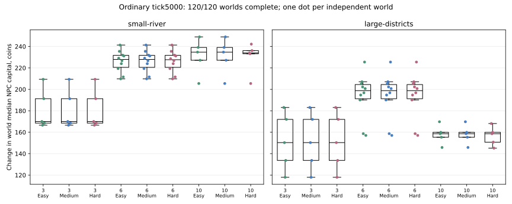
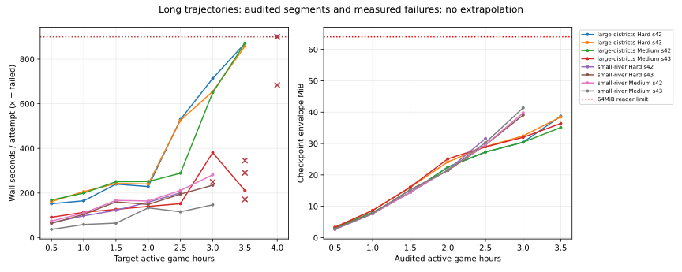

# H1 после дополнительной G2: результат и границы калибровки

Автор: Шелестов Максим Евгеньевич. Итог 30.10.2026 по времени пользователя.
Основа 3cc17e8/map-adapter-2; игровая когорта 0f89a63e4ff3421d00df755cd8cb6d61e641b62e.
[PR75](https://github.com/MaksShelest/Delsk/pull/75), без автоматического слияния.

120 из 120 обычных миров дошли до 5000 тиков (83 мин 20 с), но ни один из 750 NPC
не построил предприятие. Все 8 длинных миров остановлены:5 CheckpointTooLarge,
3 timeout900s. Последние проверенные границы 9000–12600 (2,5–3,5 ч).
Цель первого предприятия 15–30 мин не достигается в этой NPC-политике;
II–V, полная окупаемость и зрелое преимущество Hard не подтверждены.
P77 остаётся частично открытым. Числа баланса не подгонялись под ориентиры.

## Протокол и воспроизводимость

[План](research/h1-post-g2/study-plan.json) зарегистрирован commit507ec3e до
основных результатов. Использованы действующие C# OrdinaryNewGame и G1 coherent
policies; Python только организует реальные процессы, читает экспорты и считает
статистику. Человек-наблюдатель не ведёт хозяйство, self ballot. Это измерение
NPC-траектории, не скорость опытного игрока. Исторические 120ordinary1800/long
adapter1 из PACKAGE_H1 остаются отдельной когортой, не прибавлены к новой выборке.

Обе карты ×3/6/10NPC ×Easy/Medium/Hard:18 условий. При 6NPC n10 seed42–51,
при 3/10NPC n5 seed42–46. Единица независимости — мир/seed, не NPC и не сегмент.
Первичный показатель — изменение медианного NPC-капитала внутри мира, включая
оценку имущества/запасов Core; это не чистая прибыль.12 заранее объявленных
парных контрастов Hard−Medium/Easy−Medium, exact sign, Holm12, bootstrap5000,
seed20261029,95% CI медианы. n5 — разведочные клетки, не поздняя проверка Hard.

Long: обе карты ×6NPC ×Medium/Hard ×seed42,43, n2 на клетку. Только начальные
resolved maxTicks и controller finalTick увеличены до 126000; другой горизонт
планирования явно отделён от ordinary. Сегменты 1800, максимум 8 на worker;
первый runtime/save блокер останавливает мир.600/900s,2MiB входных планов и
64MiB envelope/512MiB decoded checkpoint не повышены. Неудачные попытки
сохранены; отсутствующие milestones не заполнены нулями.

[Команды повторения и продолжения](research/h1-post-g2/README.md).
[Исходная workflow40921991720](https://github.com/MaksShelest/Delsk/actions/runs/40921991720)
завершилась успешно как сбор измерений, а не как прохождение 8long миров.
Успешных сегментов 411:360ordinary+51long, каждый после accounting/privacy.
Повторный сбор аудитов и portable bundles не запускает игровых тиков.
[Архив наблюдений](verification/economy-h1-post-g2/observations.json.gz),
[manifest](verification/economy-h1-post-g2/archive-manifest.json),
[сводка](verification/economy-h1-post-g2/study-summary.json),
[CSV всех 128 миров](verification/economy-h1-post-g2/world-endpoints.csv).

## Обычная партия до 5000

Ни одного производственного корпуса, ни одного выпуска/XP; все 750 персональных
first-enterprise milestones справа цензурированы на 5000. Это не доказательство,
что предприятие невозможно: в long Medium корпуса строятся позже.
Занятость на финальном срезе 0 во всех 120 мирах; зарплаты 0. Зафиксированы 60 купленных
единиц стали в 14 мирах,7 купленных земельных клеток (700 монет суммарно по выборке),
но не завершённое производство. Техника/частные дорожные ступени/услуги 0.

Ниже прирост медианного NPC-капитала по независимым мирам: медиана [min;max],
монеты. Полные IQR/средние/каждый seed и все парные разности находятся в JSON/CSV.

| Карта | NPC | n на сложность | Easy | Medium | Hard |
|---|---:|---:|---:|---:|---:|
| small-river | 3 | 5 | 170.010 [166.590;209.380] | 170.010 [166.590;209.380] | 170.010 [166.590;209.380] |
| small-river | 6 | 10 | 227.920 [209.815;241.345] | 227.920 [209.815;241.345] | 227.670 [209.815;241.345] |
| small-river | 10 | 5 | 234.725 [205.470;248.920] | 234.725 [205.470;248.920] | 233.930 [205.470;242.200] |
| large-districts | 3 | 5 | 150.310 [117.960;183.080] | 150.310 [117.960;183.080] | 150.310 [117.960;183.080] |
| large-districts | 6 | 10 | 198.750 [157.040;225.470] | 198.750 [157.040;225.470] | 198.750 [157.040;225.470] |
| large-districts | 10 | 5 | 158.590 [145.790;169.780] | 158.590 [145.790;169.780] | 158.590 [145.180;168.110] |

При 3NPC разности Hard−Medium0 на обоих картах. При 6NPC на малой одна разность
−0,50 монеты (seed43), остальные 0; на большой все 0. Медиана разностей 0 и CI[0;0]
у обеих карт, но это не тест эквивалентности и не доказательство позднего равенства.
При 10NPC Hard−Medium: малая медиана−0,795 монеты, диапазон[−6,72;+8,99],
CI[−6,72;+8,99], raw p0,625; большая медиана−0,61, диапазон[−4,60;0],
CI[−4,60;0], raw p0,25. Все 12 Holm-adjusted p=1. Easy−Medium в каждой паре 0.
Подтверждённого выигрыша Hard нет; малое n/ранняя стадия не доказывают отсутствия
эффекта в развитой экономике.

## Длинные траектории и наблюдаемые сроки

Время первого предприятия — событие завершённого производственного корпуса,
отдельно от первого выпуска и технологического допуска. Все физические II–V
и допуски по XP остаются цензурированными на последней проверенной границе.

| Карта | Сложность | seed | Последний audited tick | Первый корпус | Выпуск, партий | Следующая граница | Причина/время процесса |
|---|---|---:|---:|---:|---:|---:|---|
| large-districts | Hard | 42 | 12600 | не наблюдался | 0 | 14400 | timeout, 900.008s |
| large-districts | Hard | 43 | 12600 | не наблюдался | 0 | 14400 | timeout, 900.002s |
| large-districts | Medium | 42 | 12600 | 10764 | 2 | 14400 | timeout, 900.002s |
| large-districts | Medium | 43 | 12600 | 11204 | 1 | 14400 | checkpoint_limit, 683.846s |
| small-river | Hard | 42 | 9000 | не наблюдался | 0 | 10800 | checkpoint_limit, 249.356s |
| small-river | Hard | 43 | 10800 | не наблюдался | 0 | 12600 | checkpoint_limit, 290.304s |
| small-river | Medium | 42 | 10800 | 7284 | 20 | 12600 | checkpoint_limit, 345.496s |
| small-river | Medium | 43 | 10800 | 6877 | 18 | 12600 | checkpoint_limit, 171.208s |

Medium: малая первая фабрика 6877/7284 (114,6/121,4 мин), большая 10764/11204
(179,4/186,7 мин). Это четыре наблюдения, не оценка всего распределения партии.
У Hard ни одного корпуса до его границы (малая 9000/10800, большая 12600).
Даже ориентир II1–2 ч не достигнут в восьми этих мирах. III4–7 ч/IV10–18 ч/V20–35 ч
ещё нельзя оценить: наблюдение заканчивается раньше. Не экстраполировать редкие
первые партии до 35 ч и не выдавать политическую победу за полное развитие.

На общей границе 9000 (разведочный post-hoc срез, не первичный тест) малая
Hard−Medium по seed42/43:−62,97/−72,655 монеты медианного капитала, ни одной
Hard фабрики против 5/5 Medium. Большая:0/−1,335 монеты, фабрик пока нет у обеих.
Это n2 и иной горизонт; устойчивое промышленное преимущество не доказано.

В последних audited Medium-срезах 21 производственный корпус,41 завершённая партия,
183XP исключительно Production; Quest0, доля quest XP0/183. В обычной выборке
XP0/0: доля не определена, а не 0%. Максимум накопленного XP одной отрасли/владельца
30, против 600 для II. Ни освоение 35 ч, ни ускорение от поздних заданий не измерены.

## Сырьё, импорт, рабочие и сбыт

По ordinary подтверждено 1426 отказов ResourceDepleted в 51 мире: малая 6NPC42,
малая 10NPC774, большая 6NPC21, большая 10NPC589. При 3NPC отказов нет.
Конечный public stock обнулён хотя бы у одного ресурса только в 2 мирах большой
карты/10NPC; восстановившийся конечный запас не исключает временного дефицита.
Следовательно, доступный public stock и конкуренцию нужно учитывать во времени;
нет оснований объявлять весь старт ни безусловно тупиковым, ни беспроблемным.

Импорт реально приобретался и вывозился в контуре действующей симуляции:
ordinary60steel; в каждом long мире 17–23steel, плюс 1coke у small/Medium43.
Финальные остатки/бронь/пополнение/вывоз находятся отдельно в fullEconomy.
Доступность ассортимента на терминале не равна возможности купить и довезти
каждый продвинутый материал. Полное снабжение II–V не проверено.

Длинная занятость непостоянна: small/Medium42/43 фактические зарплаты 371,40/315,00
монет, но на последнем срезе нанятых 0 при мощностях 25/30. Large/Medium42/43:
32,80/14,40 монеты зарплат, финальный штат 2 из 30 /0 из 20. Эти суммы подтверждают
реальные оплаченные периоды, но конечный штат не является интегральной загрузкой.
Все Hard long срезы без производственного штата/зарплат.

Фактический сбыт продукции заметен у малой Medium: seed42 проданы 12plank,
4flour,3cheese,2gravel; seed43 —20plank,8flour,15gravel. Сырьевой сбыт тоже
не гарантирован: large/Hard42 запросил 730sand, принято 465; заявки не являются
выручкой. Отраслевой HHI по корпусам у small/Medium: food0,5, остальные
наблюдаемые отрасли 1; large/Medium42 woodworking1/3, остальные 1, seed43
woodworking0,5, остальные 1. Это ранняя концентрация числа корпусов, не доли
выпуска/рынка. При отсутствии отрасли HHI не определён, не 0.

## Деньги, перевозки, простои и окупаемость

Метрики сверяют ledger/cash и разделяют goods/service settlement, зарплаты,
энергию/аренду/road paid, capex и escrow/refund. Во всех наблюдениях нет
неклассифицированного actor cash. OperatingReceiptResult — фактические поступления
минус оплаченные товары/услуги/операционные расходы; строительные материалы в
goods costs пока не распределены по объектам. Это не начисленная чистая прибыль:
непроданные запасы, износ и личное время владельца отдельно не оценены.

| Long Medium, последний audited срез | Денежный operating result, монеты по 6NPC | Capex, монеты | Goods costs, монеты | Зарплаты, монеты |
|---|---:|---:|---:|---:|
| large-districts seed42 | 1007.38 | 1660.00 | 625.00 | 32.80 |
| large-districts seed43 | 1019.38 | 1300.00 | 625.00 | 14.40 |
| small-river seed42 | 1270.44 | 1490.00 | 718.75 | 371.40 |
| small-river seed43 | 1407.07 | 1730.00 | 723.75 | 315.00 |

Портфели смешивают добычу/торговлю/стройку/первые линии. Положительный денежный
результат ещё не доказывает окупаемость отдельного предприятия. Атрибуция и
наблюдаемый payback каждого предприятия, техники, дороги и сервиса остаются
открытыми. В natural выборке машины/дорожные стройки/услуги отсутствуют, поэтому
нет измеренного естественного потока, который окупал бы их покупку.

Отдельный F2 контроль действующей симуляции, не natural replicate:
личный водитель fee4025minor−7road paid−10unbilled=4008 (40,08 монеты);
числовой водитель 4025−3120wages−11road paid−6unbilled=888 (8,88 монеты).
Покупка машины 250000minor учитывается отдельно. Нет основания объявлять срок
окупаемости по одному подготовленному рейсу или считать труд владельца бесплатным
в полном экономическом ROI. [Контроль](verification/economy-h1-post-g2/runtime-controls.json).

Натуральные audited срезы: overflow volume/loss0, road debt/accrual0,
автотрафик не возник (машин 0). Это отсутствие экспозиции к рискам, а не доказанная
безвредность переполнения, долгов и заторов. Накопленные задержки всех congestion
эпизодов не измерены: текущий traffic snapshot не является интегралом ожидания.
Простой NPC по sampled Idle/Wait: максимум 55 тиков ordinary,599long. Эти состояния
G1 не доказывают, что Core не допускает ни одного полезного действия. Бесконечный
тупик или универсальная recoverability по ним не установлены.

## Подтверждённая ошибка прогноза и решение о балансе

Восемь actual one-cell MoveTo на обеих картах:4/5 тиков физического движения
против map.MoveTicksPerCell=1. Протокол объявлен c3a3c3a до исполнения;
[события/команды и SHA](verification/economy-h1-post-g2/transport-forecast-diagnostic.json).
Python не ищет пути: только соседняя свободная клетка и события настоящего Core.
Fleet.PersonalMoveTicks использует 80/FleetSpeed (пешком 20 на дороге/16 вне),
тогда как G1 ForecastTicks/PlanTicks/ряд оценок перевозки используют прежнее
Map.MoveTicksPerCell. Часть планирования недооценивает этот участок в 4–5 раз.
Это подтверждённый дефект оценки, но его причинный вклад в задержку стройки,
разницу Hard и позднюю рентабельность ещё не измерен отдельной исправленной когортой.

Дополнительные гипотезы: выбор стройплощадки по ID удлиняет снабжение; Hard
capital gate может повторно учитывать уже купленные строительные материалы;
короткий forecast horizon может отсеивать полезные планы. Это чтение кода и
кандидаты на отдельные проверки, а не доказанные причины всех наблюдаемых провалов.

Решение H1: не менять цены/XP/скорости/спрос без такой проверки и длинной
траектории.82 денежных/картографических входа относительно принятой G2 совпадают
побайтно, Core/World28/session3 прежние. [SHA](verification/economy-h1-post-g2/financial-inputs.json).
Старые сохранения не мигрируются и не получают иной баланс. Изменены инструменты
исследования: bounded segments, атомарный relative journal/lock, замороженный
runtime/inputs/helpers, явный retry, сохранение неудач, lossless traces,
восстанавливаемая статистика, переносимый late checkpoint. Нет замены эксперимента
расчётной маржой и нет невалидированной правки для компенсации слабой политики.

## Измеренный блокер и оставшаяся работа

Последние envelope31,58–41,39MiB. Из этого нельзя вывести decoded размер новой
когорты: общее CheckpointTooLarge не различает конкретные проверки размера.
Пять настоящих исключений, а не прогноз по хешам. Пики процесса GitHub worker при save failure
6,59–10,49GiB; timeout runs последние heartbeat14054/14064/14088 без ожидания LLM.
По фазам Step/observation/policy/hash/save/export этот runtime здесь не разделён,
таймаут не доказывает одну конкретную горячую функцию.

H2 необходим отдельно: воспроизвести поздние checkpoints, измерить эти фазы,
рост истории/архивов и сериализацию; сохранить полную семантику денег/груза/XP,
маршрутов/собственности/политик и exact continuation. Не лечить рост повышением
64/512MiB или 600/900s. H2 этим PR не реализуется. Изменённый бинарник требует
новой объявленной когорты и сравнения, а не скрытого продолжения прежней линии.

Отдельные незавершённые H1/G1 вопросы:

1. Исправленная версия прогноза времени, paired effect на стройку/Hard и гарантии
   прежнего поведения старых сохранённых политик; это корректность политики,
   не оптимизация H2. Цены менять только после отделения эффекта стратегии.
2. Естественные сроки II–V, XP заданий и возможность необоснованного ускорения
   в развитой экономике. В наблюдениях ускоренного XP нет; поздний exploit search
   не выполнен и отсутствие нарушений не доказано.
3. Полная прибыль/ROI каждого типа предприятия/техники/дорог/услуг с атрибуцией,
   owner labour, реальным спросом, загрузкой/сбытом и временами простоя.
4. Истощённые/debt starts, длительные состояния без полезного действия,
   переполнение/заторы с реальной экспозицией и интегральными метриками.
5. Достаточное число независимых длинных paired миров для зрелой эффективности
   Hard. n10 до 83 мин и n2 до 3,5 ч это не закрывают.

## Проверки и сохранность

Реальный 30+30/continuous60 smoke с переносом каталога и две проверки
1800+1800/continuous3600 на обеих картах — одинаковы 31 содержательный экспорт,
включая ledger/commands/controllers/сжатые decisions и state hash. Короткий
smoke и длинные exact controls не считаются независимыми экономическими репликами.
Нулевой cash prepared: обе карты 6NPC/Medium42/1800,12/12 NPC заработали деньги,
оба аудита успешны. Это исключает безвыходность только этих двух zero-cash условий.

Release runner build прошёл; полный набор 64 Python tests лаборатории,
включая 7 новых протокольных проверок, прошёл.
Сохранены и неудачи: sandbox запретил 7 HTTP tests в первой попытке, корректный
повтор с local socket прошёл; ошибочный dotnet test filter дал 0tests/exit5,
прямой xUnit runner дал 2pass и создал реальные F2 fixtures. Не считать 0tests pass.
[Локальные process checks](verification/economy-h1-post-g2/local-process-checks.json).
Исходный runtime CI: Core40921991610 success, Godot40921991702 success;
основная матрица 40921991720 success как сбор всех 120complete/8blocked результатов.

[Worklog](WORKLOG_H1_POST_G2.md). Полный raw архив и переносимые комплекты имеют
явный срок хранения; локальные bundles проверяются по SHA и сохраняют последние
audited состояния. Продолжение не обещает устранить уже измеренный блокер.

Все 8late bundles скачаны в work/h1-retained-resume/CASE/world: проверены 23artifact
parts/manifest, ZIP SHA, SHA каждого файла и frozen worker--segments0 после
переноса, journal не изменился. Это не новый C#deserialize/игровая реплика;
исходные следующие сегменты уже реально загрузили те же checkpoint bytes.
[Подробная проверка переносимых состояний](verification/economy-h1-post-g2/retained-resume-verification.json).
Первичный secondary artifact аудитов содержал 96 миров и не принят как итог;
недостающие 32 получены по явным IDs, [проверка 128/411](verification/economy-h1-post-g2/collection-verification.json)
подтвердила неизменность всех игровых измерений. Дальнейший collection требует
полноту, оригинальные аудиты и равенство исходных данных; partial не скрывается.
