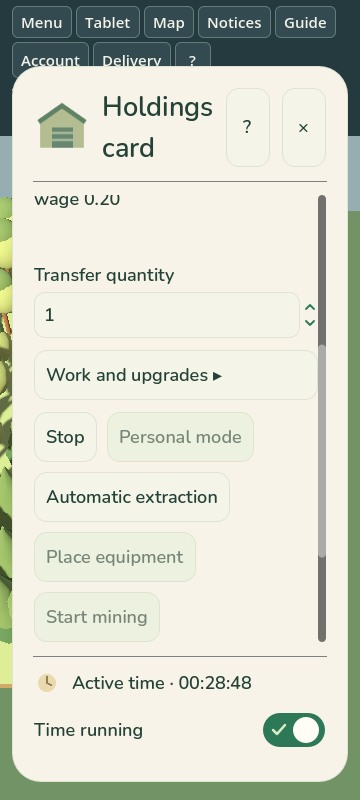
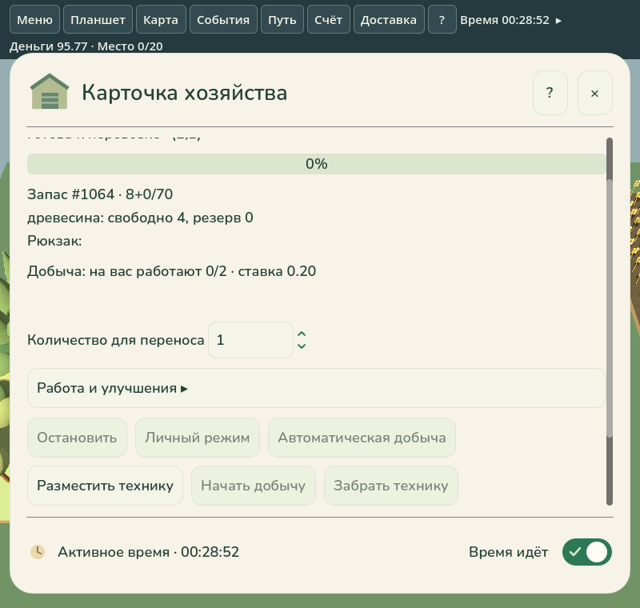

# I4 — городская покупка и физическая перевозка добывающей техники

Автор: Шелестов Максим Евгеньевич. 04.11.2026, Europe/Samara.
Ветка `balance/vehicle-prices-30pct`, существующий [PR #82](https://github.com/MaksShelest/Delsk/pull/82), база `feat/economic-cycle-p00-p05`.

## Результат и правила

Новый профиль `vnext-i4-mobile-equipment-1`, проекция
`mobile-equipment-projection-1`, добавляет городской конечный каталог из восьми
ресурсных специализаций × двух комплектаций. Оборудование стоит 150/600 монет,
выпускает 2/6 единиц за два рабочих тика, хранит 70/200 единиц, числовой автоштат
равен 2/5. Зарплаты и остальные экономические параметры сохранены.

Цены пяти автомобилей в этом новом профиле: Спутник-20 — 1300, Муравей-70 —
1800, Егерь-70 — 3200, Вектор-200 — 6300, Тракт-Д1 — 8400 монет.
Преобразование от исходного BALANCE выполняется один раз, до добавления техники;
UI, hold и оплата используют конечный `PriceMinor`.
Подробности: [отчёт о ценах](VEHICLE_PRICE_REBALANCE_2026-11-04.md).

Новые ordinary-партии трёх designed maps и новые пресеты лаборатории используют
I4. Для площадки добавляется городской южный аннекс с 16 разнесёнными стоянками,
реальными подъездами и соединением с прежней дорожной сетью. Исходные участки,
ресурсы и городские объекты не переносятся. Проверены все 48 выездов
(16 машин на каждой из трёх карт) до прежних городских дорог.

Покупка использует общий DealerVehicle/BuyVehicle: конечное наличие, пятитактовое
окно, money hold и детерминированное конкурентное разрешение. При занятом
физическом месте сделка не списывает деньги. Покупатель получает один OwnedVehicle
и связанную EquipmentState с тем же ID, владельцем и **одним общим инвентарём**.
Расчёт капитала не учитывает эту связь второй раз. Бесплатного штата при покупке нет.

Игрок подходит, садится и едет через общий Fleet Movement2/VehicleControl1:
MoveTo, WASD и джойстик используют одну авторитетную геометрию, повороты,
footprint, коллизии и дорожные платежи. Представление рисует один корпус.
Груз, собственность и состав группы сохраняются при размещении и перевозке.
Размещение проверяет собственный подходящий ресурсный участок, остановку,
положение, доступное место и отсутствие конфликтующей работы. Публичная земля
и аренда не заменяют требование собственности.

Обычные действия: «Разместить технику», «Начать добычу», «Остановить»,
«Забрать технику». Личная непрерывная добыча использует существующие рабочие циклы;
автоматическая — существующий штат и оплату. При полном складе работа ожидает
выгрузки без создания лишнего товара; остановка освобождает незавершённые резервы.
Перед упаковкой нужно остановить работу. Перенос сохраняет готовый груз и работников.
Оборудование не получает роли грузового автомобиля, автосервиса или equipment kit.

Планировщик NPC минимально расширен: купить доступную машину в городе,
подойти/сесть, физически доехать, при необходимости законно купить землю,
разместить и использовать прежнюю добывающую цель. Тесты запускают реальные
алгоритмические контроллеры, а не создают машину на месторождении.

## Исходные отказы PR #82

Исследованы репрезентативные журналы и пять архивов artifacts первоначального
HEAD `ae7e9e565a9b46e5c6831de5cf86ff7aac6ce1a0`. Размеры, SHA-256 и проверка CRC:
[initial-ci.json](verification/equipment-i4/initial-ci.json).

| Тип | Причина и исправление |
|---|---|
| Road / I3 | Изменение старой Fleet-фабрики оставляло 360000 minor units в фикстурах, которые после покупки должны быть бедными. Вместо NoMoney получались Working/Allowed. Восстановлены прежние цены и прежние ожидания исторического профиля. |
| H3 unit | Вновь построенный G1 перестал совпадать с сохранённым миром. Восстановлена историческая проекция; golden save и контрольный хеш не менялись. |
| H1 research | Историческая подготовленная F2-капитализация транспорта должна быть 250000, а становилась 180000. Исправлена та же первопричина. |
| H3 research | Зарегистрированный исторический cohort использует Movement1, тогда как fresh ordinary по умолчанию стал Movement2. Его запуск теперь явно указывает Movement1; план исследования и 192 мира не переписывались и заново локально не запускались. |
| Windows Godot | curl exit 28 при скачивании pinned Godot, таймаут 170004 ms до запуска приложения. Это внешний сетевой отказ. |
| Отмены и производные | Отменённые дубли и зависимые проверки не считались отдельными нарушениями поведения. |

Старые проверки не удалялись, старые таймауты не повышались. Новая I4-матрица
использует отдельные обязательные ordinary/developer задания; агрегатор `verify`
требует их успеха вместе со всеми прежними suites. Долгий тест 16 district-выездов
разделён на малые/большие машины с прежним лимитом на раздел; ни один выезд не исключён.

## Настоящее ordinary-прохождение

`tools/I4Acceptance` запускает обычный compact-valley, seed 42, исходные **200
монет**, одного игрока и три настоящих AlgorithmicController. Developer не подключён,
деньги, материалы и права не добавляются. Игрок зарабатывает личной добычей на
публичных ресурсах и фактическими продажами в столицу, затем покупает землю.

| Веха итогового прогона | Тик | Доступно монет |
|---|---:|---:|
| Покупка малой машины из стартовых денег | 33 | 50.00 |
| Законная покупка первого участка | 1604 | 95.77 |
| Физическое прибытие с городской площадки | 1723 | 95.77 |
| Добыча и реальная выгрузка | 1737 | 95.77 |
| Тот же экземпляр добывает на втором купленном участке | 2519 | 75.84 |

Прохождение завершилось за 92.39 s. После остановки сохранённый груз перевезён
на второй участок; ID, общий инвентарь и собственник не менялись. Checkpoint
посреди движения и работы воспроизводит ещё три тика с точными world/controller
hashes. Полный command replay совпал. Экспорт прошёл независимые проверки денег,
товаров, вместимости, населения, капитала, billing, услуг, Fleet, дорог и приватности.
В [local-gate.json](verification/equipment-i4/local-gate.json) сохранены результаты
и SHA-256 исходных свидетельств. Большие журналы и промежуточные неуспешные попытки
не включены в репозиторий; CI повторяет ordinary-прогон и публикует artifacts.

## Проверки и интерфейс

| Локальная проверка итоговой реализации | Результат |
|---|---|
| Release I4, семь непересекающихся разделов | 40 passed |
| Developer I4 и запрет Developer в Release | 40 passed, ожидаемый отказ сборки Release |
| D3/E1 связанные регрессии | 58 passed |
| I1/I2/I3 движение, управление, работа, положение | 29 passed |
| Три исходные road/I3/H3 регрессии | 3 passed без изменения эталонов |
| Python Checks / Research.Lab | 47 / 64 passed |
| Ordinary-прохождение, replay, независимые аудиты | succeeded |
| Godot Mono RU 800 / EN 1000 / EN 360 | 3 native cases succeeded |
| Исторические G2 forms RU/EN и F2 delivery после исправления launcher | 3 native cases succeeded |

I4-тесты покрывают пять автомобильных цен и hold/save/load, исходные 200 монет,
все 16 комбинаций покупки/размещения/повторного размещения, три карты и 48 выездов,
реальный NPC-путь, конкуренцию (разные победители при разных seed), запреты чужой
земли/неподходящего ресурса, полный склад, зарплаты и сохранение работников,
повороты/платежи, единственный запас и старый checkpoint.

В RU/EN-каталоге показаны специализация, комплектация, цена, выпуск/цикл,
вместимость, штат и доступность. Собственная карточка показывает координаты,
рабочий участок либо готовность к перевозке, режим, запас, штат и прогресс.
Короткие действия расположены рядом и имеют естественную ширину. Причины отказа
локализованы; джойстик не перекрывает открытую карточку.

Нативный probe загружает checkpoint реального ordinary-прохождения, нажимает
обычные кнопки мышью/синтетическим touch, добывает товар, останавливает и упаковывает
технику. Проверены один корпус, сохранение груза/ID, отсутствие повторной оплаты,
точный save/load и читаемые размеры кнопок. До добавления probe собран и проверен
обычный клиент; shared DLL заморожены хешами и не меняются probe-сборкой.
AssemblyAudit запрещает I4EquipmentProbe в обычной поставке.

Актуальный полный GitHub CI на HEAD PR — источник окончательного статуса:
[обязательные checks PR #82](https://github.com/MaksShelest/Delsk/pull/82/checks),
[Core](https://github.com/MaksShelest/Delsk/actions/workflows/core.yml),
[GitHub Actions](https://github.com/MaksShelest/Delsk/actions).
Локальные результаты выше не заменяют GitHub CI. PR переводится в Ready только
после успешных обязательных checks финального HEAD; конкретные run-ссылки и SHA
записываются в описание PR после их завершения, без отдельного изменения кода.

Полный [Core run 41861682117](https://github.com/MaksShelest/Delsk/actions/runs/41861682117)
на `c8f48da` завершился успешно, включая обязательный `verify`, I4 ordinary/developer,
реальное ordinary-прохождение и все прежние suites. В
[Godot run 41861682099](https://github.com/MaksShelest/Delsk/actions/runs/41861682099)
Windows core/replay прошёл; city-ux-ui прошёл шесть map cases, затем остановился
на `G1 profile replaced by UX` при подготовке forms-ru. Этот подготовленный
исторический probe сначала создаёт обычную G1-партию, после чего загружает
сохранённые формы. Явный `--economy economy.g1-npc.json` был передан map cases,
но пропущен в forms launcher. Исправлен только выбор профиля этого launcher:
проверка G1 и все проверки форм/доставки сохранены. Исходный Windows ZIP
`13339883813`, 14682926 bytes, SHA-256
`889ef97afefe34233c1ebc02adfb4c877ae993ccb887b160631fd20357a665e6`,
CRC всех записей проверен. После исправления необходим полный обязательный CI
нового HEAD; старый успешный Core не объявляется результатом нового коммита.
Локальный запуск `check_city_experience_ui.py --case forms` на неизменённых
фикстурах из этого Windows artifact прошёл обе формы и прежний F2 delivery probe
на Linux software GL. Выбор профиля формы больше не зависит от нового default I4.

На следующем HEAD `1623ea7` полный
[Core #496](https://github.com/MaksShelest/Delsk/actions/runs/41901347958) также
прошёл целиком. Windows core/replay успешен. В
[Godot #199](https://github.com/MaksShelest/Delsk/actions/runs/41901348193) все
шесть map cases и обе формы прошли, но общий native timer 600 s прервал последний
delivery probe. Выполнен один запрос повтора только упавшего UI job на том же
HEAD и с прежними лимитами. В повторе все девять native cases и проверки их
журналов завершились с exit0, но последовательная сборка/импорт/девять окон снова
исчерпали общий лимит 600 s до итогового завершения gate. Этот exit124 не засчитан
как успех. Реальные timings и SHA/CRC архива:
[windows-budget.json](verification/equipment-i4/windows-budget.json).

Вместо дальнейших одинаковых повторов Windows UI разделён на три непересекающиеся
группы: три городских map cases, три compact cases, RU/EN forms + F2 delivery.
Все прежние девять cases сохранены; `--case all` по-прежнему доступен. Каждая
группа проверяет число своих cases, собирает/аудирует ordinary client и сохраняет
native logs/artifacts. Лимиты 180 s на case, 600 s на группу и 15 min на Windows job
не повышены. Прежнее обязательное имя `city-ux-ui` сохранено как always-run
агрегатор, требующий успеха всех трёх групп. Новый HEAD после этого изменения
обязан пройти полный CI; результаты предыдущего HEAD его не подменяют.

## Совместимость и границы

Для I4 используется world schema 31 и явный флаг equipment dealer; прежние
schema 18–30 продолжают читаться. Новые поля nullable/default-omitted, поэтому
старые канонические представления не получают лишних свойств. Старые профили,
golden saves, деньги, contracts/holds и покупки не переоцениваются. Уже сохранённая
геометрия не регенерируется. Исторические EquipmentMotion/ExtractionRoute и покупка
на месторождении остаются в старых мирах; новая I4-техника пакуется и едет общим Fleet.
Версии Session/Envelope и прежние лимиты не менялись.

Нативные проверки выполнены на Linux Godot Mono/software GL; это не приёмка
физических Windows/Android-устройств, FPS или оборудования. Единственное ordinary-
прохождение доказывает доступность цепочки, но не долгосрочный баланс или
накопление на Тракт. Большая стратегия NPC, I5–I8, полный рефакторинг планшета и
контекстного меню не выполнялись. PR автоматически не сливается.
