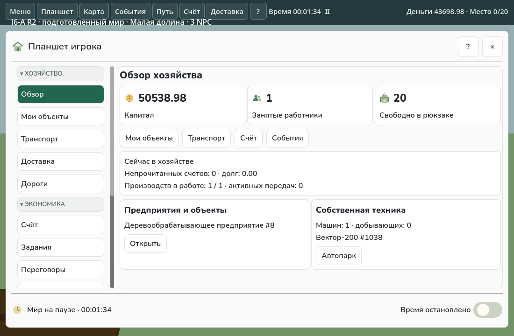
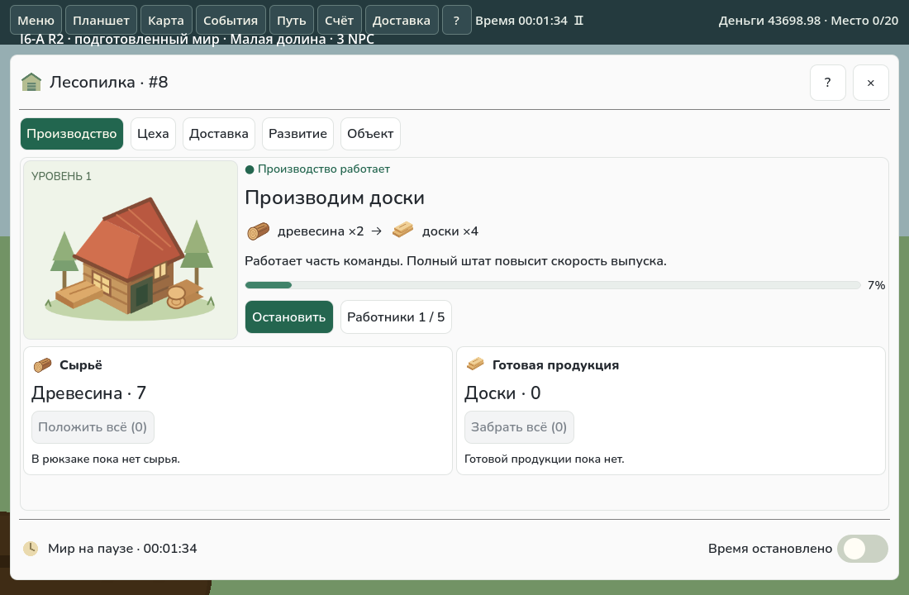
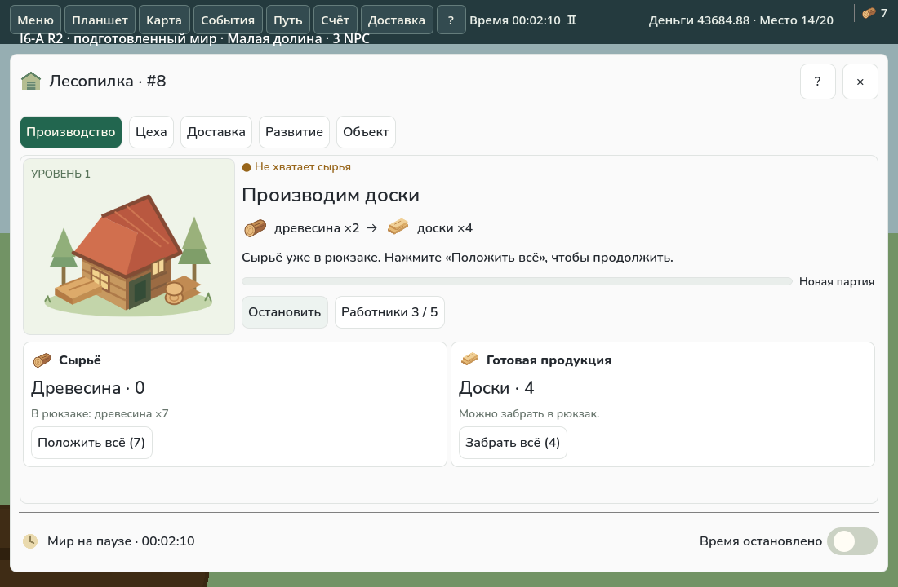
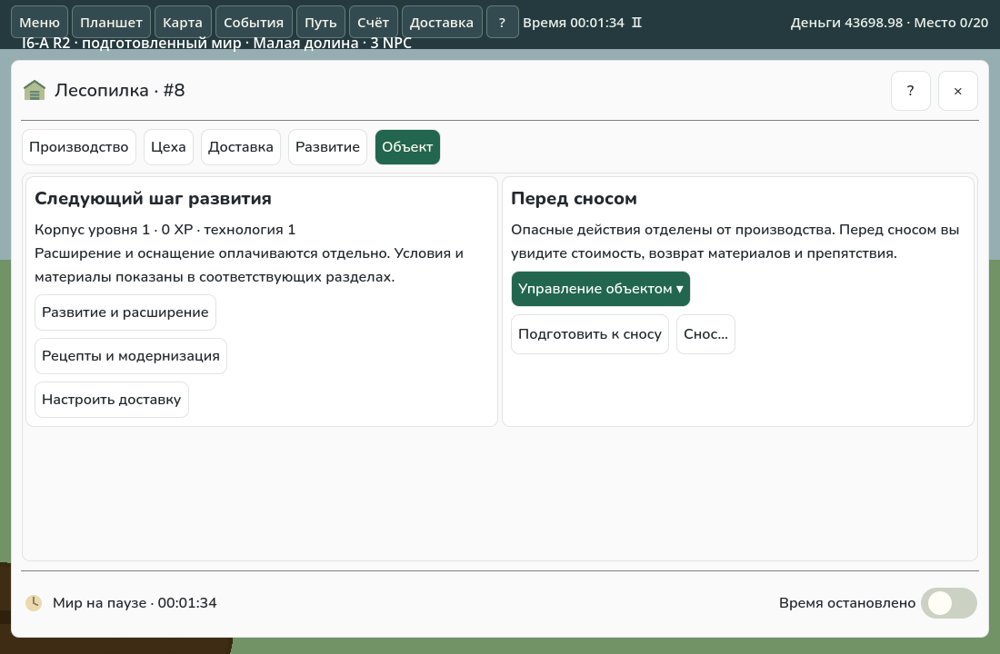

# I6-A Revision 2 — лесопилка с понятным первым экраном

Продолжение `feat/vnext-i6a-tablet-prototypes` и **Draft PR #84**. Основа этой доработки — `6341f63`; I5/PR #83 уже входит в основание PR. I6-B не начат, merge не выполнялся. Core, экономика, NPC, настройки зарплат/циклов и формат сохранений не изменены.

## Почему выбрана эта композиция

Первый экран посвящён выпуску партии. Слева крупная существующая SVG-иллюстрация лесопилки и уровень; справа — название продукции, рецепт с иконками и настоящими количествами, статус, объяснение и прогресс. Ниже две связанные карточки: сырьё с загрузкой и готовая продукция с получением. Это даёт две колонки для сравнения входа и результата, а не длинный перечень технических параметров.

В первые секунды игрок видит: **лесопилка → 2 древесины → 4 доски**, работает ли выбранный цех, сколько работников занято и где будет результат. «Остановить»/«Запустить» и число работников находятся рядом с прогрессом. Кнопка работников открывает действующий `WorkshopPanel` с рецептами, ставкой и оснащением. Доставка, развитие и управление объектом вынесены в отдельные страницы; производство открывается первым.

Следующее действие зависит от опубликованного состояния. При отсутствии сырья и древесине в рюкзаке экран прямо предлагает «Положить всё»; при пустом рюкзаке объясняет, где добыть древесину, и предлагает открыть карту. Для нехватки работников, денег, заполненного выхода и подготовки изменений есть человеческие объяснения. Коды Core не заменяют основной текст. Невозможность быстрого переноса объясняется возле кнопки; показанное `(N)` — фактически допустимое количество, а не весь запас независимо от вместимости.

## Что изменено

- Новый лёгкий `WoodworkingTabletPresenter` включён только для `woodworking`, при локальном открытии и просмотре собственного объекта. Удалённая карточка в планшете игрока получает доступную высоту без внешней второй прокрутки; права доступа остаются прежними. Он читает `EnterpriseView`/выбранный workshop и переиспользует `WorkshopPanel`, `DevelopmentPanel`, склад, маршруты и действующие команды. Старый `ProductionTabletPresenter` к новой модели не подключается. Остальные отрасли не переработаны.
- `ManualTransferChoice` сохранён. Видимые «Положить всё»/«Забрать всё» отправляют одну обычную `Transfer`, перепроверяют доступ и количество, блокируют повторную отправку. Сырые технические строки быстрых переносов заменены контекстом карточек; старые варианты переноса доступны на вторичной странице.
- В `DemolitionPanel` действия собраны под «Управление объектом». Кнопки имеют естественную ширину и высоту 44 px; связанные действия переносятся целиком по строкам. Предварительный расчёт, blockers, свежий token, непрерывное двухсекундное удержание и окончательная проверка Core сохранены.
- В навигации игрока добавлены **13 px слева и справа до скроллбара**. Одинаковая ширина кнопок, независимые группы, активная страница и deep link сохранены. Обзор хозяйства и список объектов не перестраивались.
- На 960×440 иллюстрация уменьшается, карточки запасов переходят в одну колонку; содержимое страницы прокручивается внутри общей рамки с доступными закрытием и паузой. Внешней второй вертикальной прокрутки нет. Портретная компоновка не создавалась.

## Четыре снимка настоящего Godot

Один явно подготовленный мир **«Малая долина», человек и три обычных NPC**. Переиспользован исходный checkpoint предыдущей Revision: стартовые деньги/предприятие подготовлены, древесина добыта и перенесена обычными командами, доски действительно произведены. Это проверка интерфейса, не исследование естественного прогресса.

## Выполненные проверки

Godot 4.7.2, .NET SDK 10.0.401, настоящий оконный Linux/Godot с software GL и синтетическим вводом. Обычная сборка и AssemblyAudit прошли перед подключением изолированного probe; он не входит в обычный клиент. Зависимости и импорты переиспользовались с контролем неизменности DLL.

Выполнен один целевой объединённый smoke; после найденных проблем повторялись затронутые фазы. Хронология попыток сохранена без замены отказов успехом:

1. `native-1 / all`: сборка и audit успешны, навигация и производство проверены; процесс завершился отказом последней проверки удержания. Он не считается полным pass. На снимках также найдены вытянутые переносом подписи запасов и процента.
2. `native-2 / remaining`: после исправления подписей прошли производство, вторичные действия и снос; финальные снимки производства взяты здесь. Затем визуальный просмотр выявил autowrap/HFlow-дефект кнопок сноса: проверка одной ширины его не обнаруживала.
3. `native-3 / secondary`: после исправления кнопок прошли проверки ширины **и высоты**, снят окончательный вторичный экран; последняя проверка удержания снова завершилась отказом. Диагностика показала только 1,86 секунды накопленного Godot delta за 5 секунд медленного software rendering. Это исходный отказ тестового ожидания, не успешный процесс.
4. `native-4 / demolition`: увеличен только ограниченный wall-clock бюджет изолированного probe, удержание продолжается до срабатывания прежнего UI-порога; повторено только подтверждение сноса. Игровые исходники не менялись, обычная сборка/audit переиспользованы с побайтной проверкой. Итог — успешный native-процесс, строгая проверка его журналов и checkpoint round trip.

Двухсекундный UI-порог и защита от ухода курсора/потери фокуса не ослаблялись. Первоначальные receipts, журналы и ошибки сохранены.

5. `native-5 / remote`: проверка кода выявила необходимость передать доступную высоту новой карточке внутри планшета игрока. После локальной правки только контейнера этой страницы повторён удалённый просмотр: высота, достижимость главного действия, одна прокрутка и недоступность физического переноса. Обзор и список объектов не менялись.

Проверено на реальных состояниях/командах:

- Открытие лесопилки напрямую и через «Мои объекты», рецепт 2 древесины → 4 доски, реальный прогресс партии.
- Остановка и запуск через pending/обычный тик; завершение сохранённой партии и настоящий `NoInputs`, объяснение и следующий шаг.
- Загрузка древесины, получение произведённых досок и одна команда при повторном нажатии загрузки.
- Действующий персонал: изменение ставки обычной командой и авторитетный pending/current результат. Правила найма и зарплаты не менялись.
- Доступность маршрутов/доставки, развития и рецептов/модернизации через существующие панели.
- Компактные кнопки сноса, запрет до подготовки, предварительный расчёт, короткое нажатие без команды, непрерывное удержание до порога 2 секунд, ровно одна команда и фактический принятый Core снос.
- Равная ширина навигации и точные 13/13 px; сохранение групп/страницы при Refresh и раскрытие группы по deep link.
- RU 1100×720 и EN landscape 960×440: видимые close/pause, достижимость главного действия, читаемая иллюстрация, отсутствие внешней второй прокрутки; checkpoint round trip и инварианты после завершённых фаз.

[Сводка фаз и снимков](verification/i6a/revision2-results.json), [все попытки и исходный отказ](verification/i6a/revision2-attempts.json), [SHA исходников и входов](verification/i6a/revision2-inputs.json). Фазы, снятые до последних локальных правок компоновки `DemolitionPanel` и контейнера удалённой карточки, отмечены своими настоящими входами; они не выданы за повторный полный прогон окончательного дерева. Предыдущие evidence Revision сохранены как история, но её старые изображения не служат визуальным результатом Revision 2.

Воспроизведение: `python scripts/check_i6a_native.py --output work/i6a-revision2/fresh --godot /path/to/Godot_v4.7.2-stable_mono_linux.x86_64`. Скрипт создаёт тот же ограниченный сценарий; для точного повторения имеющегося мира используется `--fixture <prepared.save.json>`. После ошибки доступны `--case layout|production|secondary|remaining|demolition|remote` и `--prepared <предыдущая попытка>`; `--probe-only` разрешён только при побайтно неизменных игровых исходниках.

Другие карты, матрицы NPC/сложностей, длительные экономические прогоны и повторный полный аудит команд не запускались. Обязательный GitHub CI сохранён. Linux/синтетический ввод не является аппаратной приёмкой Android/Windows.

## Что остаётся для визуальной оценки

Нужно проверить с новым игроком, достаточно ли подсказки «добавить древесину → запустить → забрать доски» и понятно ли постепенное заполнение штата. Наименование «Цеха» и плотность существующих форм рецептов/развития требуют пользовательской оценки, особенно при нескольких цехах и длинных локализованных подписях. Эта работа даёт один законченный прототип лесопилки; единая переработка вторичных форм и других отраслей не включена. Отдельного исследования удобства с новичками не проводилось.

PR остаётся **Draft** для визуальной приёмки пользователя, без merge и перехода к I6-B.
