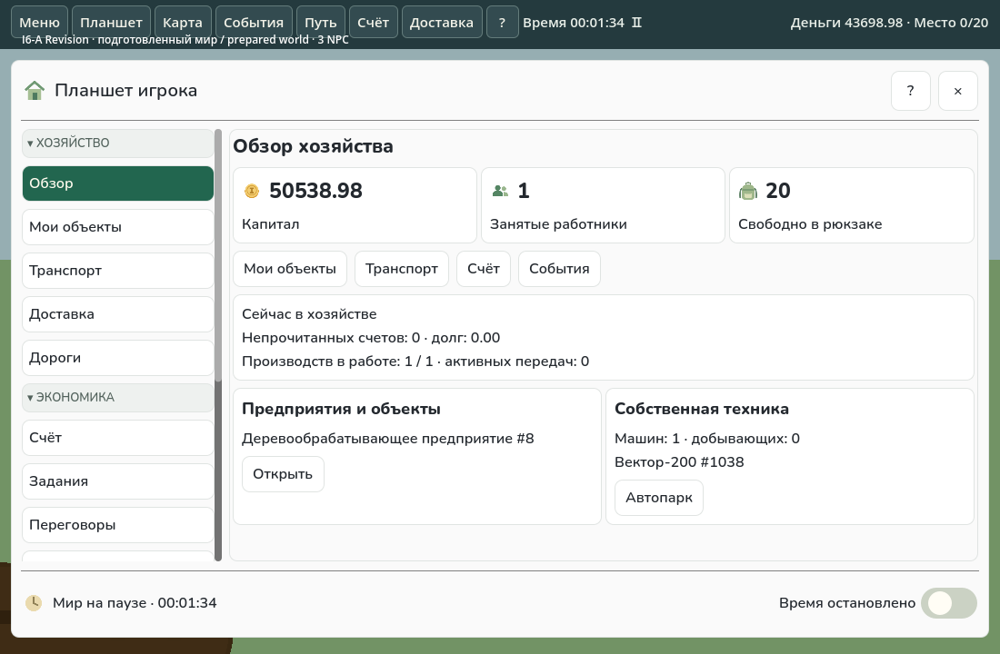
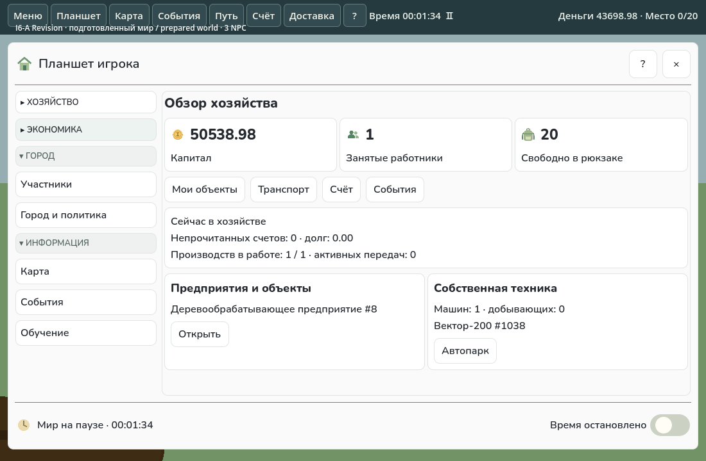
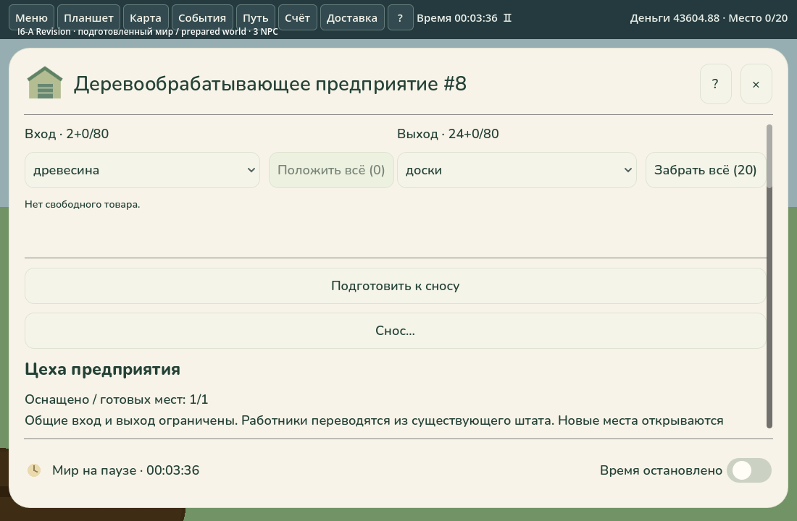
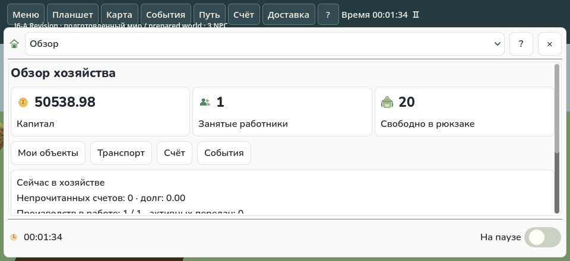

# I6-A Revision — визуальные замечания

Продолжение ветки `feat/vnext-i6a-tablet-prototypes` и **Draft PR #84**. Основа — I5/PR #83 (`f369d91`); первая версия I6-A — `566b0b2`. Ни I6-B, ни I7/I8 не начаты. Core, экономические правила, NPC и схемы сохранений не менялись.

## Результат

У планшета игрока сохранены обзор, собственные объекты, страницы и спокойное оформление. Четыре группы навигации независимо сворачиваются, меняют стрелку и имеют hover/focus/pressed-состояния. Кнопки страниц занимают одинаковую ширину колонки **220 логических px**, имеют высоту 40 px и левое выравнивание. Длинные подписи сокращаются с полной подсказкой. Сворачивание не меняет текущую страницу; обычный Refresh не сбрасывает группы. Deep link раскрывает нужную группу. `FitControls` больше не обходит левую навигацию; действия справа остаются компактными.

Отклонённый `CompactProductionTablet` удалён вместе с `compactPrototype`. Производство снова использует прежние `HouseholdObjectCard`, `WorkshopPanel`, `DevelopmentPanel`, склад, логистику, рецепты и модернизацию. Локальное открытие с карты и из «Моих объектов» идёт в старый объектный планшет с прежней темой. Удалённый просмотр сохраняет прежнюю карточку внутри планшета игрока и ограничения доступа; он не начинает движение сам. Другие планшеты не получили новую дизайн-систему.

У производства добавлены небольшие строки возле входа и выхода: явный выбор товара и **«Положить всё (N)» / «Забрать всё (N)»**. Такие же быстрые операции есть рядом с количеством в `StoragePanel`; в `FleetPanel` — **«Всё (N)»** рядом с количеством. Это одна обычная команда `Transfer`, без цепочки автоматических переводов. Общий `ManualTransferChoice` учитывает свободный физический запас, резервы, объём единицы, вместимость, допустимость товара по существующим опубликованным определениям, pending, активную передачу, занятость и `AccessFor`. Ноль отключает действие с причиной. При нажатии выбор пересчитывается; окончательное подтверждение остаётся Core. Прежние режимы `one`, `selected`, `all` сохранены.

Целевая мобильная ориентация — **только landscape**. В проекте явно задано `display/window/handheld/orientation=0`; Android preset уже содержал `screen/orientation=0`. У короткого планшета игрока меньше отступы, шапка и подвал; выбор страницы находится в шапке вместо боковой колонки. Адаптация учитывает и ширину, и высоту. На 960×440 и 800×360 остаётся не менее 180 px рабочей области, закрытие и пауза закреплены. Внешней двойной прокрутки нет. Портретный интерфейс больше не является целью приёмки.

## Четыре новых снимка настоящего Godot

Это явно подготовленная **«Малая долина», человек + три обычных NPC**, с заданными стартовыми деньгами/предприятием. Машина куплена обычной командой; древесина добыта и перенесена физически; доски действительно произведены. Это не исследование естественного прогресса. Снимки первой версии I6-A не являются результатом Revision.

## Ограниченные проверки

Обычная Godot/.NET сборка (Godot 4.7.2, SDK 10.0.401) и AssemblyAudit прошли без ошибок/предупреждений. Затем выполнен один объединённый native smoke, а после выявленных ошибок повторялись только переносы и незавершённые landscape-проверки. Игровые зависимости и импортированные ресурсы переиспользовались; последние изменения только probe собирались без повторной игровой сборки. Успех отдельных завершённых фаз не выдаётся за успех охватывавшего их упавшего процесса.

- Навигация: реальные mouse/keyboard/touch, одинаковая геометрия кнопок, независимость групп, Refresh, сохранение страницы, deep link, оба пути старого предприятия и прежняя тема.
- Переносы: реальные 1 и 3 единицы, выбранный товар, Store all, **18 досок в источнике → 7 в рюкзак**, отсутствие превышения вместимости и повторной отправки, отключение при полном рюкзаке, складская клетка и кузов машины. Зарезервированный запас/место и объём товара отдельно проверены общим preview. Удалённый доступ дополнительно проверен с **11 реально доступными досками и свободным рюкзаком**: `NotAtLocation`, без изменения мира.
- Landscape: RU 960×440 и EN 800×360, нативный выбор пункта/переход к соответствующей странице, видимые close/pause, реальные touch-нажатия паузы и закрытия, checkpoint round trip. Для всплывающего меню использован X11/XTest; вызов `Select`/`EmitSignal` не заменял приёмку мобильной навигации. Проверка журналов заключительного native-процесса прошла прежним `verify_platform_probe.py`.

Исходные отказы сохранены: первый общий запуск выявил попытку положить зерно в отраслевой вход; исправлен UI preview, складская операция проверена на собственной клетке. Повторные отказы popup-проверки относились к маршрутизации синтетического ввода и неверному предположению о строке под курсором при другой высоте окна. Переключатель проверен реальным X11 вводом и соответствием события выбранной строке. Сводка завершённых фаз: [revision-results.json](verification/i6a/revision-results.json); полные receipts/исходные ошибки: [revision-attempts.json](verification/i6a/revision-attempts.json); SHA входов и изображений: [revision-inputs.json](verification/i6a/revision-inputs.json).

Не запускались другие карты, матрицы NPC/сложностей и длительные экономические прогоны. Обязательный GitHub CI не менялся и вручную не дублировался. Это Linux/llvmpipe и синтетический ввод, а не аппаратная приёмка Android/Windows или экспорт APK.

Воспроизведение: `python scripts/check_i6a_native.py --output work/i6a-revision/fresh --godot /path/to/Godot_v4.7.2-stable_mono_linux.x86_64`. Нужны .NET 10.0.401, Xorg/dummy и libXtst. Для точечного повторения предусмотрены `--case navigation|transfers|landscape|landscape-800`, `--prepared <прошлый запуск>`; `--probe-only` разрешён только при побайтно неизменных игровых исходниках.

## Мини-аудит и границы

Взята существующая матрица I5, повторного аудита 96 команд не было. [12 частых UX-сценариев](verification/i6a/revision-ux-audit.csv): исправлены быстрые переносы и недопустимые товары во входе; остальные команды сохранены. Для отдельного согласования I6-B перечислены порядок собственного автопарка/автосалона, длинные каталоги рецептов/маршрутов, единый редактор персонала и безопасный быстрый возврат отдельного overflow lot. Прежний производственный экран по решению пользователя остаётся длинным; новая композиция для него не проектировалась. Состояние групп сохраняется в открытой рамке, но не записывается в сохранение игры.

Следующий шаг — повторная визуальная оценка пользователя. PR остаётся Draft, без merge.
