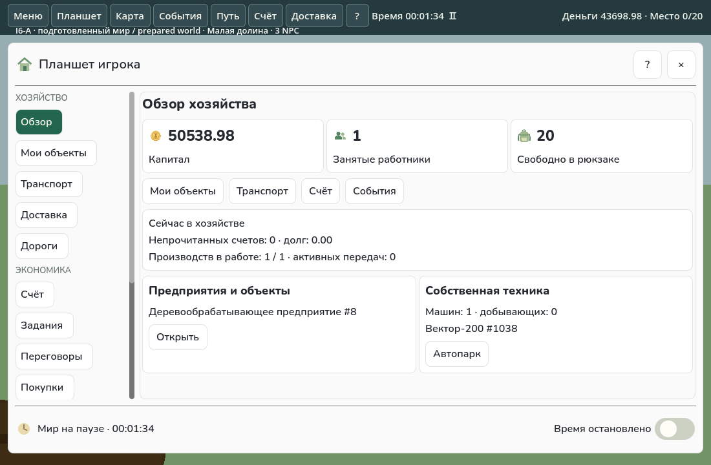
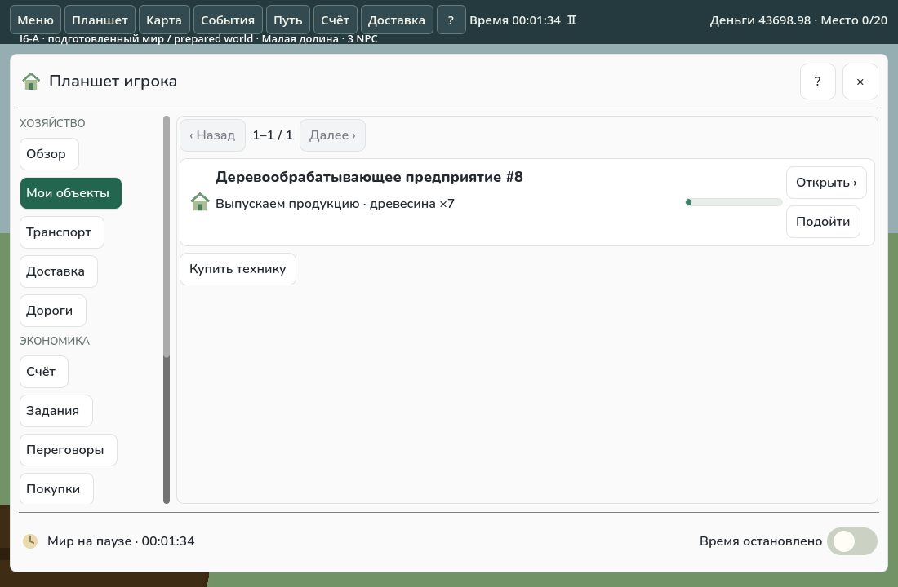
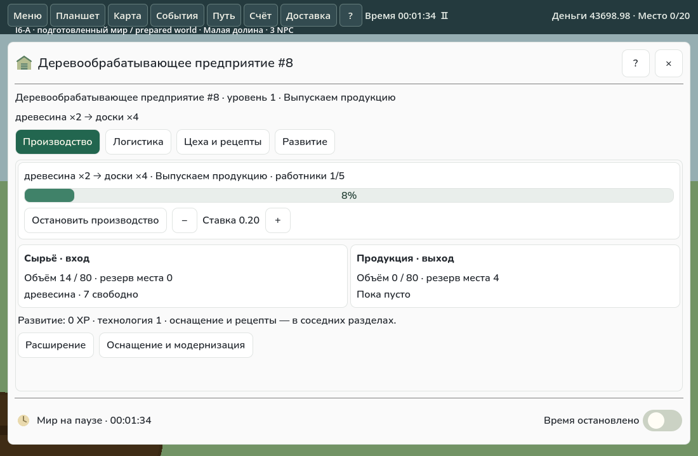
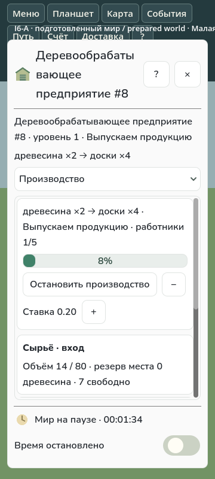

# I6-A — два прототипа планшетов

Основа: `feat/economic-cycle-p00-p05`, merge I5 / PR #83 — `f369d91c78aa7df44fbec62bbfe5c0e61c34510a`.
Ветка: `feat/vnext-i6a-tablet-prototypes`. Результат предназначен для визуального согласования; PR остаётся Draft. I6-B не начат.

## Что изменилось

Прежде планшет игрока совмещал горизонтальные вкладки, длинный обзор с раскрывающимися разделами и два вложенных вертикальных ScrollContainer. В карточке предприятия блоки склада, развития и цехов предшествовали основным командам; зарплата находилась в раскрывающейся группе.

Теперь у игрока слева сгруппированная навигация, справа — самостоятельные рабочие страницы. Обзор показывает капитал, занятость, свободный объём рюкзака, непрочитанные счета/долг, работу производств, собственные объекты и технику. Действия ведут к настоящим объектам, автопарку, счёту и событиям. Существующие компоненты доставки, дорог, заданий, переговоров, покупок и города сохранены. На узком экране вместо боковой панели используется переключатель разделов.

Производственный прототип включён только для типа `woodworking` — деревообрабатывающего предприятия «Малой долины». На первой странице находятся рецепт, состояние и прогресс цехов, персонал, остановка/запуск, ставка с кнопками −/+, фактические входные/выходные запасы и резервы места. Логистика, цеха/рецепты/модернизация и развитие доступны отдельно через один переход. Прежние действия переноса, маршрутов, оснащения, расширения и сноса сохранены во вторичных разделах.

Общая рамка получает новое оформление только через `UseCompactFrame()`. Прочие планшеты и отрасли сохраняют прежние компоненты и оформление. Кнопки двух прототипов подбирают ширину по подписи и ограничивают её доступным местом; высота области касания — от 40 px. У рамки нет внешней прокрутки, заголовок/закрытие/пауза закреплены. Навигация и текущая страница прокручиваются отдельно; у каждой страницы остаётся собственный ScrollContainer. Последний раздел игрока сохраняется при перестроении рамки в текущей сессии.

## Реальные снимки Godot

Все четыре изображения получены из нативного Godot 4.7.2 Mono. Это **явно подготовленный тестовый мир**, не естественный экономический прогресс: обычный профиль I4, карта `compact-valley`, человек и три обычных NPC-контроллера; человеку заданы деньги, собственный участок и первоначально укомплектованная деревообработка. Покупка машины, добыча древесины, доставка на вход и запуск производства выполнены обычными командами. Над планшетами видна пометка подготовленного мира. На производственном снимке есть настоящая незавершённая партия и резерв выходной вместимости.

### Игрок — обзор хозяйства, RU 1100×720



### Игрок — собственные объекты, RU 1100×720



### Деревообработка, RU 1100×720



### Деревообработка, RU 360×800



## Проверки

- Успешная обычная сборка Godot/.NET с locked restore, Godot SDK 4.7.2 / .NET SDK 10.0.401; 0 ошибок и предупреждений. Проверка AssemblyAudit обычной сборки прошла до добавления изолированного probe; зависимости Core/Hosting/NPC при сборке probe не меняются.
- Один полный целевой native smoke: RU 1100×720, EN 1280×720, RU 360×800, оба прототипа. 266 проверок: открытие/закрытие, рабочие разделы, открытие собственного объекта, автопарк, отсутствие внешней прокрутки и горизонтального выхода кнопок, видимость основных команд на первом экране ПК, сохранение Control при Refresh во время нажатия, пауза и ровно одна отправка команды, настоящий Stop/Start, ожидающая зарплата в Core и обновление после тиков, вторичные разделы, мобильные переключатели, загрузка подготовленного checkpoint и проверка инвариантов.
- После визуальной проверки мобильного снимка уменьшены только стрелка переключателя и высота кнопок заголовка. Заключительная мобильная проверка прошла: 44 проверки за 21,685 с, в том числе высота переключателя ≤44 px и кнопки закрытия 44 px. Полный предшествующий прогон занял 91,188 с.
- Широкий прогон и заключительный мобильный прогон проверяются прежним `verify_platform_probe.py`: одного exit=0 недостаточно. Свидетельства — [native-full.json](verification/i6a/native-full.json), [native-mobile.json](verification/i6a/native-mobile.json), [checks.json](verification/i6a/checks.json), [inputs.json](verification/i6a/inputs.json).

Не запускались другие карты, матрица сложностей/числа NPC, экономическое исследование или полное ручное повторение I1–I5. Автоматический обязательный GitHub CI не изменён и выполняется обычным образом для PR.

Исходные неудачи не считаются успехом: при разработке исправлены две ошибки компиляции, затем два визуальных дефекта ширины кнопок/подписи ставки. Два диагностических native-прогона остановлены после обнаружения дефектов; отдельно сохранён отказ запуска Xorg без разрешённого сетевого контекста. Последующие прогоны используют уже импортированные идентичные ресурсы и собранные зависимости. Краткие receipts: [attempts.json](verification/i6a/attempts.json).

Воспроизведение полного ограниченного smoke из корня репозитория, с установленными .NET 10.0.401, Godot Mono 4.7.2 и Xorg/dummy:

```sh
python scripts/check_i6a_native.py --output work/i6a/fresh --godot /path/to/Godot_v4.7.2-stable_mono_linux.x86_64
```

Для точечного повторения мобильной компоновки после изменения только UI:

```sh
python scripts/check_i6a_native.py --output work/i6a/mobile --prepared work/i6a/fresh --case mobile --godot /path/to/Godot_v4.7.2-stable_mono_linux.x86_64
```

## Компоненты и границы

Изменены `PlayerTablet`, `HouseholdObjectCard`, `Playfield.Tablets`, opt-in метод `TabletPanel`; добавлены `CompactTabletDesign` и `CompactProductionTablet`. Добавлены изолированный `I6ATabletProbe`, скрипт воспроизведения и запрет probe в ordinary AssemblyAudit. Core, экономические формулы, NPC, конфигурации и схемы сохранений не менялись.

Это прототип, а не массовая миграция. Вторичные страницы используют прежние, местами длинные формы; логистические переносы и полный каталог рецептов ещё не получили новую компактную композицию. Обзор показывает до трёх объектов и двух названий машин; полный список доступен в собственных объектах/автопарке. На телефоне запасы и дополнительные команды могут требовать прокрутки. Положение прокрутки хранится при переключении страниц существующей рамки, но не сериализуется в сохранение и не восстанавливается после её закрытия. Другие планшеты и игровой HUD не переработаны; аппаратная приёмка Windows/Android не заявляется (Linux, llvmpipe, синтетический ввод).

Следующий шаг — визуальное решение пользователя по этим двум примерам. I6-B требует отдельного задания.
