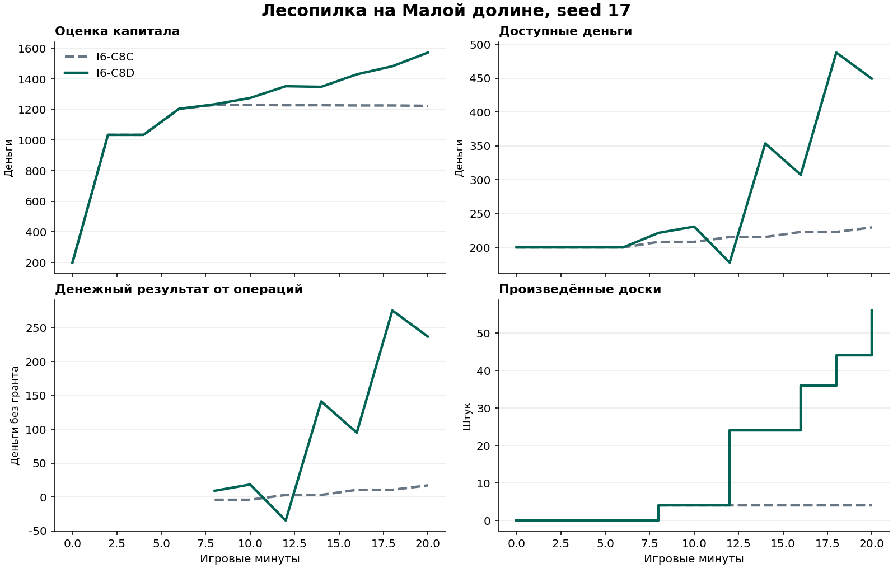

# I6-C8D / P77 — сбыт, расходы и масштаб производства

Автор — Шелестов Максим Евгеньевич. Основа исследования — `master` на `bf07d1721e21c800659751cc2c38ca953bb2e52e`.

## Результат итерации

Обычные новые партии Малой долины, Лесного края и пользовательских карт получают профиль `vnext-i6c8d-economic-balance-1` поверх программы поддержки I6-C8C. Столица каждый период финансирует конечную корзину с заказами на все четыре стартовых продукта. Часть бюджета учитывает недавний выпуск. Входящий рейс из собственного склада использует доступную грузоподъёмность, когда всем цехам предприятия требуется один и тот же компонент.

До 20-й игровой минуты на обеих картах все четыре управляемые стартовые цепочки показали положительный денежный результат по столичным продажам за вычетом фактически выплаченных производственных зарплат и электричества. Первая выплата получена между 3:48 и 8:09. Покупка второй технологии и естественное прохождение I–V остаются открытыми проверками P77.

## Источник и область изменений

- PR [#107](https://github.com/MaksShelest/Delsk/pull/107) ввёл действующую поддержку. Один участник получает одно право на участок, первое строение, физическую поставку и операционный резерв. Проверка отчёта сверяет проводки целевого финансирования. Разовый резервный выкуп остаётся доступным при отсутствии открытого заказа.
- PR [#108](https://github.com/MaksShelest/Delsk/pull/108) исправил восстановление архивов и ускорил маршрутизацию. PR [#109](https://github.com/MaksShelest/Delsk/pull/109) обновил обычный старт и подсказки. Геометрия берётся из прежних снимков `compact_valley_i6c8c` и `woodland_region_i6c8c`. При новом старте `OrdinaryNewGame.Resolve` применяет профиль к карте и сохраняет уже разрешённую конфигурацию.
- H1 обнаружил медленное строительство, слабый Hard и ограничения длинных прогонов. H2 проверил восстановление старых миров и измерил горячие фазы. H3 подтвердил компактные карты и оставил темп II–V, зрелый Hard и реальную окупаемость открытыми. Их численные результаты относятся к прежним профилям. [H1](IMPLEMENTATION_REPORT_H1_POST_G2.md) · [H2](IMPLEMENTATION_REPORT_H2.md) · [H3](IMPLEMENTATION_REPORT_H3.md)
- На исходном `master` были открыты PR [#45](https://github.com/MaksShelest/Delsk/pull/45) и [#60](https://github.com/MaksShelest/Delsk/pull/60). Для `bf07d17` Core завершился успешно за 22:16, H2 за 13:27. [Core](https://github.com/MaksShelest/Delsk/actions/runs/44059496428) · [H2](https://github.com/MaksShelest/Delsk/actions/runs/44059496417)

| Наблюдение в I6-C8C | Причина | Изменение и проверка | Риск |
| --- | --- | --- | --- |
| За 11 периодов до t600 обе карты дали 0 заказов на сыр. В человеческих прогонах после 7 произведённых единиц оплачена 1 из резерва провинции | Сыр стоит 50,00. Общий бюджет, распределённый между 34 позициями, обычно даёт этому товару меньше цены одной единицы | Заказ минимум на каждую из четырёх позиций. Отдельный аудит проверяет количество, замороженную цену, сумму резерва и возврат остатка | Доля других товаров в корзине меняется. Объём проданного сырья измерен отдельно |
| На Малой долине за t1200 по стартовой лесопилке опубликовано 5 заказанных досок при наличии выпуска и ожидании игрока на терминале | Рост общего бюджета использует городской выпуск, распределение между товарами почти целиком зависит от волны | Часть остатка после минимума распределяется по выпущенным товарам. Для заказов действует потолок, привязанный к числу участников | В периодах с высокой загрузкой некоторые цепочки останутся ограничены конкретными заказами |
| Контрольный склад на 15 единиц заполнялся восемью рейсами с экипажем | В многоместной системе автоподвоз ограничивался потребностью одного рецепта даже при единственном входном товаре | Два рейса на 10 и 5 единиц. Проверены загруженный checkpoint, заполнение, простой и автоматическое возобновление | Для нескольких входов сохраняется прежнее поштучное резервирование места для остальных компонентов |
| Hard не произвёл товар к t3600, первый платёж по гранту зависел от расстояния и загрузки | Гипотеза о приоритетах Hard не изолирована. Стройка и доставка материалов требуют обычных перемещений | Алгоритм выбора целей и механика стройки сохранены. Отдельно измерены NPC и команды человека | На длинной траектории возможен прежний тупик развития |

## Параметры

| Параметр | I6-C8C | I6-C8D |
| --- | --- | --- |
| Минимальная цена единицы и отображение | 100 minor на одну единицу денег | 100 minor. Русский интерфейс показывает 0,15, 2,50, 17,00, английский использует точку |
| Примеры базовых цен и зарплаты | Дерево 5,00, зерно 3,00, хлеб 21,00, базовая ставка 0,15, шаг 0,02 | Те же цены и ставки |
| Начальные деньги, цена участка 2×3 | 200,00 и 600,00 | Те же величины и целевое покрытие первого участка |
| Столичный период / расчёт / срок заказа | 60 тиков / действующее окно сделки / 180 тиков | Те же сроки и рыночные волны |
| Базовый бюджет на 4 участников и коэффициент выпуска | 200,00 и 11/10 | 200,00 и 11/10 |
| Верхний предел цели по базовым ценам на период | Определялся выпуском | Шестикратный базовый бюджет после масштабирования состава. 1 200,00 на 4 участника |
| Минимальная корзина | По 1 товару на добываемый вид | Дополнительно по 1 единице досок, муки, сыра и щебня |
| Резерв по недавнему выпуску | Весь остаток распределялся по волнам | До 50% остатка после минимума распределяется по базовой стоимости выпуска за три периода. Количество дополнительно ограничено выпуском. Свободный остаток распределяется по волнам |
| Входящий рейс на склад производства | В цеховой модели до потребности одного рецепта | Для одного общего ингредиента до вместимости транспорта, свободного места и наличия товара |
| Состав рецептов, XP, модернизации, импорт, техника | Рецепты V1–V3, уровни I–V и существующие цены | Те же параметры |

Целевой потолок выражен в базовых ценах. Резерв столицы вычисляется по фактическим ценам заказов. При закрытии окна деньги переходят продавцу за выделенное количество. Остатки истекающих заказов возвращаются во внешний контур. Сглаживание городского выпуска, ручной сбыт и торговля участников используют те же денежные счета. Провинциальный выкуп и стартовый резерв видны отдельными строками в журнале.

Новые поля сериализуются только при включении. Экспорт I6-C8C совпал с исходным байт в байт. SHA-256 полного баланса `5352b6e48b39f4548ddb0fea404603ed200528798b6a40130d521648dc65765d`, экспорта I6-C8C `86e334640b0990063e51dea5117c479866aec1f2aa99a0830b89cc09212ba645`, I6-C8D `4ba9603431be9ba4f3af19e4cfb6ff78576e8a79a1863df9489b85b38dbe3833`. При создании мира хеш профиля попадает в его provenance. Загрузка использует параметры, контрактные цены и остатки из самого сохранения.

## Управляемый старт

Человек исполнял воспроизводимую стратегию обычными командами. Старт — 200,00, пустые склады, три участника с политикой голосования за себя. Измерение отделяет пешеходную тактику владельца от конкуренции NPC. В производственной группе человек получает обычную субсидию, перевозит материалы с терминала, строит, добывает сырьё для следующих партий и продаёт продукцию небольшими лотами. Каждый тик — одна активная игровая секунда.

Срез t1200, seed 17. Операционный результат в таблице равен оплаченным столичным продажам за вычетом зарплаты и электричества. Для сыров из I6-C8C разовый выкуп 50,00 учтён отдельно. Показатель охватывает только денежные операции по продаже и производству.

| Карта · товар | Первая выплата t, C → D | Весь стартовый выпуск продан t, C → D | Выпуск / оплачено, C → D | Выручка столицы, C → D | Прямые расходы, C → D | Операционный результат, C → D |
| --- | ---: | ---: | ---: | ---: | ---: | ---: |
| Малая долина · доски | 473 → 473 | 1147 → 491 | 4/4 → 56/44 | 28,31 → 405,54 | 11,12 → 168,38 | 17,19 → 237,16 |
| Малая долина · мука | 483 → 483 | 607 → 489 | 24/10 → 44/44 | 85,84 → 391,21 | 70,47 → 129,82 | 15,37 → 261,39 |
| Малая долина · сыр | 420 → 425 | 420 → 425 | 7/1 → 11/7 | 0 → 363,96 | 125,31 → 210,07 | −125,31 → 153,89 |
| Малая долина · щебень | 489 → 489 | >1200 → 501 | 5/4 → 45/38 | 29,26 → 304,97 | 13,90 → 132,60 | 15,36 → 172,37 |
| Лесной край · доски | 228 → 228 | 907 → 307 | 24/5 → 64/64 | 36,11 → 584,23 | 70,47 → 198,45 | −34,36 → 385,78 |
| Лесной край · мука | 228 → 228 | 307 → 307 | 24/15 → 64/63 | 131,18 → 555,40 | 70,47 → 189,17 | 60,71 → 366,23 |
| Лесной край · сыр | 225 → 230 | 225 → 230 | 7/1 → 17/13 | 0 → 655,36 | 125,31 → 318,70 | −125,31 → 336,66 |
| Лесной край · щебень | 234 → 234 | 1147 → 252 | 5/5 → 85/84 | 37,44 → 692,27 | 13,90 → 251,30 | 23,54 → 440,97 |

Вычет всей использованной партии сырья по базовой стоимости, включая полученные от провинции компоненты, оставляет на t1200 от 9,89 до 287,97 на восьми маршрутах I6-C8D. Доля тиков с начисленной зарплатой от всей партии составила 23,2–47,3% по этим маршрутам. Начало восстановления денег не равно гарантии дальнейшей окупаемости. Данные по каждому прогону, включая отдельно материал, зарплату, электричество, бесплатный резерв, доступные деньги и оценку имущества, приведены в [CSV стартов](verification/i6c8d/ordinary-starts.csv).



## Ручная добыча и производство

Стратегия добычи использует тот же старт, специализацию, карту и seed. Владелец наполняет рюкзак, идёт на терминал и продаёт сырьё по реально доступным заказам. Провинциальный пакет в этой группе остаётся доступным. Сравнение на t1200 учитывает ходьбу, добычу, обработку и ожидание расчёта в одном горизонте. Рыночные волны совпадают при одинаковом seed. Распределение заказов реагирует на фактические действия в каждой партии.

| Карта · готовый товар | Сбыт сырья C → D | Операционный результат переработки D | Результат D с вычетом стоимости сырья | Денежное отношение D, переработка / добыча |
| --- | ---: | ---: | ---: | ---: |
| Малая долина · доски | 183,57 → 100,10 | 237,16 | 87,16 | 2,37× |
| Малая долина · мука | 147,41 → 102,12 | 261,39 | 162,39 | 2,56× |
| Малая долина · сыр | 178,34 → 100,57 | 153,89 | 9,89 | 1,53× |
| Малая долина · щебень | 153,03 → 87,47 | 172,37 | 91,37 | 1,97× |
| Лесной край · доски | 183,57 → 100,10 | 385,78 | 215,78 | 3,85× |
| Лесной край · мука | 147,41 → 102,12 | 366,23 | 222,23 | 3,59× |
| Лесной край · сыр | 184,56 → 100,57 | 336,66 | 120,66 | 3,35× |
| Лесной край · щебень | 153,03 → 90,65 | 440,97 | 287,97 | 4,86× |

Продажа сырья всё ещё даёт первую выручку за 1:12–2:56. Её общий доход на t1200 снизился на 31–45% из-за изменения корзины. Поэтому отношение 1,53–4,86 внутри I6-C8D включает изменение обоих каналов сбыта. При сравнении с ручной добычей **I6-C8C** отношение составляет 0,86–2,88. Сыр на Малой долине остаётся ниже этого более строгого ориентира. Цены, рецепты и качество техники в этом контрасте одинаковые. Для оценки прибыльности партии в отдельной колонке учтена базовая цена всего использованного сырья. [Сопоставление с журналами выплат](verification/i6c8d/strategy-comparison.csv)

На t2400 завершились 12 пар по тем же стратегиям. Для seed 17 проверены все четыре отрасли на обеих картах. Для seed 42 дополнительно проверены деревообработка и молочная цепочка. Отношение операционного результата к добыче внутри I6-C8D составило 2,72–5,41, к добыче в I6-C8C — 1,71–3,62. Осторожный критерий устойчивого результата в пределах теста — положительное сальдо после первой полной продажи, затем два дальнейших прироста, без отрицательного среза в оставшихся точках. При частоте срезов 120 тиков наблюдаемое начало составило 4–14 игровых минут во всех 12 парах I6-C8D. В первом прогоне ручной добычи молока на Малой долине подача команды совпала с паузой выборов. После явной обработки обычных бюллетеней повтор достиг t2400. [Данные 40-минутных прогонов](verification/i6c8d/human-2400.csv)

Целевая поддержка даёт доступ к земле и первому производству, покрывая стартовые затраты на сумму около 1 000–1 100. В измеренной выручке I6-C8D на t1200 присутствуют только столичные расчёты. Операционный резерв 12,32–18,48 в зависимости от отрасли отражён отдельно, выручка от первого продукта остаётся рыночной. Для окупаемости без поддержки учитывается полная стоимость участка, материалов, здания, а также фактические затраты подпитки и сбыта.

## Производительность и инвестиции

На подготовленном участке II уровня сравнили один оснащённый цех и два. Те же цены реального рецепта досок, одинаковые 80 тиков работы, исходно заготовленное сырьё и конечный действующий заказ на 60 досок по 9,00. После оплаченной продажи один цех дал 16 досок, 144,00 выручки и 33,17 после зарплаты, электричества и оценки потреблённого дерева. Два дали 32, 288,00 и 66,34. Оснащение второго потребовало 150,00 и материалы ценностью 79,00 по базовым ценам. Эксперимент начинается после подготовки земли, уровня предприятия и доступа к местному сбыту. Прирост 33,17 за такое окно показывает денежную отдачу от второго цеха при достаточном штате и сбыте.

Отдельный контроль входящего маршрута имеет одинаковый путь, 15 мест в приёмном складе и 30 единиц в исходном. Сравнено 8 рейсов против 2 и 32,00 против 8,00 зарплаты экипажа до заполнения. При полном складе новая доставка ожидает без зарезервированных денег. Производство освобождает место и тот же маршрут отправляет следующий рейс без новой команды. Сохранение в пути, продолжение и replay совпали с непрерывным результатом. Это упражнение на физический подвоз и оплату труда. Транспортный менеджмент целого города и сроки выбора грузовика в естественной партии остаются отдельным измерением.

[Расчёт для каждого доступного рецепта и уровня I–V](verification/i6c8d/workshop-capacity.csv) использует `ceil(FullStaffTicks × 100 / Rate)` и штатную шкалу работника 25, 45, 65, 85, 100. Показаны предельные единицы в минуту, прирост от каждого сотрудника, себестоимость с сырьём, зарплатой и электричеством и стоимость здания, оснащения и модернизации в базовых ценах. Колонки окупаемости делят соответствующие вложения на предельный прирост маржи при полном сбыте и нулевых транспортных расходах. Переход к V3 последовательно включает инвестицию V2. Для нового семейства рецептов без аналога на предыдущем уровне сравнение ступеней пропущено. Это нижняя граница времени при заданных ценах. К примеру, у досок на V1, V2 и V3 себестоимость при пяти рабочих составляет 5,58, 4,77 и 4,23, а пять цехов V3 дают до 90 досок в минуту на входящем потоке 30 брёвен в минуту. Для окупаемости при живом спросе нужны отдельные данные по загрузке, цене и продажам.

Максимум для лесопилки при пяти работниках в каждом оснащённом цехе и при продаже всего выпуска по 9,00 за доску.

| Ступень и рецепт | Выпуск в минуту | Маржа в минуту после сырья, труда и энергии | Разовые вложения на ступени | Нижняя граница окупаемости ступени |
| --- | ---: | ---: | ---: | ---: |
| I, V1 | 15,00 | 51,30 | 995,00 | 19,40 мин |
| II, V1 | 30,00 | 102,60 | 984,00 | 19,18 мин |
| III, V1 | 45,00 | 153,90 | 2 153,00 | 41,97 мин |
| IV, V2 | 66,67 | 281,87 | 8 377,00 | 65,46 мин |
| V, V3 | 90,00 | 429,00 | 24 640,00 | 167,47 мин |

При естественном спросе маржа ниже, когда покупатель принимает только часть партии. Для выбора оснащения можно сравнить эти значения со своим темпом сбыта. Например, предельный выпуск двух цехов — 30 досок в минуту, а в контролируемом старте Малой долины t1200 оплачено в среднем 2,2 в минуту вместе со стройкой. Для техники требуется измерить сэкономленное время и оплату экипажа при конкретной вместимости и пути. У машины «Муравей-70» каталожный порог составляет 1 300,00. Стоимость клетки дороги I по базовым материалам — 18,00 до труда. Их фактическая окупаемость пока открыта.

Для текущих настроек пригодны собственный склад с включённым автоподвозом, исходящий маршрут на собственный склад или обеспеченный контракт и независимые выключатели входа, выхода и работы. Для многокомпонентных партий входящий маршрут резервирует место под комплект. На следующей итерации имеет смысл показывать игроку причину ожидания и ожидаемое заполнение ближайшего рейса на карточке маршрута. Тогда дефицит сырья можно отличить от переполнения без обхода каждого предприятия.

## Алгоритмические NPC

12 пар t3600, две карты, три сложности, seeds 17 и 42, по три алгоритмических NPC. Человеческий участник только голосовал. Разные стартовые предпочтения человека не дают ему фабрику или запас. Десять замеров I6-C8D выполнены после изменения спроса, до включения нового размера рейса, два повтора выполнены на полном профиле. Во всех этих траекториях число квитанций входящей автодоставки равно нулю. Повтор Лесной край / Medium / seed 42 завершён после первого локального timeout, Hard / seed 42 после запуска с предварительным файлом профиля. Данные двух попыток различаются в журнале и не смешиваются. Итоги ниже складываются по четырём независимым партиям каждой сложности. [Данные NPC и хеши миров](verification/i6c8d/npc-results.csv)

| Сложность | Выпуск, C → D | Оплачено столицей, C → D | Разовый выкуп провинции, C → D | Прямые расходы, C → D | Изменение наличных с начала, C → D |
| --- | ---: | ---: | ---: | ---: | ---: |
| Easy | 284 → 1 079 | 1 658,88 → 9 632,15 | 422,00 → 300,00 | 2 112,90 → 5 000,69 | −268,78 → +2 694,70 |
| Medium | 270 → 1 289 | 1 688,80 → 9 604,17 | 422,00 → 300,00 | 2 066,03 → 5 542,37 | −591,99 → +2 325,04 |
| Hard | 0 → 0 | 0 → 0 | 0 → 0 | 0 → 0 | 0 → 0 |

Прямые расходы включают фактический импорт, зарплаты, электричество и оплачиваемую обработку. Изменение наличных берётся из счетов и также отражает инвестиции и субсидии. Первая выплата за готовый продукт у Easy/Medium в восьми парах сдвинулась с интервала t367–669 на t391–708. Регулярные выплаты и выпуск выросли, хотя первый расчёт в этих случаях происходил позже. Отказов от команд NPC по каждой сложности было 33 → 33, 30 → 40 и 12 → 12 соответственно. Просроченных контрактов в экспортах этой серии было ноль. В каждом из четырёх прогонов Hard обеих версий капитал производства остался нулевым к t3600. Причинная калибровка Hard требует отдельного опыта.

## Длинная траектория и уровни

Малая долина / Medium / seed 17 / woodworking, обе версии продолжены из checkpoint до t5400. I6-C8C стартовал на t3600, I6-C8D на t2700. Непрерывная попытка C до t7200 завершилась по локальному пределу 270 секунд с последней записью t6281. Непрерывная попытка D до t5400 достигла записи t4229 при том же пределе. Сравнение опирается на завершённые продолжения, а совпадение непрерывного прогона и длинного продолжения остаётся открытым для этой пары.

| Показатель на t5400 | I6-C8C | I6-C8D |
| --- | ---: | ---: |
| Реальные столичные выплаты NPC | 705,23 | 3 683,78 |
| Покупки провинции | 122,00 | 0 |
| Прямые расходы NPC | 663,45 | 1 636,05 |
| Изменение наличных NPC | −203,60 | +1 340,85 |
| Выпуск / экспорт | 110 / 99 | 230 / 225 |
| Самый высокий личный XP одной отрасли | 80 | 126 |
| Максимальная цель бюджета одного периода | 200,00 | 277,68 |
| Внешнее зачисление / возврат и траты внешнему контуру за период наблюдения | 21 530,17 / 18 077,45 | 21 351,27 / 15 071,46 |

Оба повторных продолжения Малой долины достигли t7200 и сохранили промежуточную точку t5400. На двухчасовом горизонте выпуск вырос со 134 до 291 единицы, столичные выплаты с 991,32 до 5 008,89, а итоговое приращение наличных с 28,02 до 2 139,43. Максимум XP отдельной отрасли вырос с 96 до 165. В обеих партиях сохранились три предприятия I уровня. [Хеши и показатели продолжений](verification/i6c8d/npc-results.csv)

| Этап | Ориентир vNext | Проверенный результат |
| --- | --- | --- |
| I | Первое предприятие | Ранний корпус NPC в парной серии на t248 в обеих версиях. Оплаченная продукция человека на t228–489 в I6-C8D |
| II | 1–2 часа, 600 XP | До t7200 на Малой долине максимум 165 XP и здания I уровня. Контрольный опыт двух цехов начинается с готового уровня II |
| III | 4–7 часов, 3 000 XP | Игровой горизонт пока открыт |
| IV | 10–18 часов, 12 000 XP | Игровой горизонт пока открыт |
| V | 20–35 часов, 40 000 XP | Игровой горизонт пока открыт |

На Лесном крае / Hard / seed 17 нулевой выпуск, продажи и XP сохранялись до t7200 в I6-C8C и до t5400 в I6-C8D. В новом профиле сравнили непрерывную партию, загрузку с t2700 и replay до t5400. Хеш мира совпал во всех трёх случаях, хеш контроллеров совпал у непрерывного и загруженного прогона. Совпали байты 13 экспортов, в том числе событий, проводок, команд, спроса и промышленного состояния. [Хеши](verification/i6c8d/checkpoint-replay.json) Проверка фактической окупаемости второй отрасли, машин и дорог остаётся открытой. Ориентир следующего опыта — сначала обеспечить натуральное достижение II, затем повторить пары с импортом, заказами между предприятиями и фактически оплаченной перевозкой.

## Проверки и ограничения производительности

В парном замере `--profile true` (Лесной край, Medium, seed 17, 600 тиков, один запуск на профиль) среднее настенное время фазы Core составил 9,68 → 9,07 мс, p95 полного тика 120,27 → 104,32 мс, размер checkpoint 439 178 → 479 527 байт, пиковая память 188 637 184 → 193 220 608 байт. Оба checkpoint восстановлены с совпадающим хешем. Дополнительные открытые и завершённые заказы увеличили размер записи на 9,2% в этом опыте. Замеры шли в той же среде, где выполнялись другие серии. Так можно зафиксировать размер checkpoint и наблюдаемые задержки, а для оценки малых изменений времени и памяти нужен повтор в изолированном процессе. [Измерения профилировщика](verification/i6c8d/profiler.json)

Независимый аудит `verify_results.py` сверяет баланс денег, количество товара, вместимость, выплаты экипажу, население, столичные расчёты и бюджет провинции. Назначение нового профиля, лимит бюджета, минимальные заказы, одинаковые цены волн, точный вывод денег, загрузка старого мира и новый continuous/load/replay покрыты числовыми тестами.

Сборки Research.Runner, Simulation.Tests и клиента Godot Release завершились с 0 предупреждений и 0 ошибок. Целевой набор 210/210 прошёл за 115,630 с. Python Checks — 49/49, тесты исследовательской лаборатории — 91/91. Полный локальный xUnit завершился по пределу 780 с без итогового результата. Аудит записей Малой долины на t5400 и t7200, непрерывного Лесного края / Hard на t5400 и финального повтора Лесной край / Medium / seed 42 на t3600 прошёл. Отдельный профильный тест подтвердил продажу за деньги при начальном остатке 0.

На промежуточном коммите `c842768` задание Godot `city-ux-native (forms)` завершилось с ошибкой ожидания локализованной суммы русской выплаты. Проверки точных сумм в RU/EN и цен в пояснениях обновлены в `8db1ff3`. Windows Godot platform на этом коммите прошёл все шесть заданий, включая повторный `city-ux-native (forms)`. Текущие результаты после публикации отчёта видны в проверках PR. [Первый прогон](https://github.com/MaksShelest/Delsk/actions/runs/44186913277) · [Успешный Godot platform](https://github.com/MaksShelest/Delsk/actions/runs/44188675050) · [Проверки PR #110](https://github.com/MaksShelest/Delsk/pull/110/checks)

## Воспроизведение

```sh
dotnet build src/Research.Runner -c Release
python scripts/study_i6c8d.py --cohort short --workers 2 --output artifacts/i6c8d-short
python scripts/study_i6c8d.py --cohort human --workers 2 --output artifacts/i6c8d-human
python scripts/study_i6c8d.py --cohort npc --workers 2 --output artifacts/i6c8d-npc
python scripts/study_i6c8d.py --cohort long --workers 1 --output artifacts/i6c8d-long
```

Команды используют один C# исполнитель и образцы экономики лаборатории. Python запускает серии, сохраняет код завершения и сверяет хеши либо анализирует экспорт. Новые данные, команды и вторая симуляция в Python не создаются. Лимиты процесса 180 секунд на ячейку и 270 на длинную ячейку. История NPC сохраняется с существующим сжатием. Изменений времени CI нет.
