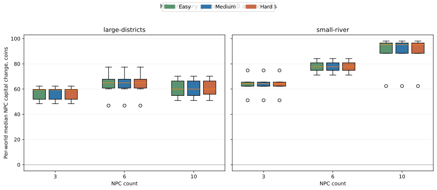
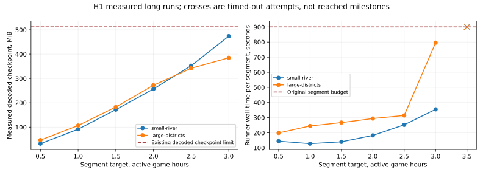

# H1 — исследование экономики после F/G

Автор: Шелестов Максим Евгеньевич. Дата: 29.10.2026, Europe/Samara.

**Статус: ограниченное исследование H1 завершено; полная калибровка P77
не принята из-за измеренных блокеров длительного прохождения.**
PR [#73](https://github.com/MaksShelest/Delsk/pull/73) подготовлен для review, без слияния. G2 завершён в PR
[#72](https://github.com/MaksShelest/Delsk/pull/72) и затем слит владельцем; агент
не выполнял слияние.

## Основа и предмет проверки

Основа H1 — G2 `cf0784be360024b2b6874753a8d231da8b4a8f59`, включая завершённые F2/G1.
Отдельная ветка `feat/vnext-h1-economy-calibration` построена поверх G2; PR73
первоначально зависел от PR72. После его слияния в `b9f59ad8` PR73 перенаправлен
на `feat/economic-cycle-p00-p05`. Инструкция — [ECONOMY_RESEARCH_H1.md](ECONOMY_RESEARCH_H1.md),
ход работы и сохранённые ошибки — [WORKLOG_PACKAGE_H1.md](WORKLOG_PACKAGE_H1.md).

Используется действующий C# `SimulationEngine`/`GameSession` и алгоритмические G1
контроллеры. Python отвечает за очередь, проверки, сохранение данных и статистику.
Цены, карты, правила производства, логистики, зарплат, дорожных платежей, услуг,
World28/session3 и старые сохранения в этой итерации не изменены.

## План и единицы наблюдения

До основной матрицы закреплён [план v2](research/h1/study-plan.json): обе designed
карты × 3/6/10 NPC × Easy/Medium/Hard × seeds42–46, 1800 активных тиков. Затем
для шести NPC добавляются seeds47–51 на обеих картах/трёх сложностях: по десять
парных независимых миров в выбранных сравнениях. Сложность меняется одним фактором.

Человек одинаково не ведёт хозяйства, на выборах голосует за себя. Это исследование
автономных NPC с естественного старта, а не запись действий живого опытного игрока.
NPC одной партии конкурируют за общий спрос, рабочих и ресурсы; их нельзя считать
независимыми повторениями. Единица статистики — мир/seed.

Основная величина — медиана прироста капитала NPC внутри мира, по оценке Core.
Она включает стоимость запасов и активов и не называется денежной прибылью.
Дополнительные величины — реальные оплаченные поступления/затраты, производство,
покупки, опыт, физические ступени и состояния на границе. Ненаблюдавшиеся
производства/ступени цензурируются, не заменяются нулём или последним тиком.

[Статистический протокол](research/h1/analysis-plan.json): median/IQR/min/max,
парные разности; точный двусторонний sign test, Holm по четырём заданным контрастам,
5000 bootstrap-выборок медианы, seed20261029. Короткий горизонт не решает вопрос
превосходства Hard в развитой промышленной экономике даже при узком интервале.

Длинные траектории: обе карты, шесть NPC, Medium/seed42, цель126000 тиков,
сегменты1800, бюджет900 секунд на сегмент, checkpoint/load и аудиты на границах.
Исходный профиль останавливается на5000 тиках (83m20s). Поэтому отдельно объявлено
изменение только `resolved scenario maxTicks` и `controller finalTick`. Эта когорта
имеет другой горизонт планирования и не смешивается с короткой обычной матрицей.
После второго сегмента состояние сравнивается с непрерывным запуском до3600.

## Исправления исследовательских инструментов

Старая лаборатория всегда передавала explicit legacy controller plan. Выбор
`economy.g1-npc.json` не переносил в него G1 coherent settings. Новый явный
`ordinaryNpcCount` вызывает существующий C# `OrdinaryNewGame.Resolve`; запрещены
конфликтующие overrides состава и игнорируемые параметры. Старые планы сохранены.
Фиксируется byte-exact полный balance sibling; режим проверен реальными3/6/10 NPC.

Лёгкий `--progress true` показывает фактический тик, фазу, RAM и время процесса.
Он не меняет Core, не вызывает inspection на каждом тике и не пишет тяжёлые World
frames. На реальных запусках progress on/off и checkpoint/load дали одинаковые
хэши, команды, состояния, экспорты и финансовые проекции. Новый частный экспорт
`personal-accounts.json` нужен исследователю, не публичной карте или NPC.

Учёт отделяет товарную сделку от вознаграждения услуги, funding/refund от дохода,
капвложения от повторяющихся платежей. B1 `ImportPurchase` — оплаченная внешняя
покупка, а не seller0 в старом рынке. Результат после дорожных обязательств вычитает
выставленный остаток и целые ещё не выставленные начисления ровно один раз.
Неизвестный денежный reason даёт явный диагностический остаток и `null` у сравнения
денежного результата. Баланс каждого участника сверяется с ledger.

Покупные стройматериалы пока входят в общие товарные затраты и не распределяются
по активам. Это денежный результат портфеля, не бухгалтерская прибыль отдельного
цеха. Неоценённый личный труд, износ, непроданные остатки и общие затраты не
превращаются в вымышленную полную окупаемость. Расчёт будущей маржи не заменяет
фактические рейсы/выпуск.

Очередь и попытки сохраняются атомарно; завершённые прогоны переиспользуются.
Полный журнал решений хранится lossless gzip с проверкой исходного SHA-256.
Снимки входов и DLL заморожены. Для исправлений только исследовательских оболочек
есть явная запись старого/нового SHA и причины; исходные протоколы сохраняются.
Конфигурационные входы остаются ограничены2MiB, игровые checkpoint —64/512MiB.
Большая собственная очередь и доверенные экспорты читаются отдельно от входных
планов, чтобы продолжение не ломалось на искусственном лимите небольшого плана.

## Подтверждённые контрольные расчёты

Реальные F2 replays, отдельно подготовленные богатые миры, а не обычный старт:

| Исполнение | Получено за услугу, minor | Зарплата водителя | Оплаченная дорога | Денежный результат услуги | Невыставленная дорога | После неё |
| --- | ---: | ---: | ---: | ---: | ---: | ---: |
| Личный водитель | 4025 | 0 | 7 | 4018 | 10 | 4008 |
| Числовая команда | 4025 | 3120 | 11 | 894 | 6 | 888 |

Покупка машины250000minor учитывается отдельно. Покупатель действительно платит
4025 за услугу; это не платёж за товар. Нулевые пени/остаток счетов в этих примерах
не означают отсутствия ещё не выставленного дорожного начисления. Личный труд
первой строки не объявляется бесплатным в экономическом смысле. Один выполненный
заказ не является доказательством окупаемости машины или устойчивого спроса.

## Результаты матрицы и длинных траекторий

### Обычная матрица

Завершены все120 обычных партий:90 пилотных и30 дополнительных, без отказов,
таймаутов или повторных попыток. Все120 независимых проверок учёта и120 проверок
приватности успешны. В каждой из18 групп осталось предусмотренное число миров:
по5 при3/10 NPC, по10 при6 NPC. Суммарно runner-процессы этой матрицы заняли
18474.187s; отдельные процессы47.497–388.858s при исходном бюджете600s.

Во всех120 мирах к1800 (30 активных минут) не построено ни одного производственного
корпуса, нет партий/XP, приобретённых машин, новых дорожных ступеней или услуг.
Все750 связанных NPC-наблюдений времени первого предприятия цензурированы на1800.
I→V не наблюдались. Доля XP заданий здесь **не определена** (0/0), а не0%.
Нанятых работников на границе0; личная добыча и продажи происходили.

Следующая таблица показывает распределение **медианы прироста капитала NPC внутри
мира** по seed. Все числа в minor (100minor=1монета), Q1/Q3 — интерполированные
квартили. Таблица содержит все сложности; одинаковые строки не удалены.

| Карта | NPC | Сложность | Миров | Median | Q1–Q3 | Min–max |
| --- | ---: | --- | ---: | ---: | --- | --- |
| large-districts | 3 | Easy | 5 | 5937 | 5188–5969 | 4839–6232 |
| large-districts | 3 | Hard | 5 | 5937 | 5188–5969 | 4839–6232 |
| large-districts | 3 | Medium | 5 | 5937 | 5188–5969 | 4839–6232 |
| large-districts | 6 | Easy | 10 | 6495.5 | 6080.625–6778.125 | 4687–7739.5 |
| large-districts | 6 | Hard | 10 | 6495.5 | 6080.625–6778.125 | 4687–7739.5 |
| large-districts | 6 | Medium | 10 | 6495.5 | 6080.625–6778.125 | 4687–7739.5 |
| large-districts | 10 | Easy | 5 | 5994.5 | 5488–6637 | 5091–7020 |
| large-districts | 10 | Hard | 5 | 5994.5 | 5588–6637 | 5091–7020 |
| large-districts | 10 | Medium | 5 | 5994.5 | 5488–6637 | 5091–7020 |
| small-river | 3 | Easy | 5 | 6434 | 6228–6548 | 5108–7477 |
| small-river | 3 | Hard | 5 | 6434 | 6228–6548 | 5108–7477 |
| small-river | 3 | Medium | 5 | 6434 | 6228–6548 | 5108–7477 |
| small-river | 6 | Easy | 10 | 7770.75 | 7482.375–8081.375 | 7111.5–8417.5 |
| small-river | 6 | Hard | 10 | 7770.75 | 7482.375–8081.375 | 7111.5–8417.5 |
| small-river | 6 | Medium | 10 | 7770.75 | 7482.375–8081.375 | 7111.5–8417.5 |
| small-river | 10 | Easy | 5 | 9522.5 | 8832.5–9651 | 6235.5–9803 |
| small-river | 10 | Hard | 5 | 9522.5 | 8832.5–9651 | 6235.5–9803 |
| small-river | 10 | Medium | 5 | 9522.5 | 8832.5–9651 | 6235.5–9803 |

У всех NPC касса на1800 выше стартовых20000minor. Минимальный прирост кассы среди
наблюдавшихся NPC:4108small/3006large. Это подтверждает заработок в данном
30-минутном окне; неоплаченный личный труд и запас товара не превращают эту сумму
в чистую прибыль предприятия. Основной денежный источник — реальный CapitalSettlement.
Полные распределения суммарного денежного результата NPC по миру:

| Карта | NPC | Сложности с одинаковым денежным результатом | Median, minor | Q1–Q3 | Min–max |
| --- | ---: | --- | ---: | --- | --- |
| small-river | 3 | Easy/Medium/Hard | 16872 | 16184–20029 | 14641–21597 |
| small-river | 6 | Easy/Medium/Hard | 42461 | 40905.5–45243.25 | 38864–49889 |
| small-river | 10 | Easy/Medium/Hard | 89070 | 77387–89438 | 76592–90478 |
| large-districts | 3 | Easy/Medium/Hard | 16226 | 14896–16682 | 12884–18422 |
| large-districts | 6 | Easy/Medium/Hard | 36862.5 | 34412–38718.25 | 24409–40825 |
| large-districts | 10 | Easy/Medium/Hard | 58058 | 53907–63433 | 46562–63752 |

Это сумма поступлений и затрат всех NPC мира, не результат одного NPC. На этом
раннем горизонте покупки/зарплаты/дорожные обязательства ещё отсутствуют;
на длинной траектории они уже существенно меняют кассу. Сверка начальной кассы,
дебетов, кредитов и конечного остатка прошла для каждого участника всех120 миров.
Неизвестных денежных reason0; сравнения не скрывают неучтённые расходы.

Четыре заранее выбранных контраста при6NPC имеют по10 полных пар:

| Карта | Контраст | Пар | Все парные разности | Median bootstrap95% | Sign p / Holm p |
| --- | --- | ---: | --- | --- | --- |
| small-river | Hard−Medium | 10 | 0minor | [0;0]minor | 1 / 1 |
| small-river | Easy−Medium | 10 | 0minor | [0;0]minor | 1 / 1 |
| large-districts | Hard−Medium | 10 | 0minor | [0;0]minor | 1 / 1 |
| large-districts | Easy−Medium | 10 | 0minor | [0;0]minor | 1 / 1 |

Ненулевых пар0: sign test не получает различающих наблюдений. Вырожденный
bootstrap-интервал описывает эти10 наблюдённых разностей; это не доказательство
эквивалентности трудностей и не предел эффекта в поздней промышленной фазе.
Hard superiority не установлено. В пилотеlarge/10 небольшое отличие капитала Hard
видно вQ1; денежные поступления там совпали. Нельзя подменять это утверждением
«все миры всех сложностей идентичны» или выбирать этот контраст после результата.

На финальных срезах обычной матрицы публичное сырьё не исчерпано полностью,
но84small/105large команды ResourceDepleted подтверждают временные дефициты.
Остатки публичного **свободного** stock (stock−reserved), min–max по60мирам карты:

| Сырьё | small-river | large-districts |
| --- | --- | --- |
| beet | 4–50 | 150–150 |
| copper_ore | 2–50 | 150–150 |
| grain | 60–60 | 180–180 |
| iron_ore | 53–60 | 124–180 |
| milk | 31–40 | 120–120 |
| sand | 1–80 | 161–240 |
| stone | 80–80 | 240–240 |
| wood | 59–60 | 180–180 |

Покупок импорта в обычной матрице0, при наличии на1800 квотsteel24/glass12/asphalt20
и по60 остальных пяти позиций, следующая поставка2400. Это не доказательство
дешевизны или достаточности импорта для следующей ступени. Точные индивидуальные
срезы квот и спроса сохранены в observations.json.

Капитал принял8322 из14526 запрошенных единиц наsmall и8319 из17841 наlarge,
суммарно по60мирам каждой карты. Повторные заявки входят в requested: это доля
удовлетворённых заявленных количеств, не оценка уникального неудовлетворённого
спроса. Основной сбытsmall: sand3813/copper_ore2751; large: sand5808/iron_ore2415.
Отраслевой HHI производства на1800 не определён: предприятий ещё нет.

Переполнение, потери overflow, выставленный долг, пени и traffic wait на финальных
срезах0. Заполненных ограниченных инвентарей на этих срезах0. Это отсутствие
наблюдавшейся экспозиции, а не доказательство безвредности переполнения, долгов или
заторов в развитой игре. Наибольшая непрерывная NPC Wait-серия в sampled данных55
тиков; человек-наблюдатель исключён. Такой sample не сертифицирует отсутствие
всех доступных команд и не доказывает исчерпывающего отсутствия тупиков.

### Длинные траектории: наблюдавшийся результат и остановка

Это по одному миру на карту: Medium, шесть NPC, seed42, отдельно объявленный
горизонт126000. Оба мира достигли полностью сохранённой и проверенной границы10800
(три активных часа). Следующие срезы до12600 превысили исходный бюджет900 секунд.
Цель35 часов не достигнута; эти ошибки не исключены из данных.

| Карта | Последний полный срез | Первый построенный производственный корпус | Выпуск на полной границе | Следующий срез |
| --- | ---: | ---: | --- | --- |
| small-river | 10800 | 7284 (2ч01м24с) | 20 завершённых партий | timeout124,900.585s; последний heartbeat12260 |
| large-districts | 10800 | не наблюдался к10800 | 0 | timeout124,900.367s; последний heartbeat12414 |

Здесь «первое предприятие» означает завершение строительства корпуса типа
Production. Это не первая продажа и не окупаемость. На малой карте к9000 завершены
пять первых предприятий участников, на7284/7383/7538/7642/8679; шестой NPC ещё без
такого корпуса. Наблюдались два пищевых, один молочный, деревообрабатывающий и
комбинат стройматериалов. Время пятерых внутри мира — связанные наблюдения, а не
пять независимых опытов. Ни физическая ступеньII, ни XP-разблокировкаII на10800
не достигнуты. Опыт на этой границе только производственный: пищевой12+20,
молочный12, деревообработка16, стройматериалы30. Доля заданий в этом мире0;
это не оценка полезности заданий на протяжении полной игры.

На7200 в уже завершённых личных перемещениях каждого NPC малой карты накопилось
5458–5886 тиков; медиана длительности завершённого перемещения115. Это фактические
пары MovementStarted/Arrived, нижняя граница затраченного на перемещения времени.
Незавершённые перемещения туда не включены. Механическое изменение цен ради
компенсации предполагаемой неэффективности маршрутов не обосновано одним seed.

На большой карте отсутствие корпуса к10800 не означает неподвижный мир: покупались
земля и импорт, материалы физически подвозились. Например, у NPC2 на площадке(9,6)
находились20wood+3steel, ещё10wood перевозились с позиции(35,54), ожидаемое прибытие
11169. Проверка выбора площадки по полной логистической стоимости вместо порядка
идентификаторов — гипотеза для следующего парного исследования.

На10800 малой карты все шесть NPC вместе получили236875minor продаж, оплатили
71875minor импортной стали (23ед., все физически вынесены),37140minor зарплат
и816minor прочих текущих затрат. Денежный результат после этих затрат127044minor;
отдельные денежные капвложения149000minor. Касса одного NPC снизилась до430minor,
хотя его капитал79830minor: оценка активов не заменяет доступные деньги.
У большой карты продаж167348minor, импорт62500minor (20стали куплено,
17вынесено), капвложения50000minor; денежный результат104848minor.
Долгов/услуг/машин/частных дорожных ступеней на10800 нет. Эти смешанные портфели
содержат раннюю добычу и стройку; их результат не является маржой одного цеха.

HHI числа построенных предприятий малой карты: food0.5, dairy/woodworking/materials1.
Это концентрация собственности корпусов, не доля выпуска/выручки. На границе10800
нанятых работников0, группы производстваpaused; уже выплаченные зарплаты выше
подтверждают работу ранее. Нулевой снимок не означает нулевую занятость за весь опыт.

### Размер сохранения и инженерное продолжение

| Карта/граница | Envelope, bytes | После распаковки, bytes |
| --- | ---: | ---: |
| small-river10800 | 41707526 | 496785540 |
| large-districts10800 | 32663263 | 403601733 |
| large-districts11600, отдельная проверка | 34663090 | 427609870 |

После исходных таймаутов отдельно проверены срезы10800→11600 по800 тиков на тех же
замороженных DLL и конфигурациях, с прежним бюджетом900 секунд. Это инженерное
продолжение исходных миров, не новые экономические replicates. Малая карта получила
настоящий `CheckpointTooLarge`/exit1 за171.536s; общее исключение само по себе не
показывает, какая из проверок64MiB envelope/512MiB decoded сработала. Большая карта
сохранилась за462.103s, оба независимых аудита прошли; первое предприятие11233
(3ч07м13с), два деревообрабатывающих корпуса к11600, ещё без выпуска и нанятого
штата. Население236. Прежние неудачные1800-тиковые попытки сохранены.

Наибольший пик RAM завершённого процесса исходной малой траектории5847019520bytes.
Среда имеет два CPU/8GiB, OOM в измеренный момент не зарегистрирован. Пик последнего
heartbeat и время между heartbeat не являются профилем фаз: доли Step, контроллеров,
хэширования, сохранения и экспорта отдельно ещё не измерены. Последние флаги
waiting=false не доказывают отсутствие ожиданий во всём процессе.

Реальный обычный профиль (в том числе встроенный в Godot Play) имеет maxTicks5000,
то есть83м20с. Это отдельное противоречие с целью20–35ч. Исследовательский override
позволил изучить более поздний мир, но не исправил продолжительность обычной игры.
Нужен совместимый новый профиль и повторные длительные проверки; старые сохранения
молча не меняются.

### Подготовленная проверка восстановления с нулевых денег

Начальное состояние получено существующим C# resolver. Только cashMinor всех
участников изменён на0 и объявлен отдельный research profile ID; обратная замена
этих двух отличий даёт исходную конфигурацию. Medium/6NPC/seed42/t1800, обе карты:
все шесть NPC заработали положительную кассу; small5743–7896minor,
large4969–7659minor. Учёт и приватность прошли. Это два подготовленных контроля,
не обычные стартовые партии и не доказательство выхода из любого позднего долга.

### Что пока не установлено

СрокиII–V, зрелое преимущество Hard, устойчивый спрос на перевозки, окупаемость
предприятий/техники/дорог и общий эффект заторов/переполнения/долгов не подтверждены.
Существующие подготовленные F/G проверки операций не заменяют естественную
промышленную партию. Наличие сырья или квоты импорта на последнем тике не гарантирует
доступность пути, прав и денег у конкретного участника. Idle/Wait samples не доказывают
отсутствия допустимого действия; автоматический сертификат «безвыходного старта»
не построен. Слишком быстрого прохожденияII–V в наблюдённых мирах нет, но это не
исключает всех способов ускорения игроком.

Достаточных оснований для численного изменения цен/XP/зарплат/скоростей нет.
Оставлены прежние82 финансовых входа. Версии исследовательских инструментов и
метрик закреплены вместе с протоколом и исходными SHA; для иной симуляции нужен
новый каталог/когорта. Необходимая инженерная работа перечислена в
[H2_BLOCKERS.md](research/h1/H2_BLOCKERS.md); H2 не начат. P77 остаётся частично
исследованным, а не закрытым заявлением о сбалансированной полной экономике.

## Проверки и границы

Программная база source `99ea0b59d2f8dff34e49eb130e0d76fe4a9ef62b`:
57 Python tests (полный unit13), после уточнений дополнительно6ordinary/9metrics;
реальный smoke61.329s: ordinary3/6/10, progress on/off, checkpoint60→120,
два F2 расчёта. CI Core [40835135617](https://github.com/MaksShelest/Delsk/actions/runs/40835135617):
все30 jobs success. Windows [40835135468](https://github.com/MaksShelest/Delsk/actions/runs/40835135468):
оба jobs success. Прежние suites, бюджеты и лимиты не повышены.
Финальная [сверка953 runtime/tool inputs](verification/economy-h1/final-source-comparison.json)
не нашла отличий от проверенного source;675 замороженных входов симуляции,
пять DLL и82 финансовых файла также совпали. В локальных манифестах GitHEAD
оставался G2 во время работы: фактический H1 определяется закреплёнными хэшами
кода и DLL, а не ошибочным предположением о чистом G2 runtime.

На обеих длинных траекториях1800+load→3600 точно совпало с непрерывным3600,
включая экспорты и частные денежные проекции. Перезапуск процесса и пауза очереди
использованы фактически; завершённые миры не проигрывались повторно.

Опубликованы [сводка](verification/economy-h1/study-summary.json),
[все120 наблюдений](verification/economy-h1/observations.json),
[хэши исходных экспортов](verification/economy-h1/source-artifacts.json),
[длинные траектории](verification/economy-h1/long-trajectories.json),
[инженерное продолжение](verification/economy-h1/checkpoint-diagnostic.json),
[нулевые деньги](verification/economy-h1/zero-cash-diagnostic.json),
[каждый ограниченный процесс](verification/economy-h1/process-checks.json).
Полные исходные экспорты/журналы/сохранения оставлены в `/workspace/work/h1`;
десятки гигабайт сырых данных не добавлены в Git. Повторить можно командами из
[инструкции](ECONOMY_RESEARCH_H1.md) с закреплёнными планами и входами.

Изменения инструментов в ходе исследования документированы: ошибка начального
build, HTTP sandbox у тестов, неполная тестовая фикстура, ordinary smoke с несогласованной
копией полного balance sibling, ошибочная метаданная нулевого старта, observer2MiB, имя recovered
аудита. Исходные ошибки/трассы и прежние SHA сохранены. Их нельзя считать
неудачными экономическими стартами. Отдельно настоящие engine/runtime неудачи:
два timeout124 и один CheckpointTooLarge1. Список процессов хранит их исходы,
а не заменяет успешными повторами. Observer9000 восстановлен по уже успешному
runner/checkpoint/аудитам, без повторной симуляции.

Крест на графике означает целевую границу неудачной попытки, а не достигнутый
экономический этап. Аппаратная производительность телефона/планшета не измерялась;
это Linux managed container,2CPU/8GiB. G2 native/VM проверки описаны отдельно
в его отчёте. Числовой баланс и старые сохранения не изменены. H2 не запущен;
PR73 не сливается агентом. P77/P53 остаются частично открытыми по указанным причинам.
